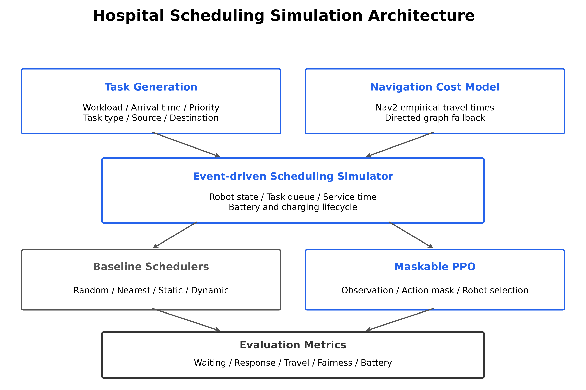
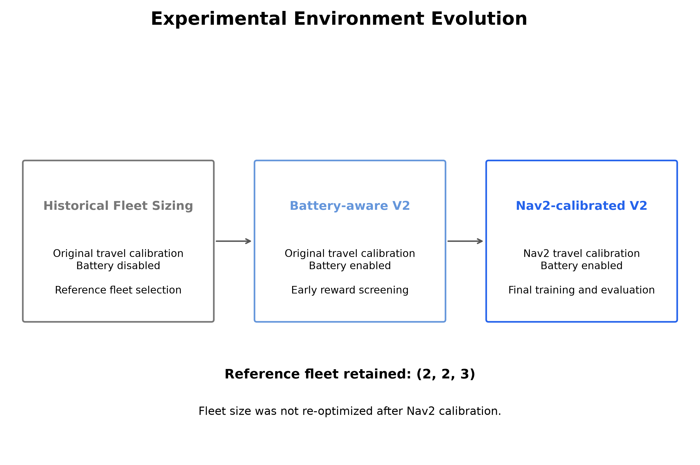
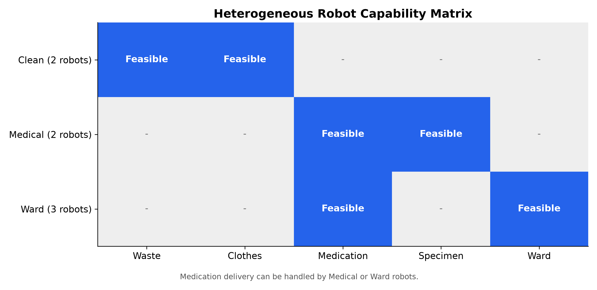
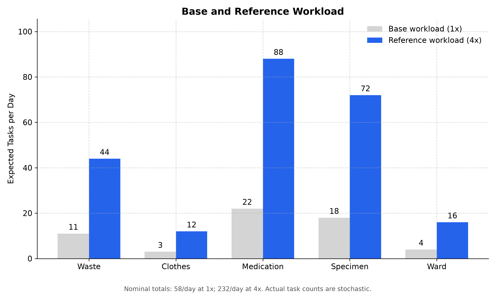
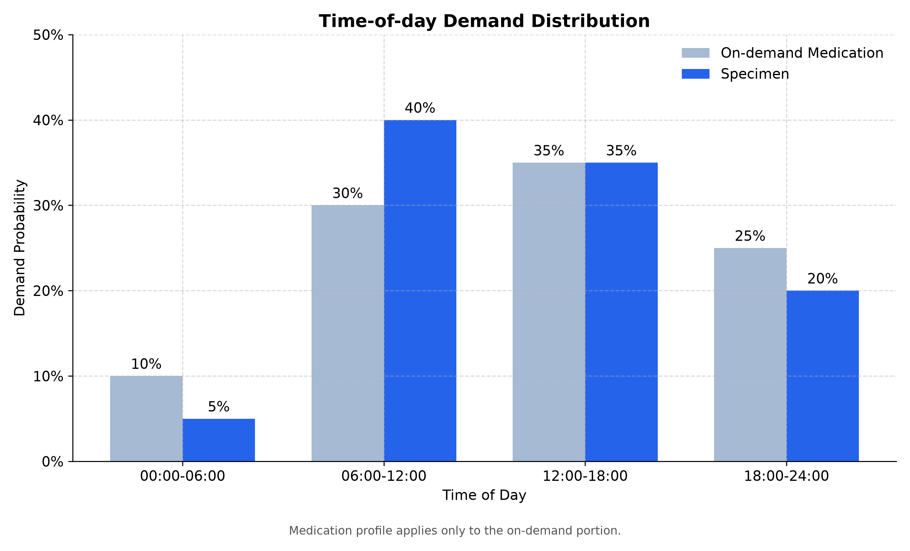
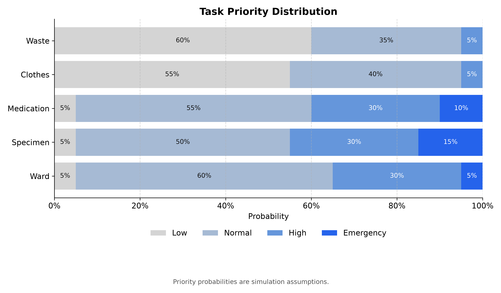
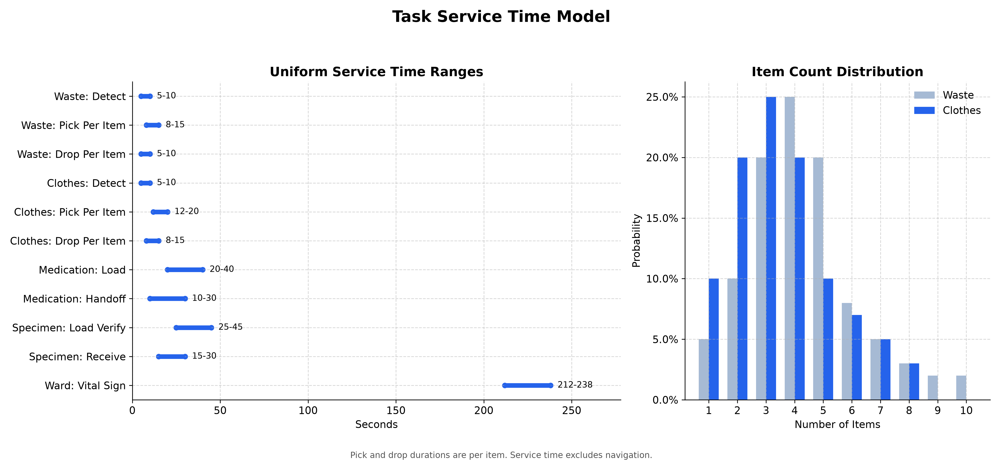
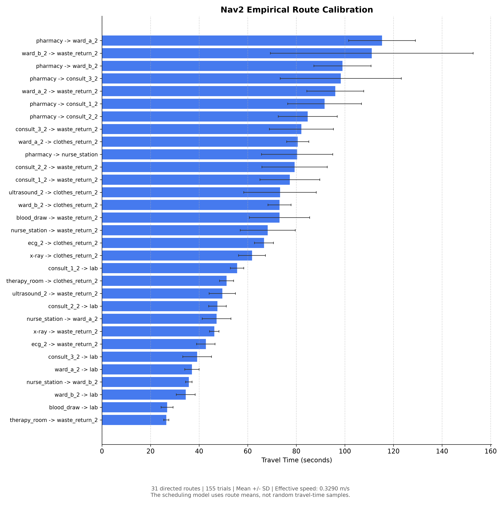
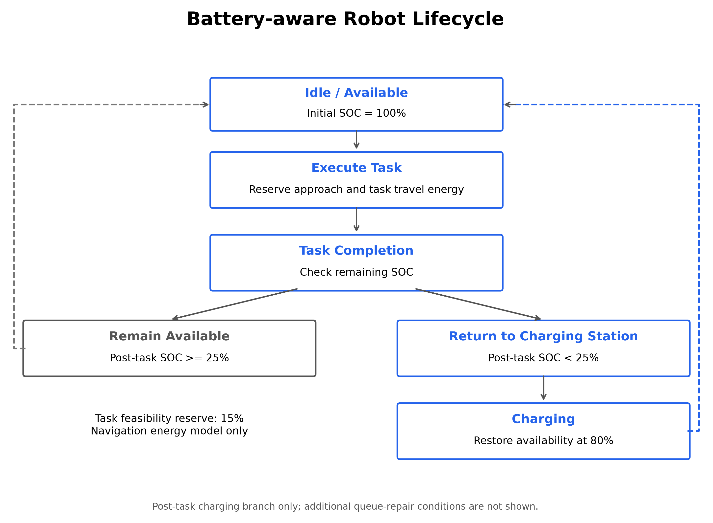
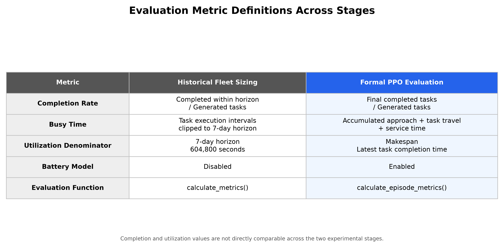

# 01. Experiment Environment — 醫療異質多機器人共用實驗環境

基於強化學習之醫療異質多機器人智慧任務調度系統

## 1. 研究目的

建立可重複執行的 Python 事件驅動排程模擬環境，供車隊配置、基準派工、Maskable PPO 訓練及正式效能比較使用。Gazebo/Nav2 提供導航校準資料；大量排程實驗不逐次啟動 Gazebo。本文區分歷史實驗設定與目前正式設定，不覆寫歷史結果。



**Figure 01.** 共用排程模擬環境架構；Baseline 與 PPO 為替代派工策略，並非依序執行的模組。

[PNG](figures/01_environment_architecture.png) · [SVG](figures/01_environment_architecture.svg)

## 2. 環境版本演進

| 階段 | 移動時間 | 電量 | 用途 |
|---|---|---|---|
| Fleet Sizing | 原始校準 | 關閉 | 選擇參考車隊 |
| Battery-aware V2 前期 | 原始校準 | 啟用 | Reward 候選初篩 |
| Nav2-calibrated V2 | Nav2 實測均值與圖估計 | 啟用 | 候選重訓、Baseline 校準、正式比較 |

前期車隊不在新環境重新最佳化。`ENABLE_BATTERY_MODEL=False` 為相容歷史實驗的預設；後期評估明確傳入 `enable_battery_model=True`。



**Figure 02.** 歷史實驗至正式 Nav2 校準環境的演進。

[PNG](figures/02_experiment_version_evolution.png) · [SVG](figures/02_experiment_version_evolution.svg)

## 3. 醫院場域與導航圖

導航圖使用 YAML 的 L1 樓層。`NavGraph` 讀取具名稱的 vertices，依 lanes 建立有向鄰接表，以節點座標的歐氏距離作為邊權重，使用 Dijkstra 求最短路徑。充電節點為 `charging_station_2`。本模型不等同於即時 Nav2 避障或 RMF 交通協調。

來源：`nav_graph.py`、`config.py`、`travel_time.py`。

## 4. 異質機器人能力

| Robot | 參考數量 | Waste | Clothes | Medication | Specimen | Ward |
|---|---:|---|---|---|---|---|
| Clean | 2 | ✓ | ✓ | — | — | — |
| Medical | 2 | — | — | ✓ | ✓ | — |
| Ward | 3 | — | — | ✓ | — | ✓ |

藥品配送具跨類型能力重疊；其餘任務各有專屬機器人類型。車隊 tuple 順序固定為 (Clean, Medical, Ward)。



**Figure 03.** 異質機器人的任務能力矩陣。

[PNG](figures/03_robot_capability_matrix.png) · [SVG](figures/03_robot_capability_matrix.svg)

## 5. 任務類型與合法路線

| Task | Source | Destination |
|---|---|---|
| waste_transport | ward_a_2, ward_b_2, consult_1_2, consult_2_2, consult_3_2, nurse_station, blood_draw, x-ray, ultrasound_2, ecg_2, therapy_room | waste_return_2 |
| clothes_collection | ward_a_2, ward_b_2, x-ray, ultrasound_2, ecg_2, therapy_room | clothes_return_2 |
| medication_delivery | pharmacy | ward_a_2, ward_b_2, consult_1_2, consult_2_2, consult_3_2, nurse_station |
| specimen_delivery | ward_a_2, ward_b_2, consult_1_2, consult_2_2, consult_3_2, blood_draw 或 lab | lab 或相應臨床地點（雙向） |
| ward_service | nurse_station | ward_a_2, ward_b_2 |

合法任務方向不等同於已實測導航路線集合；未測路線由導航圖估計。

## 6. 基準任務負載

| Task | Expected tasks/day (1x) | Nominal 4x |
|---|---:|---:|
| Waste | 11 | 44 |
| Clothes | 3 | 12 |
| Medication | 22 | 88 |
| Specimen | 18 | 72 |
| Ward | 4 | 16 |
| Total | 58 | 232 |

七天任務生成期間 H = 604800 s。倍率 m 的名義需求為 58m tasks/day，非固定生成數量。02 歷史 4x 車隊實驗觀測約 230.93 tasks/day；03 校準記錄約 233.8 tasks/day，因評估 seeds 不同而可能有差異。這些設定皆為研究假設，非醫院實際營運統計。



**Figure 04.** 基準與參考負載的理論每日期望值，非實測生成平均值。

[PNG](figures/04_base_workload_distribution.png) · [SVG](figures/04_base_workload_distribution.svg)

## 7. 任務生成與時間分布

| Task | 基準生成設定 |
|---|---|
| Waste | 11 個來源，約每處每日一筆；10:00–16:00 |
| Clothes | 6 個來源，各 Bernoulli(0.5)；09:00–17:00 |
| Medication | 50% scheduled、50% on-demand；定時 08:00、12:00、18:00、22:00，擾動參數 30 分鐘 |
| Specimen | 分段 Poisson 計數，區段內均勻抽樣時間；70% clinical→lab、30% lab→clinical |
| Ward | 兩病房各 08:00、20:00；均勻 ±15 分鐘 |

| Time block | Medication on-demand | Specimen |
|---|---:|---:|
| 00–06 | 10% | 5% |
| 06–12 | 30% | 40% |
| 12–18 | 35% | 35% |
| 18–24 | 25% | 20% |

檢體的區段計數為 Poisson(daily_expected × block_weight)。Ward 每個例行時段：m=1 時一筆；m<1 時 Bernoulli(m)；m>1 時 1+Poisson(m−1)。目前提供的 generator 原始碼片段從 specimen 中段開始，因此 Waste、Clothes、Medication 的精確倍率抽樣及 RNG 初始化尚未逐行核對，表格僅記錄已確認設定。



**Figure 05.** 即時藥品需求與檢體需求的時段分布。

[PNG](figures/05_temporal_demand_distribution.png) · [SVG](figures/05_temporal_demand_distribution.svg)

## 8. 任務優先級

| Task | Low (0) | Normal (1) | High (2) | Emergency (3) |
|---|---:|---:|---:|---:|
| Waste | 60% | 35% | 5% | 0% |
| Clothes | 55% | 40% | 5% | 0% |
| Medication | 5% | 55% | 30% | 10% |
| Specimen | 5% | 50% | 30% | 15% |
| Ward | 5% | 60% | 30% | 5% |

優先級機率與 PPO reward 的優先級權重是不同概念；後者為 1、1.5、2.5、4，詳見 04、05。



**Figure 06.** 各類任務的優先級機率設定。

[PNG](figures/06_task_priority_distribution.png) · [SVG](figures/06_task_priority_distribution.svg)

## 9. Service Time Model

各服務階段獨立呼叫 `rng.uniform(min,max)`；物品數量以離散加權抽樣取得。

| Task | Component | Range (s) |
|---|---|---:|
| Waste | Detect | 5–10 |
| Waste | Pick per item | 8–15 |
| Waste | Drop per item | 5–10 |
| Clothes | Detect | 5–10 |
| Clothes | Pick per item | 12–20 |
| Clothes | Drop per item | 8–15 |
| Medication | Load | 20–40 |
| Medication | Handoff | 10–30 |
| Specimen | Load / verify | 25–45 |
| Specimen | Receive | 15–30 |
| Ward | Vital sign service | 212–238 |

| Item count | Waste probability | Clothes probability |
|---:|---:|---:|
| 1 | .05 | .10 |
| 2 | .10 | .20 |
| 3 | .20 | .25 |
| 4 | .25 | .20 |
| 5 | .20 | .10 |
| 6 | .08 | .07 |
| 7 | .05 | .05 |
| 8 | .03 | .03 |
| 9 | .02 | — |
| 10 | .02 | — |

Waste/Clothes 的服務時間為 Detect 加上各件 Pick 和 Drop 時間總和；Medication 與 Specimen 為兩階段加總；Ward 為單一服務時間。服務時間不含導航時間。實現的服務時間不應被視為派工前已知資訊。



**Figure 07.** 服務階段均勻抽樣範圍與物品數量分布。

[PNG](figures/07_service_time_model.png) · [SVG](figures/07_service_time_model.svg)

## 10. Nav2 Travel Time Calibration

31 條有方向性路線各測試 5 次，共 155 次；已記錄全部成功。正式排程使用 route summary 的 mean，不抽樣 SD、P95 或其他分位數。有效速度為正值路線平均速度的算術平均，約 0.3289677419354839 m/s。

$$
T(s,d)=\begin{cases}\bar T_{s,d}& (s,d)\in R\\D_{\mathrm{shortest}}(s,d)/v_{\mathrm{eff}}&\text{otherwise}\end{cases}
$$

Fallback 的同節點移動為零；反向路線不自動沿用正向實測值。未連通路線會報錯。

| Example | Mean travel time (s) |
|---|---:|
| therapy_room → waste_return_2 | 26.518 |
| pharmacy → ward_a_2 | 115.296 |

正式來源 SHA-256：

- Raw: `2afdbdf57e8f5f0ffe6d318ec689c10b8b638477476ea63e56483b3ef6377b4a`
- Summary: `0baf6a695bacd2dac8f99a9e1b540dbb30901dfff0086afb93a0666acf030399`
- Navigation graph: `91c491b860ce97036ecceba4cf2460085baf9169d22484c1328cd722dc94bf79`



**Figure 08.** 31 條有方向性路線，誤差棒為樣本標準差；排程使用平均時間。

[PNG](figures/08_nav2_route_calibration.png) · [SVG](figures/08_nav2_route_calibration.svg)

## 11. Battery-aware Model

| Setting | Value |
|---|---:|
| Initial SOC | 1.00 |
| Minimum reserve | 0.15 |
| Charging trigger | 0.25 |
| Resume SOC | 0.80 |
| Full navigation runtime | 5400 s |
| Full charge time | 7200 s |
| Drain rate | 1/5400 SOC/s |
| Charge rate | 1/7200 SOC/s |

任務開始時預扣 Approach 與 Task Travel 的導航電量；返充開始時預扣返充導航電量；服務、閒置不直接計入此導航耗電。最低 SOC 在扣除電量時更新。

$$
SOC_{after}=SOC_{before}-T_{navigation}/5400
$$

任務完成後若 SOC 嚴格小於 0.25，觸發返充。這與 config 註解的「小於或等於」不同。此處描述已核對的 post-task 分支，不宣稱涵蓋全部佇列修復或特殊返充條件。候選任務的 15% reserve 可行性檢查與實際返充最低 SOC 必須分開理解。

充電開始 SOC 為 s 時，至 80% 的時間為 max(0,0.8−s)×7200 秒；充電完成將 SOC 設為 0.8 並恢復 idle。返充與充電不是 PPO 直接控制的 action。

前期 Fleet Sizing 的無任務行為為留在上個目的地；實際部署系統的待命策略另於 07 驗證。電量模型為簡化假設，並非實體機器人功耗量測。



**Figure 09.** 任務完成後的返充分支示意。100% 僅為 Episode 初始 SOC，並非每次 Idle 的電量；充電完成為 80%。

[PNG](figures/09_battery_aware_lifecycle.png) · [SVG](figures/09_battery_aware_lifecycle.svg)

## 12. 事件驅動模擬器

SchedulingSimulator 包含任務到達、任務完成、返充完成、充電完成事件。相同時間的事件優先序常數依序為完成(0)、返充完成(1)、充電完成(2)、到達(3)。機器人初始位於充電站且 idle。

Baseline 由 SchedulingSimulator.run() 執行；PPO 透過 HospitalSchedulingEnv.reset/step 及 action mask 選擇可行機器人，正式評估使用 deterministic prediction。暫時無可行 action 的任務保留原到達時間，待後續狀態變化；環境在最後的 reassignment 檢查後標記 terminated。完整任務序列一致性尚未取得歷史執行紀錄，不能僅依相同 seed 宣稱逐項驗證完成。

## 13. Fleet Configuration 與 Workload

固定參考情境：(2,2,3)，4x。前期 sensitivity 倍率：1、2、3、4、5、6、8。選擇條件為平均及最差 seed 完成率均至少 99%、最大利用率低於 90%、平均 P95 source-response 不超過 300 s。300 s 是研究參考門檻，不是臨床標準。正式比較固定七台、3/3.5/4/4.5/5x、每組 30 seeds。詳細歷史結果見 [02 Fleet Sizing](../02_fleet_sizing/README.md)。

## 14. 隨機種子與正式模型

| Purpose | Seeds |
|---|---|
| Historical fleet replications | 0–29 |
| Baseline calibration | 3001–3010 |
| PPO training scenario pool | 7001–7100 |
| Formal representative model | 7101 |
| Nav2 candidate validation | 9501–9530 |
| Formal evaluation | 9601–9630 |

正式模型為 Nav2 Sweep 12 Seed 7101，W/A/Q/I = .40/.35/.15/.10，Observation 98、Action 7、requested timesteps 200000、actual 200192。訓練場景種子和模型種子用途不同。正式評估 seeds 與調參 seeds 分離，但曾用於歷史比較，不是全新未使用的測試集。

## 15. 評估指標定義

前期 `metrics.py:calculate_metrics()` 與後期 `rl/evaluate_reward_tuned_workload_robustness.py:calculate_episode_metrics()` 使用不同的完成率及利用率範圍。

| Metric | Fleet Sizing | Formal comparison |
|---|---|---|
| Completion rate | 七天內完成 / 生成 | 最終 completed / 生成 |
| Utilization numerator | 任務執行區間裁切至 [0,H] 後加總 | robot.busy_time_s |
| Utilization denominator | H=604800 s | Makespan = 最後完成任務時間（自模擬零時起） |

正式 Busy Time = Approach + Task Travel + Service 的累計；不含排隊、閒置、返充或充電。因此不是所有非 idle 時間的比例。Makespan 不一定等於最後充電事件時間，也不是固定七天。

令 a/s/p/c 分別代表任務到達、開始執行、抵達來源地、完成時刻。正式時間指標使用完成任務中有效的時間戳，差異以零為下限：Wait=s−a、Response=p−a、Total=c−a。P95 為每 episode 的分位數，再跨 seed 彙整。Total Travel 為 assignments 的 Approach + Task Travel 加總，不含返充移動。Jain fairness 以各台機器人完成任務數計算。Minimum SOC 為所有機器人最低紀錄的最小值；Average Final SOC 為終態 SOC 平均。

22 項原始效能指標與四項衍生指標、正式統計結果見 [06 PPO vs. Baselines](../06_ppo_vs_baselines/README.md)。Episode reward 另有欄位，非五種方法共同效能指標。



**Figure 10.** 前期與正式評估的指標計算範圍。

[PNG](figures/10_evaluation_metric_definitions.png) · [SVG](figures/10_evaluation_metric_definitions.svg)

## 16. 研究假設與限制

- 任務需求、優先級、服務時間及電量參數為研究假設，不是臨床驗證。
- 使用固定平均導航時間，不模擬逐次 Nav2 路徑變異、真實交通互斥及完整物理耗電。
- 前期 Fleet Sizing 配置未在 Nav2 環境重新最佳化；跨階段完成率及利用率不可直接比較。
- 正式評估僅使用單一代表模型；不同 evaluation seeds 不等於不同訓練模型。
- 目前未取得完整歷史任務序列逐項一致性、全部特殊返充條件與完整 generator 前半部的核對證據。
- 部署模型及端到端功能仍需於 07 驗證。

## 17. 資料封存與重現

本章記錄目前環境快照，並非歷史訓練當時的完整原始碼快照。來源 Git branch `feat/fleet-sizing-experiment`，HEAD `0924b71`；未追蹤與工作區變動仍可能存在。

相關章節：[02 Fleet Sizing](../02_fleet_sizing/README.md)、[03 Baseline](../03_baseline/README.md)、[04 PPO Design](../04_ppo_design/README.md)、[05 Reward Selection](../05_reward_weight_selection/README.md)、[06 Formal Comparison](../06_ppo_vs_baselines/README.md)。

原始程式位於 `experiments/fleet_sizing/`：config.py、task_generator.py、service_time.py、nav_graph.py、travel_time.py、models.py、simulator.py、scheduling_simulator.py、metrics.py、rl/environment.py。正式評估的共用計算位於 `rl/evaluate_reward_tuned_workload_robustness.py`。

校準來源為 `ros2_ws/batch_route_results_nav2.csv`、`ros2_ws/batch_route_summary_nav2.csv`；導航圖及 task profiles 路徑以 config.py 為準。封存時應驗證上述已知 hash，並建立目前快照 manifest；封存副本不應直接當成獨立執行環境。請勿為整理文件重新執行已完成的大型實驗。

### 17.1 封存資料與來源

已完成 19 份來源檔案的 SHA-256 核對及 82 項設定值匯出。以下連結指向本章封存副本。

| 資料 | 路徑 |
|---|---|
| 環境設定 | [environment_config.json](data/environment_config.json) |
| 環境封存清單 | [environment_manifest.json](data/environment_manifest.json) |
| 任務設定 | [task_profiles.yaml](data/task_profiles.yaml) |
| 導航圖 | [nav_graph.yaml](data/nav2_calibration/nav_graph.yaml) |
| Nav2 原始測試 | [batch_route_results_nav2.csv](data/nav2_calibration/batch_route_results_nav2.csv) |
| Nav2 路線摘要 | [batch_route_summary_nav2.csv](data/nav2_calibration/batch_route_summary_nav2.csv) |
| 圖表清單 | [figure_manifest.json](figures/figure_manifest.json) |

| 封存程式 | 用途 |
|---|---|
| [config.py](scripts/config.py) | 共用設定 |
| [models.py](scripts/models.py) | 任務與機器人狀態 |
| [task_generator.py](scripts/task_generator.py) | 任務生成 |
| [service_time.py](scripts/service_time.py) | 服務時間 |
| [nav_graph.py](scripts/nav_graph.py) | 有向導航圖 |
| [travel_time.py](scripts/travel_time.py) | 移動時間估計 |
| [simulator.py](scripts/simulator.py) | 前期車隊模擬 |
| [scheduling_simulator.py](scripts/scheduling_simulator.py) | 後期排程模擬 |
| [metrics.py](scripts/metrics.py) | 前期評估指標 |
| [baseline/common.py](scripts/baseline/common.py) | 共用派工可行性 |
| [rl/environment.py](scripts/rl/environment.py) | PPO 環境 |
| [rl/observation.py](scripts/rl/observation.py) | Observation |
| [rl/action_mask.py](scripts/rl/action_mask.py) | Action mask |
| [rl/reward.py](scripts/rl/reward.py) | Reward |
| [rl/evaluate_reward_tuned_workload_robustness.py](scripts/rl/evaluate_reward_tuned_workload_robustness.py) | 後期共用評估 |

### 17.2 圖表與驗證

十組圖表以白底、黑字及藍色主色呈現，提供 PNG（300 DPI）與 SVG。架構及生命週期圖為設計示意，非額外實驗結果。

由 repository 根目錄執行：

```bash
source .venv_rl/bin/activate
DOC=experiments/fleet_sizing/docs/01_experiment_environment
python "$DOC/verify_environment.py"
```

封存及製圖入口：[archive_environment.py](archive_environment.py)、[plot_environment.py](plot_environment.py)、[verify_environment.py](verify_environment.py)。若需重新製圖，先備份既有 figures 目錄；製圖程式拒絕覆蓋既有 PNG/SVG。封存與製圖不需要重新訓練或執行排程模擬。

目前圖表已經過縮小版總覽視覺檢查；最終本機完整性、連結與 README 雜湊應另行驗證。本文所列歷史限制仍然適用。
