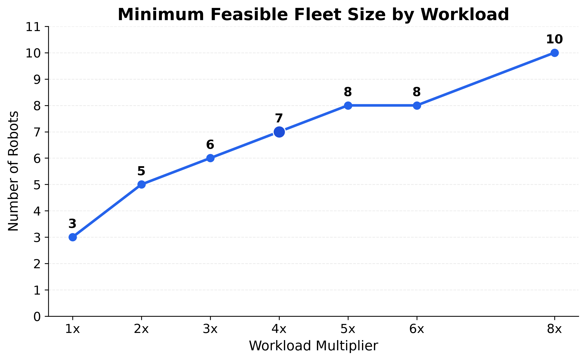
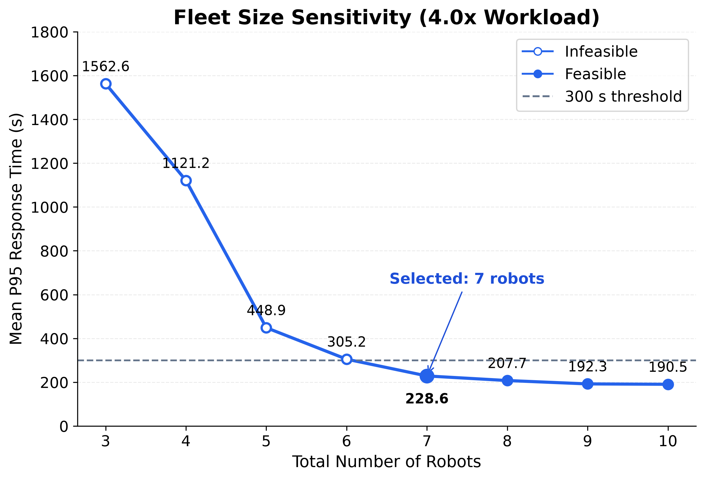
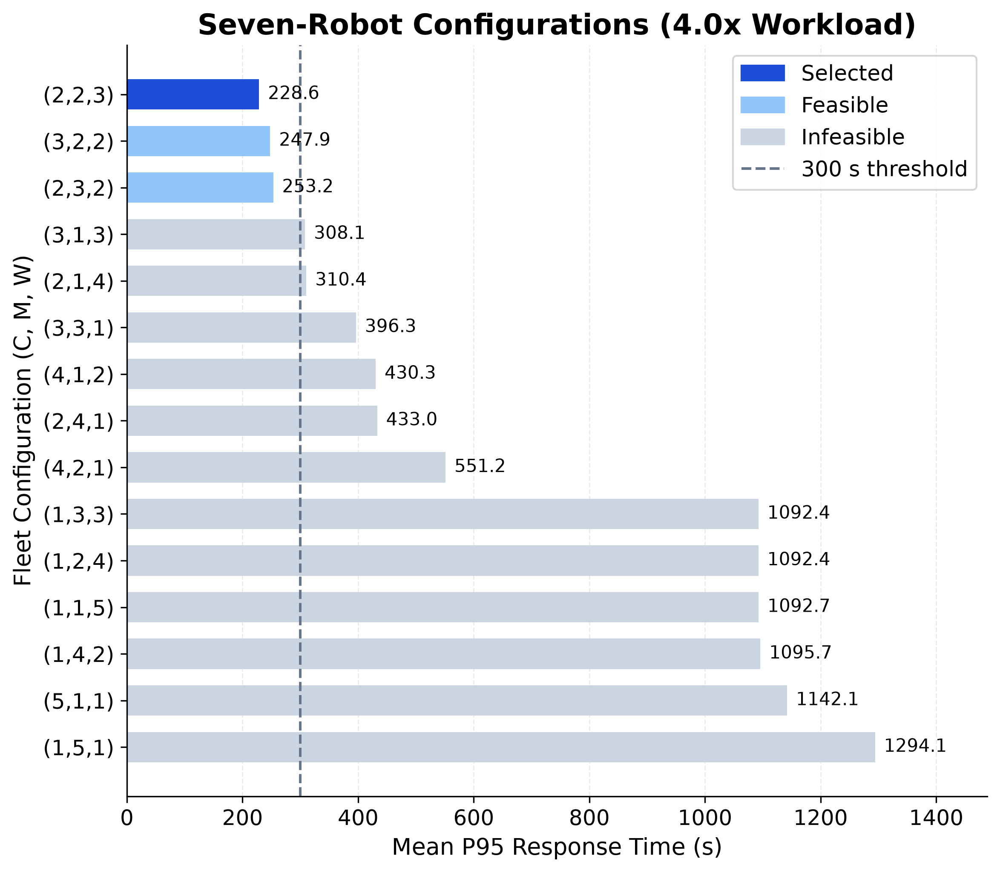
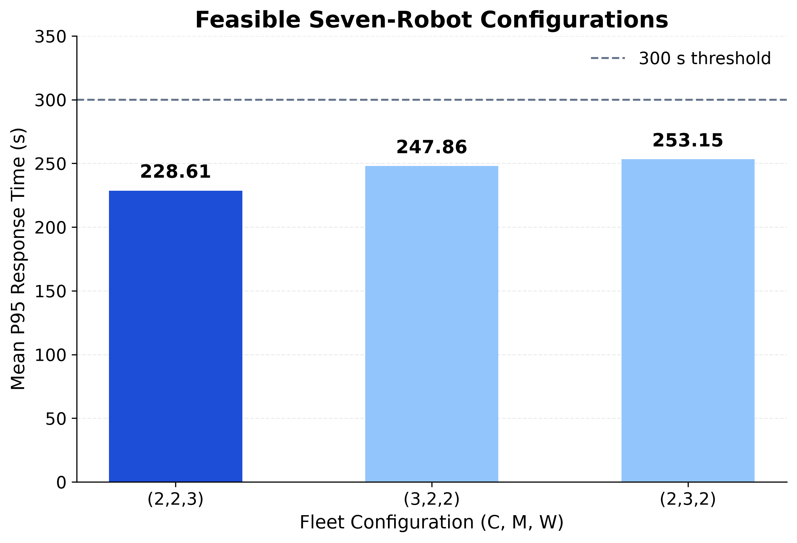

# Fleet Sizing：醫療異質多機器人數量與配置分析

## 1. 研究目的

本實驗旨在分析不同醫療任務負載下，異質機器人車隊所需的合理數量與配置。

由於不同種類的機器人具有不同任務執行能力，單純增加機器人總數不一定能有效改善整體派工效能，因此本研究同時考量機器人總台數與各種類型的配置比例。

本階段研究結果將作為後續 Baseline 派工策略設計及強化學習模型訓練的參考環境。

### 1.1 研究問題

- RQ1：不同任務負載下，需要多少台機器人才能滿足服務水準？
- RQ2：固定機器人總台數後，如何配置不同種類的機器人？
- RQ3：如何在機器人數量與任務處理效能之間取得平衡？

## 2. 實驗環境

本研究使用 Python 建立任務派工模擬環境，模擬醫院任務生成、機器人移動、任務服務與完成的過程，以支援大量重複實驗。

Fleet Sizing 並非直接在 Gazebo 中逐一執行所有候選配置，而是使用程式化模擬器進行分析。

### 2.0 實驗環境版本說明

本章為前期 Fleet Sizing 歷史實驗，
使用當時的移動時間校準資料與不含電量限制的模擬環境。

後續研究加入 Battery-aware Scheduling，
並進一步使用 Nav2 路線測試結果更新移動時間模型。

本章所有實驗數值、車隊選擇條件及圖表均保留，
不以後期 Nav2 校準結果覆蓋歷史資料。

完整環境版本與共用設定請參考：

[01 Experiment Environment](../01_experiment_environment/README.md)

### 2.1 機器人種類

| Robot Type | 可執行任務 |
|---|---|
| Clean | 廢棄物運送、衣物回收 |
| Medical | 藥品配送、檢體運送 |
| Ward | 藥品配送、病房服務 |

機器人配置統一表示為：

(Clean Count, Medical Count, Ward Count)

例如，(2,2,3) 代表兩台 Clean、兩台 Medical 與三台 Ward，共七台機器人。

由於廢棄物及衣物任務必須由 Clean 執行、檢體任務必須由 Medical 執行、病房服務必須由 Ward 執行，因此每種類型至少需要一台機器人。

### 2.2 基準任務負載

| 任務種類 | 每日預期任務數 |
|---|---:|
| Waste Transport | 11 |
| Clothes Collection | 3 |
| Medication Delivery | 22 |
| Specimen Delivery | 18 |
| Ward Service | 4 |
| Total | 58 |

以上為研究中設定的基準需求模型，並非實際醫院營運統計資料。

### 2.3 任務生成方式

不同任務具有不同的到達時間分布。

| 任務 | 生成方式 |
|---|---|
| Waste | 10:00–16:00，依來源地需求生成 |
| Clothes | 六個合法來源地，各以 0.5 機率生成，時間為 09:00–17:00 |
| Medication | 50% 例行配送、50% 即時需求 |
| Specimen | 根據不同時段的需求權重生成 |
| Ward | 08:00 與 20:00 例行服務，加入時間擾動 |

藥品配送的例行時段為 08:00、12:00、18:00、22:00，加入 30 分鐘時間擾動。

病房服務的例行時段加入 15 分鐘時間擾動。

### 2.4 即時藥品及檢體需求分布

| 時段 | On-demand Medication | Specimen |
|---|---:|---:|
| 00:00–06:00 | 10% | 5% |
| 06:00–12:00 | 30% | 40% |
| 12:00–18:00 | 35% | 35% |
| 18:00–24:00 | 25% | 20% |

### 2.5 任務優先級

| Priority | Level |
|---:|---|
| 0 | Low |
| 1 | Normal |
| 2 | High |
| 3 | Emergency |

各種類任務的優先級機率設定如下：

| Task Type | Low | Normal | High | Emergency |
|---|---:|---:|---:|---:|
| Waste | 60% | 35% | 5% | 0% |
| Clothes | 55% | 40% | 5% | 0% |
| Medication | 5% | 55% | 30% | 10% |
| Specimen | 5% | 50% | 30% | 15% |
| Ward | 5% | 60% | 30% | 5% |

上述分布為模擬假設，並非通用醫療統計資料。

### 2.6 模擬設定

| Parameter | Setting |
|---|---|
| Simulation Horizon | 7 days |
| Replications | 30 |
| Random Seeds | 0–29 |
| Assignment Policy | earliest_available_feasible |
| Battery Model | Disabled |
| Idle Robot Behavior | Stay at the previous task destination |

Fleet Sizing 階段尚未使用 PPO。

派工策略設定為 earliest_available_feasible，
允許能力相符的忙碌機器人接收未來任務，
並依預估可用時間及抵達時間進行分配。

本階段不包含後續新增的自動返回待命區與交通互斥機制。

## 3. 實驗流程

Fleet Sizing 相關研究包含三項主要實驗。

### 3.1 Initial Fleet Sweep

執行程式：

    ../../run_fleet_sweep.py

初步比較三至六台機器人的八組配置。

| Total Robots | Fleet Configurations |
|---:|---|
| 3 | (1,1,1) |
| 4 | (2,1,1), (1,2,1), (1,1,2) |
| 5 | (2,2,1), (2,1,2), (1,2,2) |
| 6 | (2,2,2) |

此實驗用於初步觀察增加不同種類機器人後，
任務完成率、等待時間、回應時間及利用率的變化。

原始結果：

    ../../results/fleet_sizing_sweep.csv

### 3.2 Workload Calibration

執行程式：

    ../../run_workload_calibration.py

固定最小異質車隊：

    (1,1,1)

測試以下負載倍率：

    0.5x, 1.0x, 2.0x, 3.0x,
    4.0x, 6.0x, 8.0x, 10.0x

每種負載重複模擬 30 次。

此實驗用於觀察不同任務需求對最小車隊處理能力的影響，
並建立後續敏感度分析所使用的參考服務水準。

在 1.0x 負載與 (1,1,1) 配置下，
程式記錄的 Mean P95 Source Response Time 約為 297.6 秒。

因此後續實驗將 300 秒設定為回應時間門檻。

此門檻為本研究的實驗參考值，
並非醫院通用的臨床服務標準。

### 3.3 Demand–Fleet Sensitivity Analysis

執行程式：

    ../../run_demand_fleet_sensitivity.py

此實驗為最終車隊選擇的主要依據。

#### Workload Multipliers

    1.0x, 2.0x, 3.0x, 4.0x,
    5.0x, 6.0x, 8.0x

#### Fleet Configurations

| Total Robots | Number of Configurations |
|---:|---:|
| 3 | 1 |
| 4 | 3 |
| 5 | 6 |
| 6 | 10 |
| 7 | 15 |
| 8 | 21 |
| 9 | 7 |
| 10 | 6 |
| Total | 69 |

三至八台涵蓋所有每種類型至少一台的整數配置。

九台及十台僅測試程式中指定的部分配置，
因此本研究不宣稱窮舉所有三至十台的可能組合。

#### Experiment Scale

- 69 種異質機器人配置。
- 7 種任務負載。
- 每組重複模擬 30 次。
- 每次模擬期間為 7 天。

配置與負載組合數：

    69 × 7 = 483

總模擬次數：

    483 × 30 = 14,490

## 4. 評估指標

| Metric | Description |
|---|---|
| Mean Completion Rate | 30 次模擬的平均任務完成率 |
| Min Completion Rate | 30 次模擬中最低的任務完成率 |
| Mean Waiting Time | 平均任務等待時間 |
| Mean P95 Waiting Time | 各次模擬 P95 等待時間的平均值 |
| Mean Source Response Time | 任務產生至抵達來源地的平均回應時間 |
| Mean P95 Source Response Time | 各次模擬 P95 來源地回應時間的平均值 |
| Mean Total Time | 平均任務總處理時間 |
| Mean P95 Total Time | 各次模擬 P95 總處理時間的平均值 |
| Mean Average Utilization | 各次模擬平均機器人利用率的平均值 |
| Mean Max Utilization | 各次模擬最大機器人利用率的平均值 |

詳細指標計算實作請參考 metrics.py。

### 4.1 P95 Response Time

P95 Response Time 用於反映回應時間較長的任務，
避免單純使用平均值而忽略長時間等待的情況。

本研究的 Mean P95 Response Time 為：

先計算各次模擬的 P95 Source Response Time，
再對 30 次模擬結果取平均。

因此它不等同於將所有模擬任務合併後計算的單一 P95。

## 5. 車隊選擇方法

### 5.1 Feasibility Criteria

候選車隊必須同時符合以下四項條件：

| Metric | Threshold |
|---|---:|
| Mean Completion Rate | >= 99% |
| Min Completion Rate | >= 99% |
| Mean Max Utilization | < 90% |
| Mean P95 Source Response Time | <= 300 s |

任何一項不符合，即判定為不可行配置。

### 5.2 Minimum Feasible Fleet

首先排除所有不符合可行性條件的配置，
再按照以下順序排序：

1. 最少機器人總台數。
2. 最低 Mean P95 Source Response Time。
3. 最低 Mean Max Utilization。
4. Clean、Medical、Ward 配置數字排序。

亦即：

    feasible_results.sort(
        key=lambda result: (
            result.total_robots,
            result.mean_p95_response_time_s,
            result.mean_max_utilization,
            result.clean_count,
            result.medical_count,
            result.ward_count,
        )
    )

排序後選擇第一組配置。

此方法的目標為選擇符合服務水準的最小車隊，
而非不考量機器人數量、單純追求最低回應時間。

## 6. 資料完整性驗證

完整實驗結果重新驗證如下：

| Validation | Result |
|---|---|
| Experiment Rows | 483 |
| Workload Levels | 7 |
| Unique Fleet Configurations | 69 |
| Replications per Configuration | 30 |
| Duplicate Experiment Rows | 0 |
| Missing Experiment Combinations | 0 |
| Feasibility Mismatches | 0 |
| Selected Fleet Cross-check | 7/7 PASS |

重新按照原始可行性條件與排序規則進行篩選，
所得結果與原始 selected CSV 一致。

## 7. 實驗結果

### 7.1 不同任務負載的最小可行車隊

| Workload | Tasks/day | Fleet | Total Robots | Mean P95 Response (s) |
|---:|---:|---|---:|---:|
| 1.0x | 58.16 | (1,1,1) | 3 | 297.56 |
| 2.0x | 116.16 | (2,1,2) | 5 | 235.73 |
| 3.0x | 173.52 | (2,2,2) | 6 | 213.84 |
| 4.0x | 230.93 | (2,2,3) | 7 | 228.61 |
| 5.0x | 288.03 | (3,2,3) | 8 | 225.31 |
| 6.0x | 347.27 | (3,2,3) | 8 | 294.31 |
| 8.0x | 463.43 | (3,3,4) | 10 | 266.97 |

隨著任務需求增加，滿足服務水準所需的最小車隊規模亦增加。

本研究選擇 4.0x 作為後續派工實驗的代表性負載，
約為每日 231 筆任務。

4.0x 是選定的研究情境，而非由數學最佳化求得的最佳負載。

### 7.2 固定 4.0x 負載：不同總台數比較

每個總台數選取 Mean P95 Response Time 最低的候選配置，
並標示其是否符合全部可行性條件。

| Robots | Best P95 Configuration | P95 Response (s) | Feasible / Tested |
|---:|---|---:|---:|
| 3 | (1,1,1) | 1562.56 | 0/1 |
| 4 | (1,1,2) | 1121.17 | 0/3 |
| 5 | (2,1,2) | 448.94 | 0/6 |
| 6 | (2,2,2) | 305.20 | 0/10 |
| 7 | (2,2,3) | 228.61 | 3/15 |
| 8 | (3,2,3) | 207.74 | 7/21 |
| 9 | (3,3,3) | 192.31 | 7/7 |
| 10 | (3,4,3) | 190.55 | 6/6 |

在 4.0x 負載下：

- 共測試 69 組配置。
- 共 23 組配置符合全部可行性條件。
- 三至六台皆無可行配置。
- 七台為首個存在可行配置的總台數。

#### 六台與七台比較

| Metric | (2,2,2) | (2,2,3) |
|---|---:|---:|
| Mean Completion Rate | 99.9814% | 99.9814% |
| Min Completion Rate | 99.8741% | 99.8741% |
| Mean Max Utilization | 21.88% | 21.26% |
| Mean P95 Response (s) | 305.20 | 228.61 |
| Feasible | No | Yes |

六台配置雖然具有良好的任務完成率，
但未能滿足 300 秒回應時間門檻。

增加一台 Ward Robot 後，
Mean P95 Response Time 由 305.20 秒下降至 228.61 秒，
降低約 25.1%。

#### 增加機器人數量的邊際改善

| Fleet Size Change | P95 Reduction (s) |
|---|---:|
| 6 -> 7 | 76.59 |
| 7 -> 8 | 20.87 |
| 8 -> 9 | 15.43 |
| 9 -> 10 | 1.76 |

八至十台仍能改善回應時間，
但七台已符合所有可行性條件。

因此依照最小可行車隊的選擇規則，
最終選擇七台機器人。

邊際改善為補充觀察，不是原始最佳車隊排序條件。

### 7.3 固定七台：全部異質配置比較

| Rank by P95 | Configuration | P95 Response (s) | Feasible |
|---:|---|---:|---|
| 1 | (2,2,3) | 228.61 | Yes |
| 2 | (3,2,2) | 247.86 | Yes |
| 3 | (2,3,2) | 253.15 | Yes |
| 4 | (3,1,3) | 308.11 | No |
| 5 | (2,1,4) | 310.38 | No |
| 6 | (3,3,1) | 396.29 | No |
| 7 | (4,1,2) | 430.32 | No |
| 8 | (2,4,1) | 432.97 | No |
| 9 | (4,2,1) | 551.21 | No |
| 10 | (1,3,3) | 1092.43 | No |
| 11 | (1,2,4) | 1092.43 | No |
| 12 | (1,1,5) | 1092.72 | No |
| 13 | (1,4,2) | 1095.74 | No |
| 14 | (5,1,1) | 1142.05 | No |
| 15 | (1,5,1) | 1294.14 | No |

註：表格顯示四捨五入後數值，排序以原始精度及原始排序規則為準。

七台的 15 種異質配置中，
只有三種通過全部可行性條件。

實驗結果顯示，
即使機器人總台數相同，
不同種類的數量比例仍會造成明顯的數值差異。

### 7.4 三組可行配置比較

| Metric | (2,2,3) | (3,2,2) | (2,3,2) |
|---|---:|---:|---:|
| Mean Completion Rate (%) | 99.9814 | 99.9814 | 99.9814 |
| Min Completion Rate (%) | 99.8741 | 99.8741 | 99.8741 |
| Mean Waiting Time (s) | 15.37 | 18.88 | 18.79 |
| Mean P95 Waiting Time (s) | 125.22 | 143.21 | 149.20 |
| Mean P95 Response (s) | 228.61 | 247.86 | 253.15 |
| Mean Max Utilization (%) | 21.26 | 21.88 | 17.91 |

三種配置皆具有良好的任務完成率與利用率，
並滿足 300 秒回應時間限制。

雖然 (2,3,2) 的 Mean Max Utilization 較低，
但原始選擇規則優先比較 Mean P95 Response Time，
因此最終選擇 (2,2,3)。

## 8. 最終研究情境

| Parameter | Selected Value |
|---|---|
| Workload Multiplier | 4.0x |
| Average Tasks per Day | 230.93 |
| Clean Robots | 2 |
| Medical Robots | 2 |
| Ward Robots | 3 |
| Total Robots | 7 |

最終配置的詳細評估結果：

| Metric | Result |
|---|---:|
| Mean Completion Rate | 99.9814% |
| Min Completion Rate | 99.8741% |
| Mean Waiting Time | 15.37 s |
| Mean P95 Waiting Time | 125.22 s |
| Mean Response Time | 128.24 s |
| Mean P95 Response Time | 228.61 s |
| Mean Average Utilization | 11.36% |
| Mean Max Utilization | 21.26% |

最終配置符合全部四項可行性條件。

本研究將此車隊配置與負載情境固定，
作為後續 Baseline 派工策略及 PPO 模型訓練的參考環境。

### 8.1 後續研究中的固定控制條件

本章選定的 (2,2,3) 車隊配置，
後續保留作為 Baseline 與 PPO 的固定比較條件。

Nav2 校準後未重新執行 Fleet Sizing，
因此不宣稱七台機器人或 (2,2,3)
為新版環境中的最佳配置。

後期正式評估固定七台機器人，
並使用 3.0x、3.5x、4.0x、4.5x、5.0x
五種工作負載比較不同派工策略。

此設計可控制機器人數量及配置，
將研究重點集中於派工策略的效能差異。

## 9. 結論

本研究透過 Demand–Fleet Sensitivity Analysis，
同時比較不同任務負載、機器人總數及異質配置比例。

在 4.0x 代表性負載下，
七台是已測試範圍內符合所有服務水準條件的最小車隊。

固定七台後，
(2,2,3) 在可行配置中具有最低 Mean P95 Response Time。

因此選擇兩台 Clean、兩台 Medical 與三台 Ward，
作為後續智慧派工研究的車隊配置。

## 10. 研究限制

1. 任務需求、到達分布及優先級為研究模擬假設，
   並非直接來自真實醫院營運資料。

2. 300 秒為依基準情境建立的實驗服務水準，
   並非通用臨床標準。

3. 4.0x 為選定的代表性研究情境，
   並非透過最佳化求得的最佳任務負載。

4. 九台及十台只測試部分候選配置，
   最小可行車隊的結論限定於已測試範圍。

5. Fleet Sizing 階段未使用電量限制、
   自動返回待命區與目前的 RMF 交通互斥機制。

6. 本結果不能直接推論為真實醫院、
   或完整 Gazebo 系統中的最小可行車隊。

7. 後續電量感知 PPO 實驗與本階段的模擬假設不同，
   不宜直接跨階段比較數值。

8. 本文件保留原始實驗摘要數據，
   尚未取得每次 replication 的獨立原始紀錄，
   因此不對車隊配置差異額外宣稱統計顯著性。

### 10.1 前期與後期評估指標差異

| Metric | Historical Fleet Sizing | Formal Scheduling Evaluation |
|---|---|---|
| Completion Rate | 七天內完成任務 / 生成任務 | 最終完成任務 / 生成任務 |
| Utilization Numerator | 七天內的任務執行時間 | 累計 Approach、Task Travel、Service Time |
| Utilization Denominator | 固定七天 | 最後一筆任務完成時間（Makespan） |
| Evaluation Function | calculate_metrics() | calculate_episode_metrics() |

前期利用率使用任務執行區間與七天模擬期間的交集。

後期正式評估使用機器人的累計任務忙碌時間，
除以最後一筆任務完成時間。

因此不能直接以本章 99.9814% 與後期 100%
作為 PPO 提升任務完成率的證據，
也不能直接比較兩階段的利用率數值。

相關文件：

- [01 Experiment Environment](../01_experiment_environment/README.md)
- [06 PPO vs. Baselines](../06_ppo_vs_baselines/README.md)

## 11. 相關程式碼

| File | Purpose |
|---|---|
| [config.py](../../config.py) | 實驗環境與參數 |
| [models.py](../../models.py) | 任務及機器人資料模型 |
| [task_generator.py](../../task_generator.py) | 任務生成 |
| [nav_graph.py](../../nav_graph.py) | 導航路網 |
| [travel_time.py](../../travel_time.py) | 移動時間估算 |
| [service_time.py](../../service_time.py) | 任務服務時間 |
| [simulator.py](../../simulator.py) | Fleet Sizing 模擬器 |
| [metrics.py](../../metrics.py) | 評估指標計算 |
| [run_replications.py](../../run_replications.py) | 重複實驗 |
| [run_fleet_sweep.py](../../run_fleet_sweep.py) | 初始配置掃描 |
| [run_workload_calibration.py](../../run_workload_calibration.py) | 負載校準 |
| [run_demand_fleet_sensitivity.py](../../run_demand_fleet_sensitivity.py) | 最終敏感度分析 |
| [plot_results.py](plot_results.py) | 實驗圖表生成 |

## 12. 實驗數據與圖表

### 12.1 保存的實驗數據

| File | Description |
|---|---|
| [demand_fleet_sensitivity_all.csv](data/demand_fleet_sensitivity_all.csv) | 全部 483 組實驗摘要結果 |
| [demand_fleet_sensitivity_selected.csv](data/demand_fleet_sensitivity_selected.csv) | 七種負載最終車隊 |
| [fleet_size_comparison_4x.csv](data/fleet_size_comparison_4x.csv) | 各總台數最低 P95 配置 |
| [seven_robot_comparison_4x.csv](data/seven_robot_comparison_4x.csv) | 七台全部 15 種配置 |
| [seven_robot_feasible_4x.csv](data/seven_robot_feasible_4x.csv) | 七台三組可行配置 |

完整 CSV 為原始實驗保存的配置層級摘要，
每一列代表一種負載與一種配置的 30 次模擬統整結果。

### 12.2 保存的圖表

| Figure | PNG | SVG |
|---|---|---|
| Minimum Feasible Fleet Size | [PNG](figures/01_workload_minimum_fleet.png) | [SVG](figures/01_workload_minimum_fleet.svg) |
| Fleet Size Comparison | [PNG](figures/02_fleet_size_comparison_4x.png) | [SVG](figures/02_fleet_size_comparison_4x.svg) |
| All Seven-Robot Configurations | [PNG](figures/03_all_seven_robot_configurations.png) | [SVG](figures/03_all_seven_robot_configurations.svg) |
| Feasible Seven-Robot Configurations | [PNG](figures/04_feasible_seven_robot_configurations.png) | [SVG](figures/04_feasible_seven_robot_configurations.svg) |

## 13. 重現方式

### 13.1 重新繪製實驗圖表

在專案根目錄執行：

    source .venv_rl/bin/activate

    python experiments/fleet_sizing/docs/02_fleet_sizing/plot_results.py

此指令直接讀取保存的原始實驗摘要 CSV，
不需要重新進行模擬實驗。

圖表輸出至：

    experiments/fleet_sizing/docs/02_fleet_sizing/figures/

### 13.2 重新執行 Fleet Sizing 實驗

原始實驗入口為：

    python experiments/fleet_sizing/run_demand_fleet_sensitivity.py

注意：

此程式會執行完整敏感度分析，
並寫入 results/ 下的實驗結果。

若要重現歷史實驗，
必須使用當時的程式版本、導航路網、
任務設定、機器人設定及相關執行環境。

目前專案的導航路網與系統功能已經更新，
直接使用最新版本重新模擬不保證能得到相同結果。

因此本文件的圖表一律使用已保存的原始實驗數據。

## 14. 簡報呈現建議

主簡報使用以下兩張圖：

- Figure 02：不同總台數比較。
- Figure 04：固定七台的三組可行配置比較。

主要說明：

1. 69 種配置與七種負載，每組重複 30 次。
2. 在 4.0x 負載下，七台為最小可行車隊。
3. 七台的 15 組配置中只有三組符合條件。
4. (2,2,3) 具有最低 P95 Response Time。

其餘圖表與詳細數據作為研究紀錄及備用簡報。

