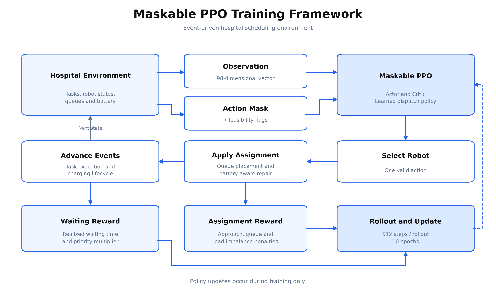
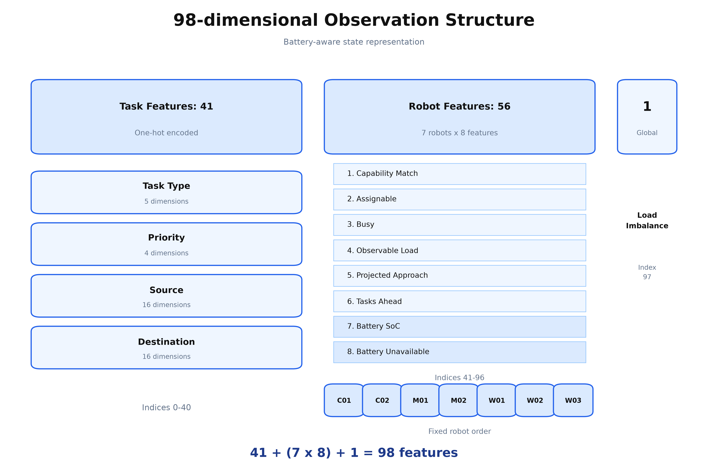
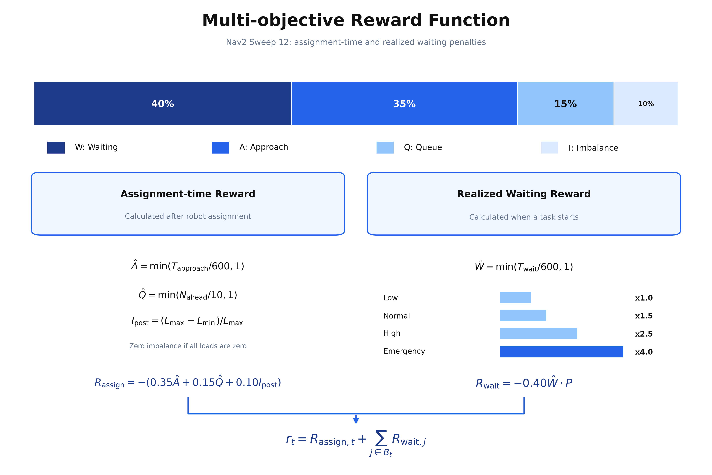
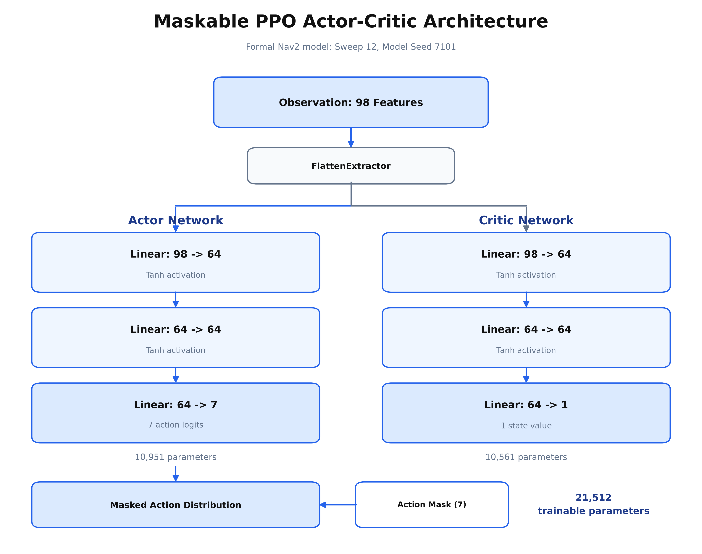
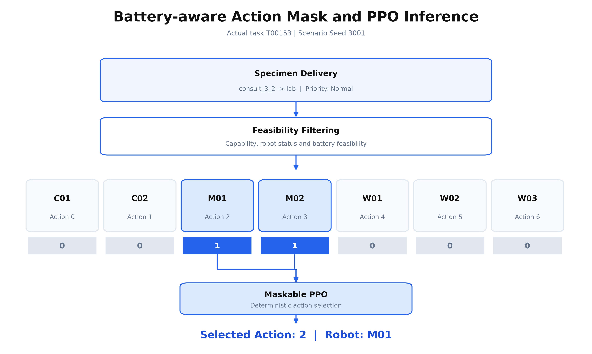
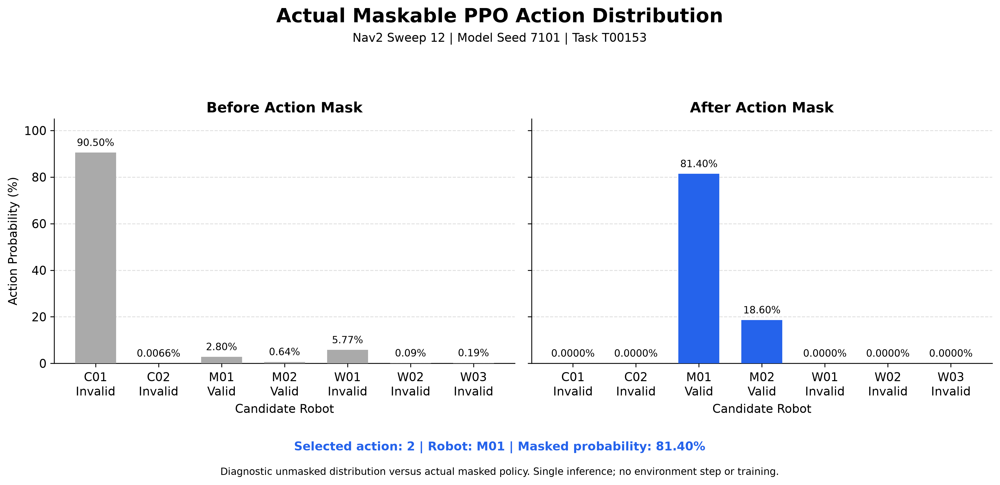

# Battery-aware Maskable PPO Scheduling Design

醫療異質多機器人智慧任務調度系統 —
強化學習模型設計、訓練機制與推論流程

---

## 1. 研究目的

本研究使用 Maskable PPO
（Maskable Proximal Policy Optimization）
設計醫療異質多機器人的智慧派工策略。

相較於使用固定或動態權重的規則式派工方法，
強化學習透過與模擬環境持續互動，
根據派工行為所產生的獎勵與懲罰更新策略。

本研究希望模型能同時考量：

- 任務等待時間。
- 任務優先級。
- 預估來源地移動時間。
- 任務佇列負載。
- 車隊負載平衡。
- 機器人剩餘電量與派工可行性。

其中電量主要透過 Observation、Action Mask
及共用環境限制影響決策，
並非直接作為獨立 Reward 懲罰項目。

模型負責選擇執行任務的機器人，
不直接負責導航、速度控制或充電排程。

本文件記錄正式 Nav2 Sweep 12（Model Seed 7101）的設計與設定。
本次文件更新僅載入既有模型、重新匯出資訊及單次推論，不涉及重新訓練或重新選擇模型。
歷史 Sweep 27（Seed 7104）的文件、資料及圖表另行備份。

---

## 2. Problem Formulation

### 2.1 強化學習問題

將醫療機器人派工表示為序列決策問題：

$$
(s_t,a_t,r_t,s_{t+1})
$$

其中：

| Symbol | Definition |
|---|---|
| s_t | 目前的任務與車隊 Observation |
| a_t | 選擇一台機器人 |
| r_t | 派工及環境轉移所產生的 Reward |
| s_(t+1) | 下一次可行派工決策的 Observation |

目標為最大化預期累積折扣獎勵：

$$
J(\pi)=
\mathbb{E}_{\pi}
\left[
\sum_{t=0}^{T-1}\gamma^t r_t
\right]
$$

本研究採用 gamma = 0.99。

由於 Observation 不包含模擬器中的所有資訊，
不能保證 Observation 本身符合完整 Markov 性質。

本研究使用可觀測特徵表示當前派工情境，
而非直接提供所有環境內部狀態。

### 2.2 決策範圍

PPO 負責：

- 接收目前待派工任務。
- 取得車隊狀態及預估派工資訊。
- 從合法候選機器人中選擇一台。

PPO 不直接負責：

- 決定機器人導航路線。
- 控制機器人移動速度。
- 任意調整完整任務佇列排序。
- 決定充電觸發時機。
- 中斷目前執行中的任務。

上述功能由共用派工規則、
模擬環境及導航系統負責。

---

## 3. Reinforcement Learning Environment

### 3.1 實驗環境

| Setting | Value |
|---|---|
| Environment | HospitalSchedulingEnv |
| Simulation type | Event-driven |
| Fleet configuration | (2,2,3) |
| Total robots | 7 |
| Training workload | 4.0x |
| Task generation horizon | 7 days |
| Battery model | Enabled |
| Navigation model | Nav2 empirical route means + graph fallback |
| Initial SoC | 100% |
| Charge trigger | 25% |
| Minimum reserve | 15% |
| Resume SoC | 80% |

七台機器人包含：

- Clean: C01, C02
- Medical: M01, M02
- Ward: W01, W02, W03

機器人配置依先前 Fleet Sizing 實驗選定，Nav2 校準後未重新最佳化車隊。
正式訓練與評估使用 Nav2 校準的 Python 排程模擬環境，而非每一步直接執行 Gazebo/Nav2。
參見 [01 Experiment Environment](../01_experiment_environment/README.md)。

相關文件：
[Fleet Sizing](../02_fleet_sizing/README.md)

### 3.2 事件驅動式環境

環境並非每隔固定秒數執行一次 PPO。

而是在模擬事件產生新的可行派工決策時，
建立 Observation 並要求 PPO 選擇機器人。

環境事件包括：

- 新任務到達。
- 待派工任務重新檢查。
- 任務開始執行。
- 任務執行完成。
- 機器人返回充電站。
- 機器人完成充電。
- 電量不足造成的任務重新派工。

### 3.3 環境互動流程



每次環境互動包含：

1. 取得下一筆可行派工任務。
2. 建立 Observation 與 Action Mask。
3. PPO 選擇合法 Action。
4. 將任務加入選定機器人的佇列。
5. 執行電量感知佇列修復。
6. 計算 Assignment Reward。
7. 推進模擬事件。
8. 計算實際開始執行任務的 Waiting Reward。
9. 回傳下一筆 Observation 與 Step Reward。

當不存在可行候選機器人時，
環境自行推進事件並等待重新派工機會，
而非讓 PPO 選擇無效動作。

### 3.4 Episode 結束條件

七天為任務生成期間，
不代表環境一定在第七天立即結束。

環境持續處理剩餘事件，
直到符合終止條件。

Episode 結束不必然表示所有任務皆已完成，
因此仍需要 Completion Rate 作為評估指標。

### 3.5 Timestep 定義

一次 Timestep 代表一次環境派工決策。

由於電量修復可能使已分配任務重新派工，
Timestep 數量不一定等於不重複的任務數量。

另外，兩次決策之間經過的模擬時間並不固定。

因此 PPO 的 gamma 是以決策步數進行折扣，
而非直接以實際經過的秒數折扣。

原始程式：
[Environment](../../rl/environment.py)

---

## 4. Observation Space

### 4.1 整體定義

Battery V2 使用 98 維 Observation：

$$
s_t\in[0,1]^{98}
$$

資料型態為 float32。

Gymnasium Observation Space：

```python
Box(0.0, 1.0, (98,), float32)
```



| Feature group | Dimensions | Index |
|---|---:|---|
| Task Type | 5 | 0–4 |
| Task Priority | 4 | 5–8 |
| Task Source | 16 | 9–24 |
| Task Destination | 16 | 25–40 |
| Robot Features | 56 | 41–96 |
| Global Load Imbalance | 1 | 97 |
| Total | 98 | 0–97 |

$$
5+4+16+16+7\times8+1=98
$$

完整特徵定義：
[Observation layout](data/observation_layout.csv)

### 4.2 Task Type

使用五維 One-hot Encoding。

| Index | Task type | Description |
|---:|---|---|
| 0 | waste_transport | 廢棄物運送 |
| 1 | clothes_collection | 衣物收集 |
| 2 | specimen_delivery | 檢體運送 |
| 3 | medication_delivery | 藥品運送 |
| 4 | ward_service | 病房服務 |

### 4.3 Task Priority

使用四維 One-hot Encoding。

| Index | Priority | Description |
|---:|---:|---|
| 5 | 0 | Low |
| 6 | 1 | Normal |
| 7 | 2 | High |
| 8 | 3 | Emergency |

### 4.4 Task Source and Destination

來源地與目的地各自使用十六維 One-hot Encoding。

| Source index | Destination index | Location |
|---:|---:|---|
| 9 | 25 | charging_station_2 |
| 10 | 26 | ward_a_2 |
| 11 | 27 | ward_b_2 |
| 12 | 28 | consult_1_2 |
| 13 | 29 | consult_2_2 |
| 14 | 30 | consult_3_2 |
| 15 | 31 | nurse_station |
| 16 | 32 | blood_draw |
| 17 | 33 | x-ray |
| 18 | 34 | ultrasound_2 |
| 19 | 35 | ecg_2 |
| 20 | 36 | therapy_room |
| 21 | 37 | waste_return_2 |
| 22 | 38 | clothes_return_2 |
| 23 | 39 | pharmacy |
| 24 | 40 | lab |

上述十六個位置為 Observation 的固定類別，
不代表導航路網只有十六個節點。

### 4.5 Robot Features

每台機器人包含八項特徵。

| Offset | Feature | Definition |
|---:|---|---|
| 0 | Capability Match | 是否具有目前任務所需能力 |
| 1 | Assignable | 狀態是否為 idle 或 busy |
| 2 | Busy | 是否具有執行中任務 |
| 3 | Observable Load | 執行中與等待佇列任務數 |
| 4 | Projected Approach | 預估前往來源地的移動時間 |
| 5 | Tasks Ahead | 預估插入位置前方的任務數 |
| 6 | Battery SoC | 剩餘電量比例 |
| 7 | Battery Unavailable | 充電或返回充電站狀態旗標 |

七台機器人的特徵順序固定。

| Robot ID | Observation indices |
|---|---|
| C01 | 41–48 |
| C02 | 49–56 |
| M01 | 57–64 |
| M02 | 65–72 |
| W01 | 73–80 |
| W02 | 81–88 |
| W03 | 89–96 |

Assignable 與 Battery Unavailable
均為 Observation 狀態特徵，
並不單獨等同最終 Action Mask。

返回充電站中的機器人是否可接收任務，
仍取決於共用可行性規則與電量設定。

### 4.6 Normalization

非負數值特徵使用固定尺度正規化：

$$
\operatorname{Norm}(x,S)
=\min\left(\frac{x}{S},1\right)
$$

| Feature | Scale |
|---|---:|
| Observable Load | 10 tasks |
| Projected Approach | 600 s |
| Tasks Ahead | 10 tasks |
| Battery SoC | Already in [0,1] |

目前環境實測的 Observation Approach Scale
為 600 秒。

若機器人沒有對應的 Placement Evaluation，
Projected Approach 與 Tasks Ahead 設為零。

零值不代表其預估移動時間必然最短，
最終合法性仍須依照 Action Mask 判斷。

歷史模型 Metadata 未獨立保存 Observation Scale。
600 秒的歷史設定是依目前原始碼、
訓練入口與實際環境進行還原。

### 4.7 Global Load Imbalance

定義機器人可觀測負載：

$$
L_i=
\mathbf{1}_{\mathrm{active\ task}}
+
N_{\mathrm{queued},i}
$$

全域負載不平衡：

$$
I=
\frac{\max_iL_i-\min_iL_i}{\max_iL_i}
$$

當所有機器人負載為零時，I = 0。

此處使用全部七台機器人，
而非僅使用目前任務的可行候選集合。

因此與 Dynamic Weighted 的候選負載
不平衡計算範圍不同。

### 4.8 Battery-aware Observation Extension

| Feature group | Without battery | Battery V2 |
|---|---:|---:|
| Task features | 41 | 41 |
| Features per robot | 6 | 8 |
| All robot features | 42 | 56 |
| Global feature | 1 | 1 |
| Total | 84 | 98 |

Battery V2 為每台機器人新增：

- Battery SoC。
- Battery Unavailable。

總共增加十四維。

### 4.9 Observation Information Boundaries

模型未直接接收：

- 機器人的完整 XY 座標。
- 目前任務已等待的時間。
- 真實未來任務服務時間。
- 真實剩餘執行時間。
- 完整未來任務佇列內容。

部分資訊透過可觀測負載、
預估移動時間與 Tasks Ahead 間接表示。

原始程式：
[Observation encoder](../../rl/observation.py)

---

## 5. Action Space and Action Mask

### 5.1 Action Space

使用七個離散動作：

$$
\mathcal{A}=\{0,1,2,3,4,5,6\}
$$

Gymnasium Action Space：

```python
Discrete(7)
```

每個 Action 對應一台機器人。

| Action | Robot ID | Capabilities |
|---:|---|---|
| 0 | C01 | clothes_collection, waste_transport |
| 1 | C02 | clothes_collection, waste_transport |
| 2 | M01 | medication_delivery, specimen_delivery |
| 3 | M02 | medication_delivery, specimen_delivery |
| 4 | W01 | medication_delivery, ward_service |
| 5 | W02 | medication_delivery, ward_service |
| 6 | W03 | medication_delivery, ward_service |

完整對應：
[Action mapping](data/action_mapping.csv)

Observation Encoder 與 Action Mask Builder
必須使用相同的機器人順序。

部署時不得任意交換機器人的輸入順序。

### 5.2 Action Mask

Action Mask 由七個 Boolean 值組成：

$$
m_t\in\{0,1\}^{7}
$$

其中：

- 1：合法候選機器人。
- 0：不可行機器人。

可行性檢查包括：

1. 任務能力。
2. 機器人狀態。
3. 預估任務佇列插入位置。
4. 電量感知佇列修復。
5. 新任務是否能保留於修復後的佇列。

Mask 不屬於 98 維 Observation 的額外特徵，
而是作為獨立輸入，
用於限制 Actor 的動作機率分布。

### 5.3 Masked Action Distribution

若 Actor 為各 Action 產生 logits z_i，
則合法動作的機率可表示為：

$$
\pi(a_i|s,m)=
\frac{m_i\exp(z_i)}
{\sum_j m_j\exp(z_j)}
$$

上述為 Masked Categorical Distribution
的概念數學表示。

實際實作使用 SB3-Contrib MaskablePPO
提供的 masking 機制。

### 5.4 Battery-aware Queue Repair

電量感知佇列修復不要求
所有原本已存在的等待任務都能保留。

Action 合法的核心條件為：
新加入的任務在修復後仍可保留。

較高優先級的任務插入佇列後，
可能導致後方任務不再符合電量限制。

這些任務可以釋放並重新進入待派工流程，
且保留原始任務到達時間。

正在執行的任務不因上述佇列修復而中斷。

### 5.5 No-feasible-action Handling

不額外設計第八個等待動作。

若全部機器人暫時不可行，
環境自行等待並推進相關模擬事件，
直到出現下一次可行決策，
或滿足環境終止條件。

因此正常 PPO 派工時，
Action Mask 至少具有一個 True。

原始程式：
[Action mask](../../rl/action_mask.py)

共用規則：
[Scheduling utilities](../../baseline/common.py)

---

## 6. Reward Function

### 6.1 Reward Design

Reward 使用四種成本：

| Symbol | Component | Final weight |
|---|---|---:|
| W | Realized Waiting Time | 0.40 |
| A | Projected Approach Time | 0.35 |
| Q | Tasks Ahead | 0.15 |
| I | Post-assignment Load Imbalance | 0.10 |

$$
w_W+w_A+w_Q+w_I=1
$$

正式權重來自 Nav2 Sweep 12；選擇過程見 [05 Reward Weight Selection](../05_reward_weight_selection/README.md)。

權重選擇及多模型實驗過程
將在 Reward Weight Selection 章節獨立整理。



Reward 分為：

- Assignment-time Reward。
- Realized Waiting Reward。

模型透過最大化累積 Reward，
學習減少上述成本。

### 6.2 Projected Approach Penalty

$$
\hat{A}
=
\min\left(\frac{T_{\mathrm{approach}}}{600},1\right)
$$

$$
P_A=0.35\hat{A}
$$

此項考量目前任務預估前往來源地的移動時間。

使用預估值而非尚未發生的真實移動結果。

### 6.3 Queue Penalty

$$
\hat{Q}
=
\min\left(\frac{N_{\mathrm{ahead}}}{10},1\right)
$$

$$
P_Q=0.15\hat{Q}
$$

此項鼓勵避免將任務放在過多等待任務之後。

Tasks Ahead 為預估插入位置前方的任務數，
不等同於整台機器人的 Observable Load。

### 6.4 Load Imbalance Penalty

$$
I_{\mathrm{post}}=
\frac{
L_{\max}^{\mathrm{post}}
-
L_{\min}^{\mathrm{post}}
}{
L_{\max}^{\mathrm{post}}
}
$$

若所有機器人負載均為零，
則 I_post = 0。

$$
P_I=0.10I_{\mathrm{post}}
$$

此項使用完成派工及相關佇列調整後的
全域車隊負載。

### 6.5 Assignment-time Reward

$$
R_{\mathrm{assign}}
=
-(0.35\hat{A}
+0.15\hat{Q}
+0.10I_{\mathrm{post}})
$$

A 與 Q 使用候選 Placement Evaluation 的預估資訊。

I 使用派工及相關佇列修復後的實際可觀測負載。

Assignment Reward 在每次有效派工時計算。

若任務後續被釋放並重新派工，
新的派工決策仍可能再次產生 Assignment Reward。

### 6.6 Realized Waiting Reward

等待時間定義為：

$$
T_{\mathrm{wait}}
=
T_{\mathrm{start}}-T_{\mathrm{arrival}}
$$

正規化：

$$
\hat{W}
=
\min\left(\frac{T_{\mathrm{wait}}}{600},1\right)
$$

優先級倍率：

| Priority | Level | Multiplier |
|---:|---|---:|
| 0 | Low | 1.0 |
| 1 | Normal | 1.5 |
| 2 | High | 2.5 |
| 3 | Emergency | 4.0 |

等待時間懲罰：

$$
R_{\mathrm{wait}}
=
-0.40\hat{W}\cdot P
$$

此項在任務實際開始執行時，
使用已發生的等待時間計算。

不使用未來真實等待時間作為派工當下的資訊。

### 6.7 Step Reward

定義 B_t 為目前環境轉移期間
實際開始執行的任務集合。

$$
r_t
=
R_{\mathrm{assign},t}
+
\sum_{j\in B_t}
R_{\mathrm{wait},j}
$$

一個 Step 可能沒有任務開始執行，
也可能同時有多筆任務開始執行。

因此等待懲罰不一定只來自當前派工任務。

四項權重總和為一，
不代表每一步 Reward 必定位於 [-1,0]。

原因包括優先級倍率，
以及同一 Step 可能產生多筆 Waiting Reward。

### 6.8 Reward Calculation Example

以下為公式說明用的假設案例，
不是實際模擬或推論紀錄。

| Input | Value |
|---|---:|
| Projected approach | 120 s |
| Tasks ahead | 2 |
| Post-assignment imbalance | 0.6 |
| Realized waiting | 300 s |
| Priority | Emergency |

計算：

$$
P_A=0.35\times\frac{120}{600}=0.07
$$

$$
P_Q=0.15\times\frac{2}{10}=0.03
$$

$$
P_I=0.10\times0.6=0.06
$$

$$
R_{\mathrm{assign}}=-0.16
$$

$$
R_{\mathrm{wait}}
=-0.40\times\frac{300}{600}\times4
=-0.80
$$

若本 Step 恰好只有上述一筆等待懲罰：

$$
r_t=-0.16-0.80=-0.96
$$

### 6.9 Reward versus Evaluation Metrics

| Factor | Direct reward component |
|---|---|
| Realized waiting time | Yes |
| Projected approach time | Yes |
| Tasks ahead | Yes |
| Post-assignment load imbalance | Yes |
| Priority importance | Waiting multiplier |
| P95 waiting time | No |
| Total travel time | No |
| Jain task fairness | No |
| Completion rate | No |
| Battery SoC | No |

評估指標用於衡量策略最終表現，
不一定直接等同訓練 Reward。

電量透過 Observation、Action Mask、
佇列修復及充電生命週期影響策略。

### 6.10 Reward Configuration

正式模型 Metadata 與本次明確傳入推論環境的 RewardConfig 一致；不依賴全域預設權重。

| Setting | Value |
|---|---:|
| waiting_weight | 0.40 |
| approach_weight | 0.35 |
| queue_weight | 0.15 |
| imbalance_weight | 0.10 |
| waiting_scale_s | 600 |
| approach_scale_s | 600 |
| tasks_ahead_scale | 10 |
| low_priority_weight | 1.0 |
| normal_priority_weight | 1.5 |
| high_priority_weight | 2.5 |
| emergency_priority_weight | 4.0 |

資料：
[Reward configuration](data/reward_config.json)

原始程式：
[Reward function](../../rl/reward.py)

---

## 7. Maskable PPO Algorithm

### 7.1 Algorithm Selection

PPO 為 On-policy Reinforcement Learning 演算法。

本研究使用 SB3-Contrib 的 MaskablePPO，
在 Actor 動作選擇時限制不可行的機器人。

使用理由：

1. 支援離散動作空間。
2. 可透過 Action Mask 排除不可行動作。
3. PPO Clipped Objective 降低策略過度更新的風險。
4. 可透過多目標 Reward 學習序列派工策略。

上述為演算法選擇依據，
並非本研究已透過實驗證明
PPO 優於所有其他強化學習演算法。

### 7.2 Actor-Critic

Actor 根據 Observation 產生動作分布。

Critic 估計目前狀態的預期累積折扣獎勵：

$$
V_\phi(s_t)
$$

Critic 提供 Advantage 估計及策略訓練所需資訊。

正式部署進行派工時，
主要使用 Actor 的動作選擇結果。

### 7.3 PPO Clipped Objective

定義新舊策略的動作機率比率：

$$
\rho_t(\theta)
=
\frac{
\pi_\theta(a_t|s_t,m_t)
}{
\pi_{\theta_{\mathrm{old}}}(a_t|s_t,m_t)
}
$$

PPO 的 Clipped Surrogate Objective：

$$
L^{\mathrm{CLIP}}(\theta)
=
\mathbb{E}_t
\left[
\min
\left(
\rho_t(\theta)\hat{A}_t,
\operatorname{clip}
(\rho_t(\theta),1-\epsilon,1+\epsilon)
\hat{A}_t
\right)
\right]
$$

本研究使用：

$$
\epsilon=0.2
$$

Clipping 限制目標函式鼓勵策略更新的幅度，
但不是保證所有動作機率比率
都一定落在 [0.8,1.2] 之內。

### 7.4 Generalized Advantage Estimation

Temporal Difference Error 的基本形式：

$$
\delta_t=r_t+\gamma V(s_{t+1})-V(s_t)
$$

實際計算須考慮 Episode 終止與 bootstrap 條件。

GAE：

$$
\hat{A}_t
=
\sum_{l\geq0}
(\gamma\lambda)^l\delta_{t+l}
$$

本研究設定：

$$
\gamma=0.99,\quad\lambda=0.95
$$

此處 Advantage 的符號 A
與 Reward 中的 Approach Cost 不同。

### 7.5 Training Objective

PPO 訓練同時考量：

- Clipped Policy Objective。
- Value Function Loss。
- Policy Entropy。

Entropy coefficient 為 0.01，
Value function coefficient 為 0.5。

上述為既有 MaskablePPO 演算法的訓練原理，
本研究未重新實作 PPO 核心更新演算法。

---

## 8. Actual Neural Network Architecture

### 8.1 Model Inspection

實際模型由 MaskablePPO.load() 載入，
直接檢查已保存的 Policy 網路。

| Item | Value |
|---|---|
| Policy | MlpPolicy |
| Policy class | MaskableActorCriticPolicy |
| Feature extractor | FlattenExtractor |
| Input dimension | 98 |
| Actor hidden layers | [64,64] |
| Critic hidden layers | [64,64] |
| Activation | Tanh |
| Actor output | 7 logits |
| Critic output | 1 scalar value |
| Trainable parameters | 21512 |



Actor 與 Critic 各自具有兩層 MLP。

FlattenExtractor 不包含可訓練參數。

### 8.2 Actor Network

| Layer | Input | Output | Parameters |
|---|---:|---:|---:|
| Linear 1 | 98 | 64 | 6336 |
| Tanh | 64 | 64 | 0 |
| Linear 2 | 64 | 64 | 4160 |
| Tanh | 64 | 64 | 0 |
| Action output | 64 | 7 | 455 |
| Total | | | 10951 |

Actor 產生七個 Action logits。

Action Mask 在動作分布階段排除非法動作。

### 8.3 Critic Network

| Layer | Input | Output | Parameters |
|---|---:|---:|---:|
| Linear 1 | 98 | 64 | 6336 |
| Tanh | 64 | 64 | 0 |
| Linear 2 | 64 | 64 | 4160 |
| Tanh | 64 | 64 | 0 |
| Value output | 64 | 1 | 65 |
| Total | | | 10561 |

Critic 輸出單一 State Value。

### 8.4 Parameter Count

$$
N_{\mathrm{total}}
=
10951+10561
=
21512
$$

每個具 Bias 的 Linear Layer
參數數量為：

$$
N_{\mathrm{layer}}
=
N_{\mathrm{in}}N_{\mathrm{out}}
+
N_{\mathrm{out}}
$$

模型共包含十二組參數張量。

全部 21512 個 Policy 參數均可訓練。

資料：

- [Model architecture](data/model_architecture.json)
- [Model parameters](data/model_parameters.csv)

---

## 9. PPO Hyperparameters and Training

### 9.1 Hyperparameters

| Hyperparameter | Value | Description |
|---|---:|---|
| Learning rate | 0.0003 | 梯度更新學習率 |
| n_steps | 512 | 每個環境的 Rollout 長度 |
| Batch size | 64 | 每個 Mini-batch 的樣本數 |
| n_epochs | 10 | 每批經驗的重複訓練輪數 |
| Gamma | 0.99 | 未來獎勵折扣 |
| GAE lambda | 0.95 | Advantage 估計參數 |
| Clip range | 0.2 | PPO Clipping 參數 |
| Entropy coefficient | 0.01 | 探索正則化權重 |
| Value coefficient | 0.5 | Value Loss 權重 |
| Max gradient norm | 0.5 | 梯度範數限制 |

上述設定均由實際模型及歷史 Metadata
交叉驗證一致。

Battery V2 沿用先前 PPO 超參數，
並非針對上述十項超參數重新進行完整搜尋。

### 9.2 Rollout Training Cycle

本研究使用單一訓練環境。

每輪收集：

$$
512\times1=512
$$

筆互動經驗。

每個 Mini-batch 使用 64 筆：

$$
512/64=8
$$

個 Mini-batches per Epoch。

每輪使用 10 Epochs：

$$
8\times10=80
$$

次理論 Mini-batch 梯度更新。

收集經驗、更新策略、
再使用新策略收集下一批經驗。

### 9.3 Actual Training Timesteps

| Setting | Value |
|---|---:|
| Requested timesteps | 200000 |
| Actual model timesteps | 200192 |
| Environments | 1 |
| Rollout size | 512 |
| Derived rollout count | 391 |
| Mini-batches per epoch | 8 |
| Epochs per rollout | 10 |
| Theoretical mini-batch updates | 31280 |

因為 PPO 以完整 Rollout 收集經驗，
實際訓練步數可能超過指定值：

$$
391\times512=200192
$$

理論更新次數：

$$
391\times8\times10=31280
$$

31280 為依照設定推導出的理論數量，
尚未以歷史梯度更新紀錄直接驗證。

200192 則為從最終模型
num_timesteps 直接取得的實際紀錄。

### 9.4 Checkpoints

原始訓練程式每 25000 Steps 保存 Checkpoint。

歷史 Sweep 27 模型資料夾曾記錄八個 Checkpoints（下表保留歷史紀錄；非正式 Sweep 12 的檔案清單）：

| Checkpoint | Timesteps |
|---|---:|
| 1 | 25000 |
| 2 | 50000 |
| 3 | 75000 |
| 4 | 100000 |
| 5 | 125000 |
| 6 | 150000 |
| 7 | 175000 |
| 8 | 200000 |

Final model 與 Checkpoint
是不同的保存時機。

不能僅根據 Checkpoint 檔名
推定其與最終模型參數完全相同。
正式 Sweep 12 模型目錄目前僅確認 final_model.zip，未驗證其歷史 Checkpoint 檔案。

資料：
[PPO hyperparameters](data/ppo_hyperparameters.json)

原始程式：
[Training](../../rl/train_battery_v2.py)

---

## 10. Training Seed Design

### 10.1 Scenario Seeds

預設訓練情境 Seed Pool：

```
7001–7100
```

共 100 個預先設定的 Scenario Seeds。

控制訓練模擬環境中的隨機任務情境。

### 10.2 Model Seed

最終代表模型：

```
Model Seed = 7101
```

Model Seed 影響模型初始化、
動作取樣及其他訓練隨機性。

### 10.3 Environment Reset Mechanism

目前環境選擇 Scenario Seed 的順序：

1. 明確傳入的 reset(seed)。
2. Episode Seed Pool 的循環設定。
3. Base Seed 與 Episode Index。

目前安裝的 SB3 套件原始碼顯示，
模型初始化時可能將 Model Seed
傳入向量化環境的第一次 Reset。

因此 Model Seed 不一定只影響模型初始化，
也可能影響第一次訓練情境。

### 10.4 Historical Seed Limitation

歷史 Metadata 已確認預設 Seed Pool。

但沒有保存完整的 Episode Seed Sequence。

本研究不宣稱：

- 每個 Seed 恰好使用一次。
- 所有模型使用完全相同的情境順序。
- 全部實際訓練情境只來自上述 100 個 Seeds。

後續獨立測試應避開
已知歷史 Scenario Seeds 與 Model Seeds。

---

## 11. Model Training and Evaluation

### 11.1 Training Paradigm

本研究在 Python Scheduling Simulator 中
預先訓練 Maskable PPO，
而不是讓真實醫院中的機器人即時學習。

由於 PPO 持續使用目前策略與模擬環境互動，
技術分類為 On-policy Reinforcement Learning。

本研究屬於部署前的模擬訓練，
並非嚴格定義的 Offline Reinforcement Learning。

### 11.2 Validation

原始 Battery V2 驗證程式預設：

| Setting | Value |
|---|---|
| Validation Seeds | 8101–8120 |
| Scenarios | 20 |
| Fleet | (2,2,3) |
| Workload | 4.0x |
| Battery model | Enabled |
| Action selection | Deterministic |
| Action mask | Enabled |
| Device | CPU |
| Model updates | Disabled |

上述為原始驗證程式的預設設定，
不同歷史實驗的實際 Seeds
仍以各自結果與 Metadata 為準。

### 11.3 Evaluation Process

1. 載入已訓練完成的模型。
2. 使用指定 Scenario Seed 初始化環境。
3. 取得 Observation 與 Action Mask。
4. 使用 deterministic=True 進行預測。
5. 執行選定動作。
6. 重複直到 Episode 結束。
7. 計算任務等待時間及其他效能指標。

原始程式：
[Evaluation](../../rl/evaluate_battery_v2.py)

### 11.4 Evaluation Consistency

原始 PPO 驗證程式使用樣本標準差 stdev。

Baseline V2 校準使用母體標準差 pstdev。

後續統一比較時應使用相同摘要統計方式，
而非直接混用歷史摘要中的標準差。

原始 PPO 驗證環境未必明確傳入
各個歷史模型的 Reward Config
及 Observation Scale。

正式評估已完成，使用 Nav2 Sweep 12 Seed 7101、五種負載及 Seeds 9601–9630，共 750 個 Episodes（含四種 Baseline）。正式比較採統一摘要方式；詳細設定與結果見 [06 PPO vs. Baselines](../06_ppo_vs_baselines/README.md)。歷史實驗的個別設定仍以其原始紀錄為準。

不同 Reward 權重的 Episode Reward
也不應直接作為跨模型優劣的唯一依據。

---

## 12. Actual PPO Inference Example

### 12.1 Scenario

使用目前 Nav2 校準環境與正式 Sweep 12 Seed 7101 模型進行一次實際模型推論（非實體機器人測試）。

本案例不執行 env.step()，
因此不是完整模擬或任務完成紀錄。

| Field | Value |
|---|---|
| Scenario Seed | 3001 |
| Task ID | T00153 |
| Task Type | specimen_delivery |
| Priority | Normal |
| Source | consult_3_2 |
| Destination | lab |
| Arrival time | 1002.6010848733918 s |
| Observation scale | 600 s |
| Battery enabled | True |

### 12.2 Actual Observation

任務 One-hot 特徵中的非零位置：

| Index | Feature | Value |
|---:|---|---:|
| 2 | specimen_delivery | 1 |
| 6 | Normal priority | 1 |
| 14 | source.consult_3_2 | 1 |
| 40 | destination.lab | 1 |

全部機器人初始電量皆為 100%，
且尚未執行任務。

M01 與 M02 的 Projected Approach
正規化數值均約為 0.19205630。

對應預估來源地移動時間約為 115.23 秒。

其他不具能力的機器人
沒有對應的 Placement Evaluation，
因此其 Projected Approach 為零。

完整實際輸入：
[Example observation](data/example_observation.csv)

### 12.3 Actual Action Mask

| Action | Robot | Mask |
|---:|---|---:|
| 0 | C01 | 0 |
| 1 | C02 | 0 |
| 2 | M01 | 1 |
| 3 | M02 | 1 |
| 4 | W01 | 0 |
| 5 | W02 | 0 |
| 6 | W03 | 0 |

```text
[0, 0, 1, 1, 0, 0, 0]
```

合法動作只有 2 與 3。

### 12.4 Actual Model Prediction

使用：

```python
action, _ = model.predict(
    observation,
    action_masks=mask,
    deterministic=True,
)
```

實際推論結果：

```
Selected action: 2
Selected robot: M01
Selected action feasible: PASS
```



本次 M01 與 M02 的八項輸入特徵相同，
但模型對不同機器人位置及動作
仍可具有不同的策略輸出。

此結果證明模型在該案例中
成功選擇一個合法候選動作。

不代表 M01 一定優於 M02，
也不能作為整體策略效能優勢的證明。

資料：
[Example decision](data/example_decision.json)

---

### 12.5 Action Probability Distribution

以下為本次實際推論匯出的動作機率（百分比）：

| Action | Robot | Mask | Before mask | After mask |
|---:|---|---:|---:|---:|
| 0 | C01 | 0 | 90.504676% | 0.000000% |
| 1 | C02 | 0 | 0.006589% | 0.000000% |
| 2 | M01 | 1 | 2.796517% | 81.398934% |
| 3 | M02 | 1 | 0.639053% | 18.601069% |
| 4 | W01 | 0 | 5.774967% | 0.000000% |
| 5 | W02 | 0 | 0.092971% | 0.000000% |
| 6 | W03 | 0 | 0.185228% | 0.000000% |



對至少有一個合法動作的狀態，遮罩後的機率可表示為：

$$
\pi_m(a\mid s)=\frac{m_a\pi(a\mid s)}{\sum_b m_b\pi(b\mid s)}
$$

Mask 前的分布僅供診斷，並非正式派工策略。C01 雖具有最高未遮罩機率，但不符合檢體運送能力；套用遮罩後五個非法動作機率為零。Deterministic Prediction 選擇 M01（81.398934%），而非依機率隨機抽樣。該機率不是任務成功率或正確性信心。

Critic State Value 為 **−16.746944427490234**，代表模型估計的折扣累積 Reward，不是等待秒數或成功率。

歷史 Sweep 27 在相同 Scenario Seed、Task ID 與合法候選集合下選擇 M02。兩次推論均合法；不能假定整個歷史環境狀態完全一致，也不能單靠此案例判斷模型優劣。正式效能比較見 06。

本次未執行 env.step()，未完成任務，亦未更新模型。

資料：[Example decision](data/example_decision.json)。

---

## 13. Deployment Design

### 13.1 Training and Deployment Separation

訓練階段：

- 與模擬環境互動。
- 收集 Observation、Action、Reward。
- 執行 PPO Policy 與 Value 更新。
- 保存訓練模型。

部署階段：

- 接收即時任務及機器人狀態。
- 建立固定格式的 98 維 Observation。
- 計算七維 Action Mask。
- 載入既有 PPO 模型進行推論。
- 將選定機器人回傳至任務調度系統。

部署時不持續更新模型參數。

### 13.2 Integration Requirements

模型整合時應保持：

- 任務類別順序一致。
- 優先級定義一致。
- 位置類別順序一致。
- Robot ID 順序一致。
- Observation 正規化尺度一致。
- Action Mask 與共用可行性規則一致。
- 模型輸入維度及動作空間一致。

任何輸入欄位順序改變，
都可能造成模型推論語意錯誤。

本文件主要定義模型及模擬環境設計。

正式評估使用 Nav2 Sweep 12 Seed 7101；實際部署是否載入同一模型尚待驗證。
實際後端與 ROS 2、Open-RMF 的整合驗證，另於 07 系統整合章節整理。

---

## 14. Frozen Final Model

### 14.1 Model Identity

| Field | Value |
|---|---|
| Experiment version | battery_v2 |
| Reward configuration | Nav2 Sweep 12 |
| Model Seed | 7101 |
| Requested training steps | 200000 |
| Actual training steps | 200192 |
| Observation size | 98 |
| Action size | 7 |
| Model created at | 2026-11-16T04:24:35.590985+08:00 |

模型位置：

```
experiments/fleet_sizing/results_rl/models/
reward_confirm_nav2_sweep12_w40_a35_q15_i10_seed7101_200k/
final_model.zip
```

### 14.2 SHA256

```
1972295e176e6907d3bee4d01b301fa10526dac40dca38a5e867fe1a63825d07
```

本階段載入模型及執行單次推論前後，
均驗證模型 SHA256 一致。

未重新訓練或修改模型。

### 14.3 Model Integrity Data

- [Original training metadata](data/final_model_metadata.json)
- [Model integrity](data/model_integrity.json)
- [PPO hyperparameters](data/ppo_hyperparameters.json)

Model Integrity 保存：

- 最終模型 SHA256。
- 原始 Metadata SHA256。
- 目前檢查的原始程式 SHA256。
- 目前 Python 套件版本。
- Git commit。
- 模型完整性檢查結果。

目前程式雜湊不等同歷史訓練當下的程式快照。

正式 Metadata SHA-256：`ab2592bc73db72db5974e9e752bf84baed5833b3616d1004ade0245b33f30047`。

本次匯出時的 Nav2 來源雜湊已記錄於 model_integrity.json，與正式校準資料一致。

[Model design manifest](data/model_design_manifest.json) 記錄十份資料、十二份圖檔及三支生成程式的 SHA-256，並記載 deployment_verified=false。
歷史資料備份：`backups/historical_sweep27_seed7104_20261128_150633`。

---

## 15. Limitations

1. Observation 未包含完整環境內部狀態，
   不保證滿足完整 Markov 性質。

2. 使用固定七台機器人的 Observation 及 Action Space，
   無法直接套用到任意規模的車隊。

3. 任務等待時間與 Approach Reward
   均在 600 秒正規化尺度飽和。
   超過上限後不會繼續增加對應單筆懲罰。

4. Tasks Ahead 與 Observable Load
   在十筆任務的正規化尺度飽和。

5. Reward 未直接最佳化 P95 Waiting Time、
   Total Travel Time、Jain Fairness 或 Completion Rate。

6. Reward 的 Load Imbalance 並不等同 Jain Fairness。

7. 電量模型未涵蓋所有真實硬體耗電行為。

8. PPO 主要進行機器人派工決策，
   不直接學習充電時機或導航路徑。

9. 事件驅動環境的每一步經過時間並不固定，
   目前折扣因子以決策步數而非實際秒數計算。

10. 歷史 Metadata 未獨立保存 Observation Approach Scale。

11. 歷史完整 Episode Seed Sequence 尚未驗證。

12. 理論梯度更新次數尚未由歷史訓練紀錄直接驗證。

13. PPO 超參數沿用既有設定，
    未對全部超參數進行完整最佳化。

14. 目前原始碼 SHA256 不代表歷史訓練程式的完整快照。

15. 單次模型推論只能確認該案例的動作合法性，
    不能證明整體模型優於 Baseline。

16. 歷史訓練與目前推論所使用的導航資料
    是否完全一致，仍需由歷史實驗紀錄確認。

---

## 16. Reproducibility

### 16.1 Environment Setup

從專案根目錄執行：

```bash
source .venv_rl/bin/activate

export PYTHONPATH="$PWD:$PWD/experiments/fleet_sizing${PYTHONPATH:+:$PYTHONPATH}"
```

### 16.2 Source Files

| File | Purpose |
|---|---|
| [environment.py](../../rl/environment.py) | 模擬環境與事件推進 |
| [observation.py](../../rl/observation.py) | Observation Encoder |
| [action_mask.py](../../rl/action_mask.py) | Action Mask Builder |
| [reward.py](../../rl/reward.py) | Reward Function |
| [train_battery_v2.py](../../rl/train_battery_v2.py) | PPO 訓練 |
| [evaluate_battery_v2.py](../../rl/evaluate_battery_v2.py) | PPO 驗證 |

### 16.3 Export Model Design Data

```bash
DOC=experiments/fleet_sizing/docs/04_ppo_design
STAGE=$(mktemp -d "$PWD/$DOC/reproduce_XXXXXX")
mkdir -p "$STAGE/data" "$STAGE/figures"
export PPO_DESIGN_DATA_DIR="$STAGE/data"
export PPO_DESIGN_FIGURE_DIR="$STAGE/figures"
python -m experiments.fleet_sizing.docs.04_ppo_design.export_model_design
```

此程式讀取既有模型、原始 Metadata 與目前環境，
並執行一次合法動作推論。

不執行模型訓練或完整效能評估。

程式具有輸出防覆蓋機制。

若需重新擷取資料，
應使用獨立工作副本，
避免覆蓋目前已驗證的資料。

[Export script](export_model_design.py)

### 16.4 Reproduce Figures

```bash
python "$DOC/plot_model_design.py"
python "$DOC/plot_action_probability.py"
unset PPO_DESIGN_DATA_DIR PPO_DESIGN_FIGURE_DIR
```

圖表直接讀取已保存的 CSV 與 JSON。

不需要重新載入 PPO 模型進行訓練。

重新執行繪圖程式會更新同名圖檔。

[Plotting script](plot_model_design.py) · [Action probability plotting script](plot_action_probability.py)

### 16.5 Available Figures

| Figure | PNG | SVG |
|---|---|---|
| Environment flow | [PNG](figures/01_rl_environment_flow.png) | [SVG](figures/01_rl_environment_flow.svg) |
| Observation structure | [PNG](figures/02_observation_structure.png) | [SVG](figures/02_observation_structure.svg) |
| Actor-Critic architecture | [PNG](figures/03_actor_critic_architecture.png) | [SVG](figures/03_actor_critic_architecture.svg) |
| Action mask flow | [PNG](figures/04_action_mask_flow.png) | [SVG](figures/04_action_mask_flow.svg) |
| Reward structure | [PNG](figures/05_reward_structure.png) | [SVG](figures/05_reward_structure.svg) |
| Action probability distribution | [PNG](figures/06_action_probability_distribution.png) | [SVG](figures/06_action_probability_distribution.svg) |

PNG 圖檔皆以 300 DPI 輸出，
並通過圖檔完整性驗證。

SVG 圖檔皆通過 XML 格式驗證。

圖檔格式驗證不等同於人工視覺排版審查；六組圖表另已進行人工視覺檢查。

### 16.6 Directory Structure

```
04_ppo_design/
├── README.md
├── export_model_design.py
├── plot_model_design.py
├── plot_action_probability.py
├── data/
│   ├── observation_layout.csv
│   ├── action_mapping.csv
│   ├── reward_config.json
│   ├── model_architecture.json
│   ├── model_parameters.csv
│   ├── ppo_hyperparameters.json
│   ├── final_model_metadata.json
│   ├── model_integrity.json
│   ├── example_observation.csv
│   ├── example_decision.json
│   └── model_design_manifest.json
└── figures/
    ├── 01_rl_environment_flow.png
    ├── 01_rl_environment_flow.svg
    ├── 02_observation_structure.png
    ├── 02_observation_structure.svg
    ├── 03_actor_critic_architecture.png
    ├── 03_actor_critic_architecture.svg
    ├── 04_action_mask_flow.png
    ├── 04_action_mask_flow.svg
    ├── 05_reward_structure.png
    ├── 05_reward_structure.svg
    ├── 06_action_probability_distribution.png
    └── 06_action_probability_distribution.svg
```

---

## 17. Conclusion

本研究使用 Battery-aware Maskable PPO，
建立具有異質機器人能力限制、
電量限制及任務優先級的智慧派工策略。

核心模型設定：

- Observation: 98 dimensions。
- Action Space: 7 discrete actions。
- Action Mask: 7 feasibility flags。
- Actor: 98 → 64 → 64 → 7。
- Critic: 98 → 64 → 64 → 1。
- Total trainable parameters: 21512。
- Reward weights: W=0.40, A=0.35, Q=0.15, I=0.10。
- Model Seed: 7101（Nav2 Sweep 12）。
- Actual training timesteps: 200192。

模型透過模擬環境進行 On-policy 訓練，
部署設計採固定策略推論，實際部署一致性仍待驗證。

本章完成模型設計、實際網路架構、
訓練設定及真實推論案例的驗證與紀錄。

Reward 權重搜尋與代表模型選擇已完成（33 → 15 → 7 → 2 → 1），詳見 [05 Reward Weight Selection](../05_reward_weight_selection/README.md)。

正式效能比較已完成 750 個 Episodes，詳見 [06 PPO vs. Baselines](../06_ppo_vs_baselines/README.md)。本章不重新訓練模型或執行完整效能實驗。下一階段為 07 系統整合與部署驗證。
