# 05 — Reward Weight Selection

**強化學習任務調度之 Reward 權重搜尋與模型選擇**

專題： 基於強化學習之醫療異質多機器人智慧任務調度系統
演算法： Maskable PPO
正式評估環境： Nav2-Calibrated Scheduling Simulation

## 1. Research Objective｜研究目的

本研究透過多目標評估與逐階段篩選，尋找適合醫療異質多機器人派工的 Reward 權重，使模型兼顧等待時間、移動成本、排隊及負載公平性。前期探索用於縮小候選空間，正式成果以 Nav2 校準後重新訓練的模型為主。

研究問題包含正規化尺度、權重搜尋、訓練種子變異、醫療緊急任務需求及代表模型選擇。

## 2. Reward Function Design｜獎勵函數設計

| Symbol | Component | 說明 |
| --- | --- | --- |
| W | Waiting | 降低等待時間並考量優先級 |
| A | Approach | 降低前往來源地的預估時間 |
| Q | Queue | 避免集中分配至已有大量待辦任務的機器人 |
| I | Imbalance | 降低機器人負載不均 |

派工成本與等待懲罰的主要組成如下（實際累積時機以 environment.py、`reward.py` 為準）。
$$
r_{\mathrm{assignment}}=-\left(A\min(t_{\mathrm{approach}}/600,1)+Q\min(q/10,1)+I c_{\mathrm{imbalance}}\right)
$$
$$
r_{\mathrm{waiting}}=-W\min(t_{\mathrm{waiting}}/600,1)p_{\mathrm{priority}}
$$

| Priority | Weight |
| --- | --- |
| Low | 1 |
| Normal | 1.5 |
| High | 2.5 |
| Emergency | 4 |

Action Mask 排除不可行動作；Reward 引導模型在可行動作中學習派工策略。

## 3. Normalization Scale Selection｜正規化尺度

已進行 Approach Scale Sensitivity、多 Seed 確認、Reward 與 Observation 解耦尺度分析。正式 Nav2 模型 Metadata 記錄 approach scale = 600 s、waiting scale = 600 s、queue scale = 10。獨立 Observation scale 未完整記錄，不能僅憑 Metadata 證明。尺度探索不代表已在 Nav2 環境全面驗證所有尺度。

詳細數據及八組圖表見 [Scale Selection README](data/scale_selection/README.md)。

## 4. Reward Weight Search Space｜權重搜尋空間

| Weight | Candidates |
| --- | --- |
| W | 0.35, 0.40, 0.45, 0.50, 0.55 |
| A | 0.20, 0.25, 0.30, 0.35 |
| Q | 0.10, 0.15, 0.20, 0.25 |
| I | 0.05, 0.10, 0.15 |

$$
5\times4\times4\times3=240,\qquad W+A+Q+I=1,\qquad W\ge A\ge Q\ge I
$$
240 組排列經總和限制剩 40 組，再經大小順序限制剩 33 組。這是有限候選搜尋，而非連續空間全域最佳化。

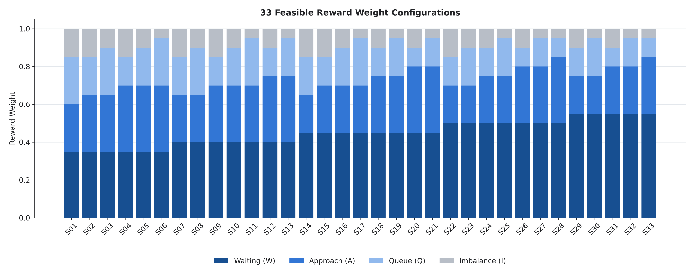

*Figure 2. 33 feasible reward weight configurations.*

[PNG](figures/stage1/02_reward_weight_configurations.png) · [SVG](figures/stage1/02_reward_weight_configurations.svg)

## 5. Experimental Settings｜實驗設定

| Parameter | Value |
| --- | --- |
| Algorithm | Maskable PPO / MlpPolicy |
| Environment | HospitalSchedulingEnv / battery_v2 |
| Observation / Action | 98 / 7 |
| Fleet | (2,2,3): Clean, Medical, Ward |
| Training workload | 4.0× |
| Battery model | Enabled |
| Training episode seed pool | 7001–7100 |
| Learning rate | 0.0003 |
| n_steps / batch size | 512 / 64 |
| gamma / GAE lambda | 0.99 / 0.95 |
| clip range | 0.20 |
| ent_coef / vf_coef | 0.01 / 0.50 |
| max_grad_norm / n_epochs | 0.50 / 10 |
| n_envs | 1 |
| Stage 1 requested / actual steps | 50,000 / 50,176 |
| Stage 2–3 requested / actual steps | 200,000 / 200,192 |

訓練種子池不等同實際完成的訓練 Episodes。實際步數因完整 rollout 而略高於要求步數。

| Metric | Definition | Direction |
| --- | --- | --- |
| Avg Wait | 任務生成至開始執行的平均等待時間（s） | ↓ |
| P95 Wait | 各 Episode 等待時間 P95 的平均（s） | ↓ |
| High Wait | 高優先級平均等待時間（s） | ↓ |
| Emergency Wait | 緊急任務平均等待時間（s） | ↓ |
| Total Travel | 來源地接近時間與任務移動時間之和（s） | ↓ |
| Jain Fairness | 各機器人完成任務數的 Jain 指數 | ↑ |
| Completion Rate | 完成任務數 / 生成任務數 | ↑ |

等待時間不同於抵達來源地的 Response Time；Total Travel 並非距離，也不代表包含全部充電行駛。所有納入權重篩選的評估完成率均為 100%，故以其餘六指標進行 Pareto 與 Rank Sum。

## 6. Overall Experimental Workflow｜整體流程

| Stage | Environment | Configs | Models | Episodes | Selection |
| --- | --- | --- | --- | --- | --- |
| 1 | Preliminary | 33 | 33 | 660 | 33 → 15 |
| 2 | Preliminary | 15 | 75 | 1500 | 15 → 7 |
| 3 | Nav2-calibrated | 7 | 35 | 1050 | 7 → 6 → 2 |
| 4 | Nav2-calibrated | 2 | 沿用 | 沿用 | 2 → 1 |
| Total | — | — | 143 | 3,210 | — |

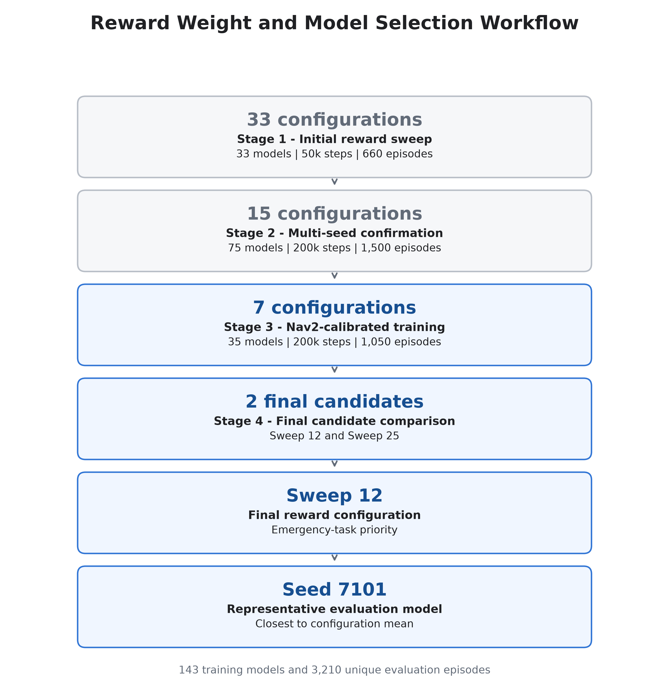

*Figure 1. Reward weight and model selection workflow.*

[PNG](figures/overview/01_reward_selection_workflow.png) · [SVG](figures/overview/01_reward_selection_workflow.svg)

Pareto dominance：A 在全部六指標不劣於 B 且至少一項較佳，即 A 支配 B。非支配配置構成 Pareto Front。Rank Sum 為六項名次等權加總（並列取平均名次），越低越好。以下分析依封存資料事後重算，不宣稱已復原全部歷史選擇規則。

## 7. Stage 1 — Initial Reward Sweep

33 組權重各訓練一個模型（Seed 7001、50k steps），使用 8101–8120 共 20 個評估種子，合計 660 Episodes。表格為評估平均值，時間單位秒。

| Config | W/A/Q/I | Avg Wait | P95 Wait | High Wait | Emergency Wait | Total Travel | Jain Fairness | Rank Sum | Pareto | Selected |
| --- | --- | --- | --- | --- | --- | --- | --- | --- | --- | --- |
| S01 | 0.35/0.25/0.25/0.15 | 308.04 | 2,152.87 | 175.21 | 89.90 | 365,581.97 | 0.8701 | 170 | No | No |
| S02 | 0.35/0.30/0.20/0.15 | 285.98 | 2,010.24 | 160.11 | 72.05 | 364,859.98 | 0.8818 | 110 | No | No |
| S03 | 0.35/0.30/0.25/0.10 | 294.88 | 2,103.64 | 146.67 | 71.62 | 364,177.11 | 0.9646 | 79 | Yes | Yes |
| S04 | 0.35/0.35/0.15/0.15 | 306.29 | 2,152.04 | 157.22 | 65.41 | 364,557.99 | 0.9373 | 107 | Yes | Yes |
| S05 | 0.35/0.35/0.20/0.10 | 300.33 | 1,871.90 | 163.63 | 81.19 | 365,595.01 | 0.8352 | 146 | No | No |
| S06 | 0.35/0.35/0.25/0.05 | 269.52 | 1,802.43 | 134.33 | 59.21 | 365,552.09 | 0.8794 | 59 | Yes | Yes |
| S07 | 0.40/0.25/0.20/0.15 | 294.68 | 2,198.00 | 152.18 | 77.51 | 364,507.64 | 0.8914 | 120 | No | No |
| S08 | 0.40/0.25/0.25/0.10 | 297.14 | 2,127.69 | 152.93 | 77.30 | 364,841.11 | 0.9252 | 117 | No | No |
| S09 | 0.40/0.30/0.15/0.15 | 294.49 | 1,992.38 | 157.90 | 58.41 | 363,822.58 | 0.9435 | 70 | Yes | Yes |
| S10 | 0.40/0.30/0.20/0.10 | 271.07 | 1,957.84 | 144.51 | 62.77 | 364,104.94 | 0.9253 | 45 | Yes | Yes |
| S11 | 0.40/0.30/0.25/0.05 | 285.55 | 2,073.18 | 151.95 | 76.35 | 365,219.72 | 0.8584 | 124 | No | No |
| S12 | 0.40/0.35/0.15/0.10 | 279.67 | 2,030.43 | 134.90 | 62.89 | 364,136.17 | 0.8708 | 63 | Yes | Yes |
| S13 | 0.40/0.35/0.20/0.05 | 278.47 | 1,828.70 | 138.06 | 52.56 | 364,530.87 | 0.8445 | 52 | Yes | Yes |
| S14 | 0.45/0.20/0.20/0.15 | 283.01 | 1,947.77 | 147.05 | 74.98 | 366,178.69 | 0.8623 | 114 | No | No |
| S15 | 0.45/0.25/0.15/0.15 | 299.90 | 1,945.13 | 179.16 | 92.24 | 365,528.02 | 0.9144 | 138 | No | No |
| S16 | 0.45/0.25/0.20/0.10 | 279.59 | 1,920.70 | 149.25 | 78.87 | 365,723.43 | 0.8857 | 103 | No | No |
| S17 | 0.45/0.25/0.25/0.05 | 283.99 | 1,915.80 | 142.63 | 63.85 | 365,889.92 | 0.9549 | 71 | Yes | Yes |
| S18 | 0.45/0.30/0.15/0.10 | 292.40 | 2,125.97 | 151.68 | 76.45 | 365,634.11 | 0.9251 | 124 | No | No |
| S19 | 0.45/0.30/0.20/0.05 | 285.50 | 2,054.74 | 141.47 | 67.59 | 364,482.12 | 0.9339 | 67 | Yes | Yes |
| S20 | 0.45/0.35/0.10/0.10 | 301.07 | 2,033.56 | 152.99 | 83.87 | 365,189.43 | 0.9227 | 128 | No | No |
| S21 | 0.45/0.35/0.15/0.05 | 273.36 | 1,957.71 | 130.25 | 58.03 | 365,521.68 | 0.8571 | 73 | Yes | Yes |
| S22 | 0.50/0.20/0.15/0.15 | 314.46 | 2,234.13 | 170.98 | 92.33 | 365,479.12 | 0.8444 | 181 | No | No |
| S23 | 0.50/0.20/0.20/0.10 | 292.42 | 2,049.86 | 142.55 | 55.48 | 364,505.61 | 0.8719 | 77 | Yes | Yes |
| S24 | 0.50/0.25/0.15/0.10 | 281.28 | 1,938.45 | 150.66 | 83.83 | 365,369.79 | 0.8624 | 112 | No | No |
| S25 | 0.50/0.25/0.20/0.05 | 285.47 | 2,009.01 | 146.81 | 58.37 | 364,714.21 | 0.9295 | 65 | Yes | Yes |
| S26 | 0.50/0.30/0.10/0.10 | 287.53 | 2,064.95 | 148.48 | 79.57 | 365,306.64 | 0.8691 | 125 | No | No |
| S27 | 0.50/0.30/0.15/0.05 | 279.99 | 1,850.61 | 132.83 | 66.64 | 364,894.47 | 0.9202 | 54 | Yes | Yes |
| S28 | 0.50/0.35/0.10/0.05 | 288.05 | 1,998.03 | 147.67 | 72.32 | 365,274.79 | 0.9096 | 100 | No | No |
| S29 | 0.55/0.20/0.15/0.10 | 333.96 | 2,211.77 | 218.35 | 92.53 | 365,903.71 | 0.8691 | 187 | No | No |
| S30 | 0.55/0.20/0.20/0.05 | 267.74 | 1,910.90 | 142.46 | 58.15 | 364,766.19 | 0.9410 | 34 | Yes | Yes |
| S31 | 0.55/0.25/0.10/0.10 | 307.54 | 2,165.52 | 165.98 | 64.27 | 365,069.38 | 0.9400 | 120 | No | No |
| S32 | 0.55/0.25/0.15/0.05 | 299.30 | 2,297.00 | 159.89 | 71.41 | 365,228.52 | 0.9008 | 134 | No | No |
| S33 | 0.55/0.30/0.10/0.05 | 281.83 | 1,885.22 | 147.83 | 83.41 | 364,665.74 | 0.8456 | 97 | Yes | Yes |

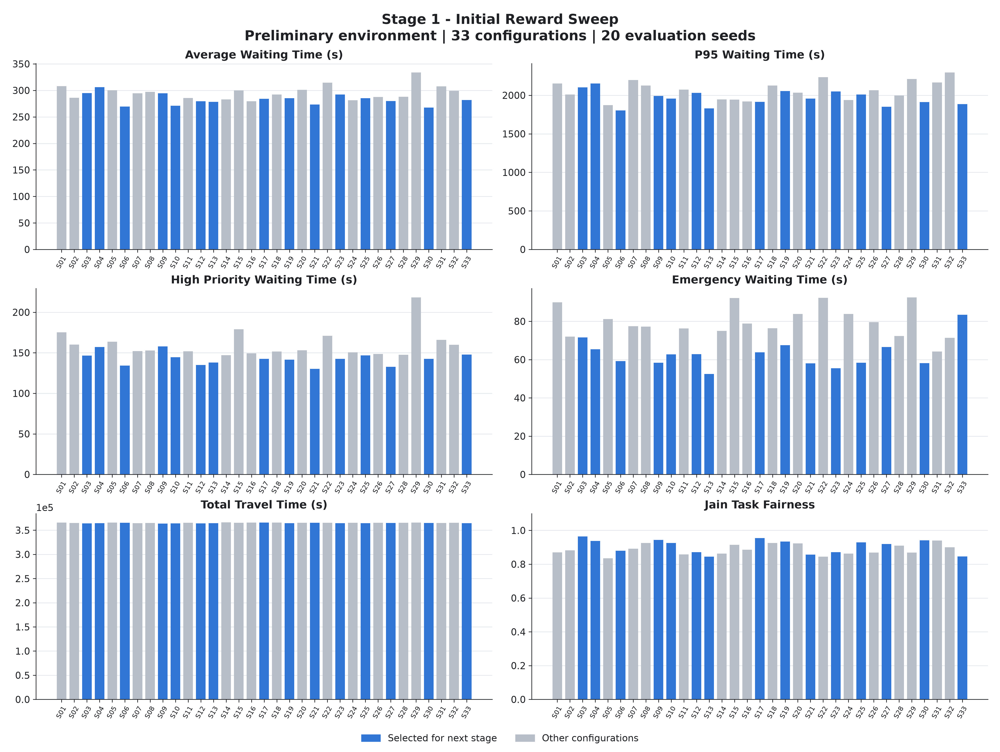

*Figure 3. Stage 1 performance.*

[PNG](figures/stage1/03_stage1_performance.png) · [SVG](figures/stage1/03_stage1_performance.svg)

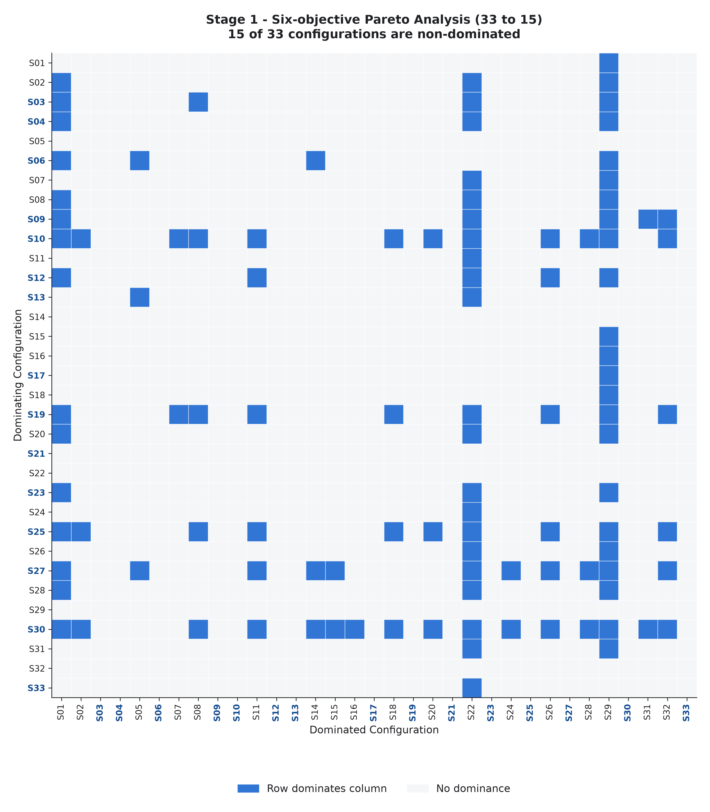

*Figure 4. Stage 1 six-objective dominance matrix.*

[PNG](figures/stage1/04_stage1_pareto_analysis.png) · [SVG](figures/stage1/04_stage1_pareto_analysis.svg)

保留候選： S03, S04, S06, S09, S10, S12, S13, S17, S19, S21, S23, S25, S27, S30, S33

| Dominated | Dominated by |
| --- | --- |
| S01 | sweep02, sweep03, sweep04, sweep06, sweep08, sweep09, sweep10, sweep12, sweep19, sweep20, sweep23, sweep25, sweep27, sweep28, sweep30 |
| S02 | sweep10, sweep25, sweep30 |
| S05 | sweep06, sweep13, sweep27 |
| S07 | sweep10, sweep19 |
| S08 | sweep03, sweep10, sweep19, sweep25, sweep30 |
| S11 | sweep10, sweep12, sweep19, sweep25, sweep27, sweep30 |
| S14 | sweep06, sweep27, sweep30 |
| S15 | sweep27, sweep30 |
| S16 | sweep30 |
| S18 | sweep10, sweep19, sweep25, sweep30 |
| S20 | sweep10, sweep25, sweep30 |
| S22 | sweep02, sweep03, sweep04, sweep07, sweep08, sweep09, sweep10, sweep11, sweep12, sweep13, sweep19, sweep20, sweep23, sweep24, sweep25, sweep26, sweep27, sweep28, sweep30, sweep31, sweep33 |
| S24 | sweep27, sweep30 |
| S26 | sweep10, sweep12, sweep19, sweep25, sweep27, sweep30 |
| S28 | sweep10, sweep27, sweep30 |
| S29 | sweep01, sweep02, sweep03, sweep04, sweep06, sweep07, sweep08, sweep09, sweep10, sweep12, sweep15, sweep16, sweep17, sweep18, sweep19, sweep20, sweep23, sweep25, sweep26, sweep27, sweep28, sweep30, sweep31 |
| S31 | sweep09, sweep30 |
| S32 | sweep09, sweep10, sweep19, sweep25, sweep27, sweep30 |

[完整分析 CSV](data/stage1_initial_sweep/pareto_analysis.csv)

## 8. Stage 2 — Multi-seed Pareto Confirmation

15 組候選各使用 7001、7101–7104 五個模型種子，200k steps，評估種子 8101–8120。兩批（5 組、10 組）合併後共 75 模型、1,500 Episodes。表中為模型平均值之 Mean ± sample SD。

| Config | W/A/Q/I | Avg Wait | P95 Wait | High Wait | Emergency Wait | Total Travel | Jain Fairness | Rank Sum | Pareto | Selected |
| --- | --- | --- | --- | --- | --- | --- | --- | --- | --- | --- |
| S03 | 0.35/0.30/0.25/0.10 | 267.94 ± 10.66 | 1,911.41 ± 128.87 | 133.93 ± 12.27 | 63.15 ± 4.64 | 364,915.31 ± 623.93 | 0.9062 ± 0.0384 | 36 | Yes | Yes |
| S04 | 0.35/0.35/0.15/0.15 | 271.26 ± 10.54 | 1,989.84 ± 92.25 | 131.33 ± 13.34 | 60.11 ± 5.21 | 365,011.30 ± 599.20 | 0.8803 ± 0.0321 | 48 | Yes | Yes |
| S06 | 0.35/0.35/0.25/0.05 | 271.38 ± 7.26 | 1,964.96 ± 19.29 | 135.38 ± 5.48 | 65.13 ± 9.00 | 364,612.33 ± 290.84 | 0.9083 ± 0.0188 | 38 | Yes | Yes |
| S09 | 0.40/0.30/0.15/0.15 | 276.13 ± 9.03 | 2,065.92 ± 86.04 | 135.71 ± 10.41 | 64.90 ± 8.26 | 364,973.85 ± 192.65 | 0.9025 ± 0.0203 | 70 | No | No |
| S10 | 0.40/0.30/0.20/0.10 | 273.80 ± 13.23 | 1,982.39 ± 129.29 | 140.87 ± 18.05 | 68.58 ± 7.83 | 365,232.09 ± 815.49 | 0.8972 ± 0.0330 | 73 | No | No |
| S12 | 0.40/0.35/0.15/0.10 | 275.46 ± 7.30 | 2,021.67 ± 79.89 | 131.76 ± 4.56 | 57.00 ± 8.44 | 364,795.67 ± 550.98 | 0.9097 ± 0.0102 | 43 | Yes | Yes |
| S13 | 0.40/0.35/0.20/0.05 | 271.71 ± 8.53 | 1,990.71 ± 96.88 | 132.56 ± 11.88 | 61.25 ± 11.41 | 364,877.02 ± 664.02 | 0.8984 ± 0.0256 | 48 | No | No |
| S17 | 0.45/0.25/0.25/0.05 | 275.44 ± 11.01 | 2,027.75 ± 137.68 | 136.11 ± 14.26 | 68.81 ± 7.84 | 365,073.61 ± 421.19 | 0.9041 ± 0.0368 | 73 | No | No |
| S19 | 0.45/0.30/0.20/0.05 | 271.38 ± 20.12 | 1,984.56 ± 198.75 | 130.77 ± 13.30 | 65.24 ± 11.36 | 364,830.73 ± 221.68 | 0.9017 ± 0.0271 | 43 | No | No |
| S21 | 0.45/0.35/0.15/0.05 | 260.74 ± 4.97 | 1,903.43 ± 48.47 | 122.81 ± 4.63 | 61.85 ± 6.23 | 364,790.27 ± 398.82 | 0.8914 ± 0.0045 | 25 | Yes | Yes |
| S23 | 0.50/0.20/0.20/0.10 | 272.07 ± 12.88 | 1,980.47 ± 131.19 | 140.26 ± 18.56 | 65.41 ± 9.06 | 364,925.96 ± 658.42 | 0.9107 ± 0.0182 | 52 | No | No |
| S25 | 0.50/0.25/0.20/0.05 | 273.01 ± 7.22 | 2,029.76 ± 37.05 | 130.33 ± 10.77 | 70.14 ± 7.52 | 365,171.14 ± 1,383.57 | 0.9282 ± 0.0219 | 56 | Yes | Yes |
| S27 | 0.50/0.30/0.15/0.05 | 267.93 ± 12.03 | 1,943.33 ± 119.48 | 127.65 ± 15.00 | 60.18 ± 13.93 | 364,738.84 ± 374.18 | 0.9236 ± 0.0311 | 14 | Yes | Yes |
| S30 | 0.55/0.20/0.20/0.05 | 273.66 ± 9.33 | 2,020.33 ± 97.21 | 131.76 ± 11.48 | 69.00 ± 8.72 | 364,897.27 ± 386.93 | 0.9075 ± 0.0242 | 55 | No | No |
| S33 | 0.55/0.30/0.10/0.05 | 268.64 ± 4.79 | 1,959.82 ± 81.94 | 134.71 ± 2.99 | 70.89 ± 7.44 | 364,933.09 ± 487.09 | 0.9116 ± 0.0233 | 46 | No | No |

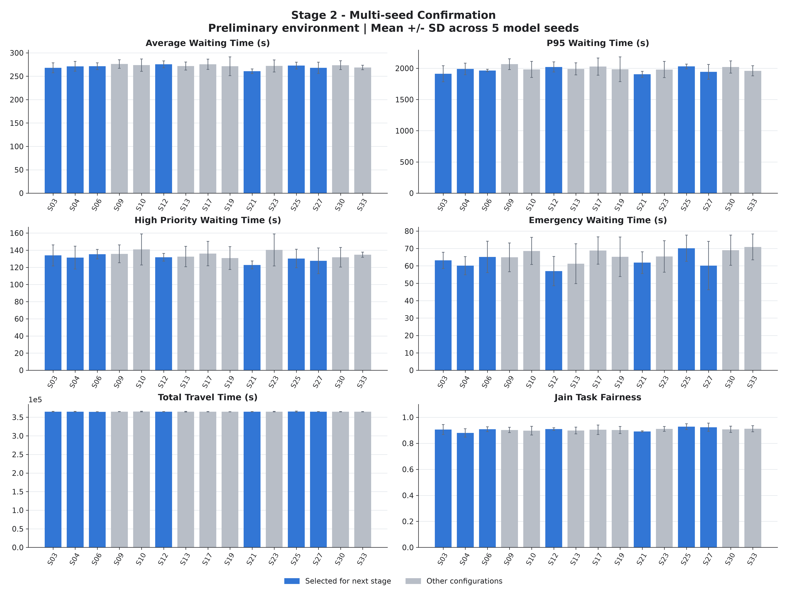

*Figure 5. Stage 2 multi-seed performance.*

[PNG](figures/stage2/05_stage2_multiseed_performance.png) · [SVG](figures/stage2/05_stage2_multiseed_performance.svg)

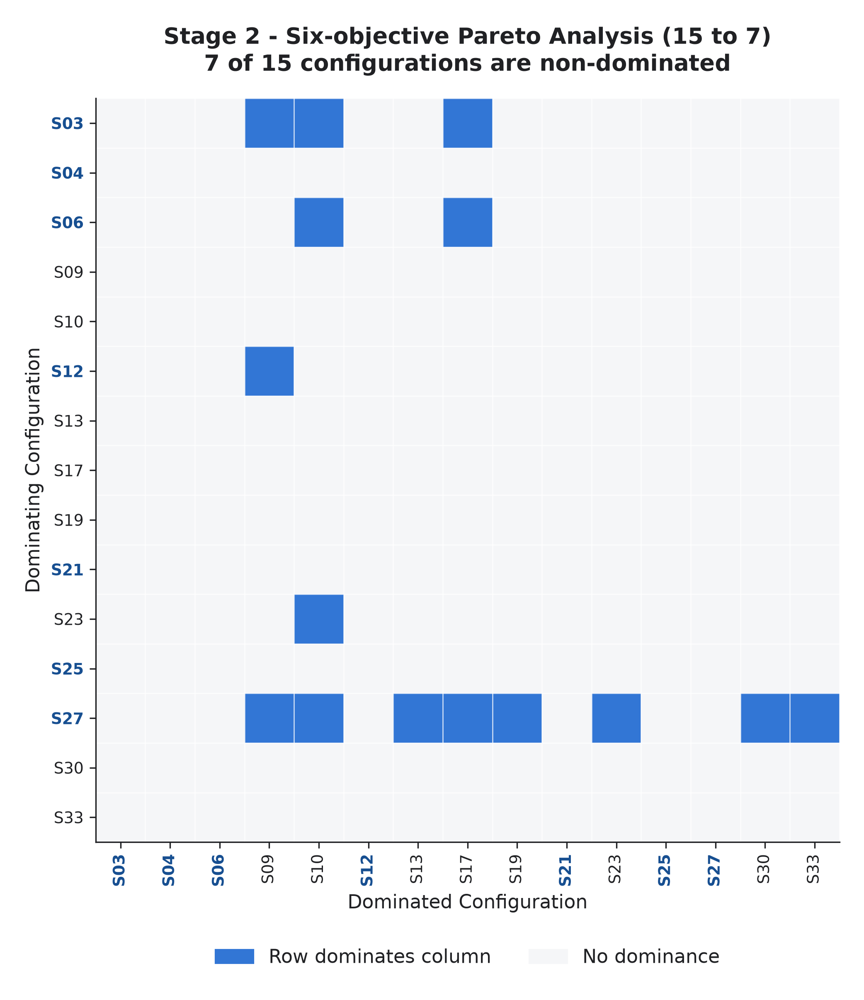

*Figure 6. Stage 2 six-objective dominance matrix.*

[PNG](figures/stage2/06_stage2_pareto_analysis.png) · [SVG](figures/stage2/06_stage2_pareto_analysis.svg)

保留候選： S03, S04, S06, S12, S21, S25, S27

| Dominated | Dominated by |
| --- | --- |
| S09 | sweep03, sweep12, sweep27 |
| S10 | sweep03, sweep06, sweep23, sweep27 |
| S13 | sweep27 |
| S17 | sweep03, sweep06, sweep27 |
| S19 | sweep27 |
| S23 | sweep27 |
| S30 | sweep27 |
| S33 | sweep27 |

[完整分析 CSV](data/stage2_pareto_confirmation/pareto_analysis.csv)

## 9. Nav2 Environment Calibration｜導航環境校準

使用 Gazebo / Nav2 批次導航測試資料校準排程模擬器，而非直接在 Gazebo 逐步訓練 PPO。31 條路線各測試 5 次，共 155 次成功導航，實測有效速度為 0.328967742 m/s。

有實測路線使用平均移動時間，否則以導航圖最短路徑距離除以有效速度（各有效路線平均速度的算術平均）。
$$
T(s,d)=\begin{cases}\overline T_{\mathrm{Nav2}}(s,d),&\text{empirical route}\\D_{\mathrm{graph}}(s,d)/v_{\mathrm{effective}},&\text{fallback}\end{cases}
$$

| Task type | Source | Destination | N | Mean (s) | SD (s) | Distance (m) | Speed (m/s) |
| --- | --- | --- | --- | --- | --- | --- | --- |
| waste_transport | ward_a_2 | waste_return_2 | 5 | 96.048 | 11.725 | 34.961 | 0.368 |
| waste_transport | ward_b_2 | waste_return_2 | 5 | 111.084 | 41.738 | 31.677 | 0.311 |
| waste_transport | consult_1_2 | waste_return_2 | 5 | 77.364 | 12.332 | 27.851 | 0.367 |
| waste_transport | consult_2_2 | waste_return_2 | 5 | 79.294 | 13.453 | 26.956 | 0.348 |
| waste_transport | consult_3_2 | waste_return_2 | 5 | 82.108 | 13.192 | 29.939 | 0.372 |
| waste_transport | nurse_station | waste_return_2 | 5 | 68.25 | 11.338 | 21.522 | 0.323 |
| waste_transport | blood_draw | waste_return_2 | 5 | 73.096 | 12.409 | 23.744 | 0.334 |
| waste_transport | x-ray | waste_return_2 | 5 | 46.24 | 1.921 | 14.905 | 0.323 |
| waste_transport | ultrasound_2 | waste_return_2 | 5 | 49.564 | 5.419 | 13.795 | 0.281 |
| waste_transport | ecg_2 | waste_return_2 | 5 | 42.76 | 3.822 | 10.747 | 0.253 |
| waste_transport | therapy_room | waste_return_2 | 5 | 26.518 | 1.048 | 7.122 | 0.269 |
| clothes_collection | ward_a_2 | clothes_return_2 | 5 | 80.606 | 4.554 | 26.948 | 0.335 |
| clothes_collection | ward_b_2 | clothes_return_2 | 5 | 73.11 | 4.733 | 23.011 | 0.316 |
| clothes_collection | x-ray | clothes_return_2 | 5 | 61.774 | 5.552 | 22.924 | 0.374 |
| clothes_collection | ultrasound_2 | clothes_return_2 | 5 | 73.324 | 14.917 | 24.247 | 0.341 |
| clothes_collection | ecg_2 | clothes_return_2 | 5 | 66.726 | 3.913 | 21.055 | 0.316 |
| clothes_collection | therapy_room | clothes_return_2 | 5 | 51.308 | 2.914 | 16.737 | 0.327 |
| specimen_delivery | ward_a_2 | lab | 5 | 37.052 | 2.976 | 10.764 | 0.292 |
| specimen_delivery | ward_b_2 | lab | 5 | 34.476 | 3.879 | 9.918 | 0.291 |
| specimen_delivery | consult_1_2 | lab | 5 | 55.64 | 2.769 | 19.687 | 0.354 |
| specimen_delivery | consult_2_2 | lab | 5 | 47.548 | 3.628 | 15.667 | 0.331 |
| specimen_delivery | consult_3_2 | lab | 5 | 39.216 | 5.916 | 12.133 | 0.315 |
| specimen_delivery | blood_draw | lab | 5 | 26.818 | 2.441 | 8.263 | 0.31 |
| medication_delivery | pharmacy | ward_a_2 | 5 | 115.296 | 13.755 | 40.171 | 0.352 |
| medication_delivery | pharmacy | ward_b_2 | 5 | 99.026 | 11.773 | 36.369 | 0.372 |
| medication_delivery | pharmacy | consult_1_2 | 5 | 91.646 | 15.2 | 32.336 | 0.362 |
| medication_delivery | pharmacy | consult_2_2 | 5 | 84.698 | 12.145 | 31.571 | 0.379 |
| medication_delivery | pharmacy | consult_3_2 | 5 | 98.304 | 24.932 | 34.455 | 0.365 |
| medication_delivery | pharmacy | nurse_station | 5 | 80.36 | 14.662 | 26.051 | 0.334 |
| ward_service | nurse_station | ward_a_2 | 5 | 47.2 | 5.908 | 14.026 | 0.301 |
| ward_service | nurse_station | ward_b_2 | 5 | 35.776 | 1.355 | 10.065 | 0.282 |

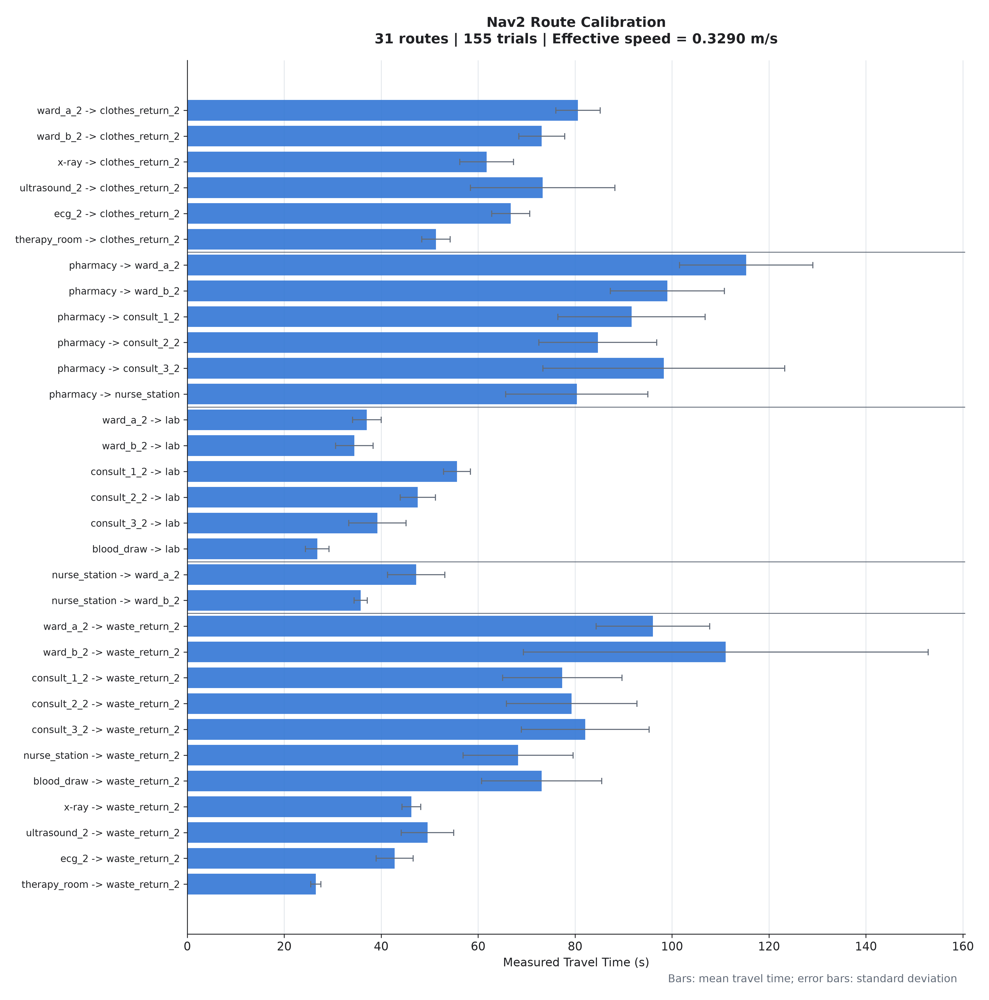

*Figure 7. Nav2 route calibration.*

[PNG](figures/stage3/07_nav2_route_calibration.png) · [SVG](figures/stage3/07_nav2_route_calibration.svg)

100% 成功率僅適用於這 155 次指定導航測試，不代表任意路線或多機器人同時導航均成功。

[Raw trials](data/nav2_calibration/batch_route_results_nav2.csv) · [Route summary](data/nav2_calibration/batch_route_summary_nav2.csv)

## 10. Stage 3 — Nav2-Calibrated Reward Confirmation

七組候選重新訓練，各五個 Model Seeds（7001、7101–7104），200k steps，評估種子 9501–9530，共 35 模型及 1,050 Episodes。不是沿用前期模型權重。

| Config | W/A/Q/I | Avg Wait | P95 Wait | High Wait | Emergency Wait | Total Travel | Jain Fairness | Rank Sum | Pareto | Selected |
| --- | --- | --- | --- | --- | --- | --- | --- | --- | --- | --- |
| S03 | 0.35/0.30/0.25/0.10 | 99.21 ± 6.03 | 491.34 ± 27.14 | 52.28 ± 5.79 | 30.32 ± 4.23 | 246,777.17 ± 419.32 | 0.8828 ± 0.0256 | 25 | Yes | No |
| S04 | 0.35/0.35/0.15/0.15 | 99.68 ± 10.80 | 503.28 ± 95.55 | 52.12 ± 7.37 | 30.77 ± 6.81 | 247,322.49 ± 563.39 | 0.8620 ± 0.0358 | 37 | No | No |
| S06 | 0.35/0.35/0.25/0.05 | 97.13 ± 5.66 | 496.91 ± 45.78 | 51.59 ± 8.36 | 25.08 ± 6.27 | 246,823.60 ± 527.38 | 0.8819 ± 0.0489 | 21 | Yes | No |
| S12 | 0.40/0.35/0.15/0.10 | 97.40 ± 10.27 | 471.96 ± 60.73 | 52.05 ± 7.45 | 24.98 ± 6.49 | 247,172.95 ± 720.07 | 0.8859 ± 0.0604 | 20 | Yes | Yes |
| S21 | 0.45/0.35/0.15/0.05 | 95.32 ± 5.38 | 456.41 ± 58.89 | 52.80 ± 6.99 | 28.36 ± 3.38 | 246,823.13 ± 388.49 | 0.8563 ± 0.0462 | 24 | Yes | No |
| S25 | 0.50/0.25/0.20/0.05 | 92.88 ± 6.18 | 438.62 ± 41.17 | 49.25 ± 6.05 | 33.18 ± 7.02 | 246,910.35 ± 142.22 | 0.9045 ± 0.0214 | 15 | Yes | Yes |
| S27 | 0.50/0.30/0.15/0.05 | 94.49 ± 6.06 | 478.04 ± 43.60 | 52.30 ± 3.83 | 29.32 ± 4.42 | 247,115.29 ± 366.52 | 0.8774 ± 0.0479 | 26 | Yes | No |

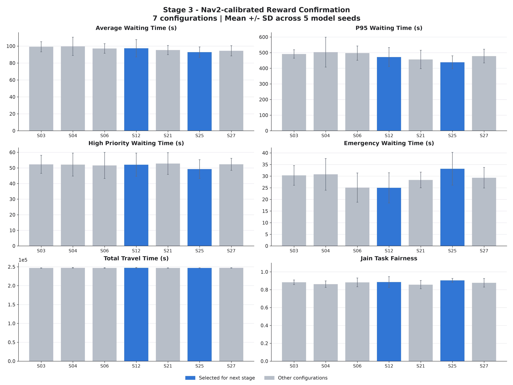

*Figure 8. Nav2-calibrated performance.*

[PNG](figures/stage3/08_stage3_nav2_performance.png) · [SVG](figures/stage3/08_stage3_nav2_performance.svg)

Sweep 04 被 Sweep 06、12 支配，剩六組 Pareto 候選；依重算 Rank Sum 選出 Sweep 25（15）及 Sweep 12（20），與歷史候選一致。

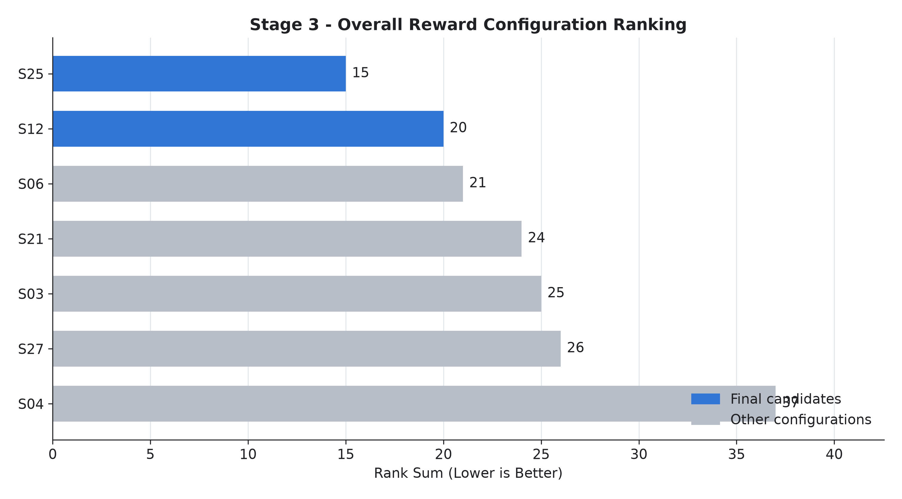

*Figure 9. Stage 3 rank sum.*

[PNG](figures/stage3/09_stage3_rank_sum.png) · [SVG](figures/stage3/09_stage3_rank_sum.svg)

### 10.1 全部 35 個模型結果

| Config | Seed | Avg Wait | P95 Wait | High Wait | Emergency Wait | Total Travel | Jain Fairness | Global Rank Sum |
| --- | --- | --- | --- | --- | --- | --- | --- | --- |
| S12 | 7104 | 89.91 | 423.48 | 45.41 | 17.44 | 246,240.79 | 0.9375 | 22 |
| S25 | 7102 | 85.12 | 412.91 | 40.37 | 23.38 | 246,775.12 | 0.9308 | 27 |
| S06 | 7101 | 93.50 | 477.23 | 45.43 | 14.18 | 246,219.83 | 0.9328 | 47 |
| S03 | 7102 | 89.29 | 448.66 | 44.44 | 24.34 | 246,435.28 | 0.8824 | 51 |
| S21 | 7103 | 87.87 | 388.63 | 46.42 | 24.73 | 246,624.84 | 0.8519 | 55 |
| S12 | 7102 | 93.15 | 465.86 | 48.66 | 20.55 | 246,700.14 | 0.9278 | 62 |
| S04 | 7102 | 94.23 | 442.02 | 44.19 | 27.35 | 246,731.95 | 0.8982 | 69 |
| S25 | 7103 | 91.13 | 390.64 | 45.57 | 30.91 | 247,109.68 | 0.9117 | 75 |
| S06 | 7001 | 90.59 | 448.86 | 44.05 | 30.20 | 247,585.33 | 0.9362 | 77 |
| S12 | 7001 | 89.51 | 442.11 | 49.46 | 23.69 | 247,850.39 | 0.8983 | 81 |
| S27 | 7101 | 90.73 | 464.10 | 46.86 | 24.47 | 246,821.60 | 0.8611 | 84 |
| S04 | 7001 | 88.86 | 431.92 | 46.11 | 26.36 | 247,279.49 | 0.8406 | 87 |
| S21 | 7101 | 91.43 | 425.42 | 50.32 | 26.46 | 247,002.95 | 0.8627 | 89 |
| S06 | 7103 | 96.19 | 477.15 | 47.80 | 26.24 | 246,500.25 | 0.8611 | 91 |
| S04 | 7101 | 95.70 | 447.04 | 51.59 | 29.17 | 246,854.53 | 0.8909 | 98 |
| S21 | 7102 | 99.84 | 537.84 | 50.72 | 26.72 | 246,416.27 | 0.9103 | 98 |
| S27 | 7102 | 86.88 | 415.96 | 52.12 | 30.88 | 247,499.01 | 0.8852 | 98 |
| S21 | 7001 | 97.86 | 437.37 | 51.78 | 32.56 | 246,664.31 | 0.8732 | 102 |
| S27 | 7104 | 101.83 | 532.81 | 55.81 | 25.43 | 246,667.10 | 0.9337 | 107 |
| S25 | 7104 | 90.73 | 437.89 | 53.83 | 41.54 | 246,784.15 | 0.8722 | 112 |
| S03 | 7001 | 98.93 | 500.93 | 51.98 | 27.40 | 246,908.65 | 0.8976 | 115 |
| S27 | 7103 | 93.94 | 475.81 | 50.67 | 35.29 | 247,155.00 | 0.9012 | 117 |
| S25 | 7101 | 95.81 | 452.98 | 52.37 | 38.15 | 246,891.24 | 0.8987 | 119 |
| S03 | 7101 | 100.27 | 511.43 | 60.00 | 32.78 | 246,250.78 | 0.9161 | 122 |
| S25 | 7001 | 101.60 | 498.69 | 54.09 | 31.90 | 246,991.56 | 0.9090 | 132 |
| S12 | 7101 | 100.40 | 451.30 | 52.02 | 32.69 | 247,177.59 | 0.8802 | 134 |
| S06 | 7102 | 100.47 | 513.57 | 63.32 | 27.59 | 246,748.93 | 0.8435 | 146 |
| S03 | 7104 | 105.22 | 481.32 | 55.03 | 34.15 | 247,044.00 | 0.8685 | 155 |
| S03 | 7103 | 102.35 | 514.36 | 49.96 | 32.90 | 247,247.13 | 0.8496 | 157 |
| S27 | 7001 | 99.06 | 501.55 | 56.04 | 30.51 | 247,433.73 | 0.8059 | 159 |
| S06 | 7104 | 104.89 | 567.75 | 57.33 | 27.18 | 247,063.64 | 0.8359 | 162 |
| S04 | 7103 | 102.77 | 539.93 | 56.74 | 28.16 | 247,657.11 | 0.8682 | 165 |
| S21 | 7104 | 99.62 | 492.81 | 64.77 | 31.31 | 247,407.32 | 0.7836 | 169 |
| S12 | 7103 | 114.03 | 577.07 | 64.69 | 30.51 | 247,895.84 | 0.7858 | 192 |
| S04 | 7104 | 116.85 | 655.48 | 61.96 | 42.82 | 248,089.37 | 0.8122 | 204 |

[Configuration analysis](data/stage3_nav2_confirmation/pareto_analysis.csv) · [Model ranking](data/stage3_nav2_confirmation/model_ranking.csv) · [Raw episodes](data/stage3_nav2_confirmation/confirmation_episode_runs.csv)

## 11. Stage 4 — Final Reward Configuration Selection

兩組候選各 5 個模型、150 Episodes，沿用 Stage 3。Sweep 12 權重為 (0.40, 0.35, 0.15, 0.10)，Sweep 25 為 (0.50, 0.25, 0.20, 0.05)。

| Metric | Sweep 12 (Mean ± SD) | Sweep 25 (Mean ± SD) |
| --- | --- | --- |
| Avg Wait | 97.40 ± 10.27 | 92.88 ± 6.18 |
| P95 Wait | 471.96 ± 60.73 | 438.62 ± 41.17 |
| High Wait | 52.05 ± 7.45 | 49.25 ± 6.05 |
| Emergency Wait | 24.98 ± 6.49 | 33.18 ± 7.02 |
| Total Travel | 247,172.95 ± 720.07 | 246,910.35 ± 142.22 |
| Jain Fairness | 0.8859 ± 0.0604 | 0.9045 ± 0.0214 |

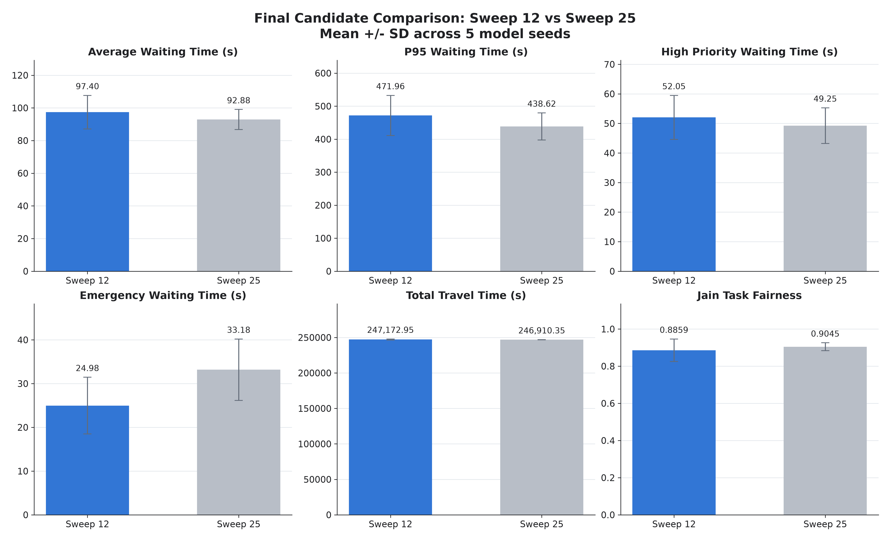

*Figure 10. Final candidate comparison.*

[PNG](figures/stage4/10_final_candidate_comparison.png) · [SVG](figures/stage4/10_final_candidate_comparison.svg)

Sweep 25 六項指標有五項平均較佳；Sweep 12 緊急任務平均等待時間 24.98 s，相較 33.18 s 減少 8.20 s（24.71%），五個配對 Model Seeds 全部較佳。

| Seed | Sweep 12 (s) | Sweep 25 (s) | Improvement |
| --- | --- | --- | --- |
| 7001 | 23.6930 | 31.9043 | 25.74% |
| 7101 | 32.6924 | 38.1539 | 14.31% |
| 7102 | 20.5532 | 23.3831 | 12.10% |
| 7103 | 30.5150 | 30.9057 | 1.26% |
| 7104 | 17.4352 | 41.5395 | 58.03% |

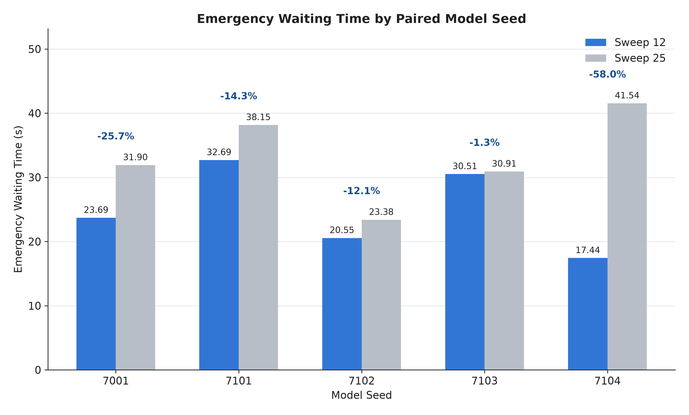

*Figure 11. Emergency waiting time by paired model seed.*

[PNG](figures/stage4/11_emergency_wait_by_model_seed.png) · [SVG](figures/stage4/11_emergency_wait_by_model_seed.svg)

### 11.1 統計分析

正差值統一表示 Sweep 12 較佳。歷史 Hierarchical Bootstrap 對模型種子與各模型內的情境種子重抽樣；補充 Crossed Bootstrap 對共同模型與情境種子交叉配對重抽樣，10,000 次，RNG seed 20261127。另對五個模型平均值進行 paired t-test、Wilcoxon，分別以六指標為一族進行 Holm 校正。

| Metric | Difference | Historical 95% CI | Crossed 95% CI | t p | Wilcoxon p | Holm t p | Holm Wilcoxon p |
| --- | --- | --- | --- | --- | --- | --- | --- |
| Avg Wait | -4.5227 | [-16.3173, 6.5625] | [-16.6688, 6.7908] | 0.4735 | 0.6250 | 1.0000 | 1.0000 |
| P95 Wait | -33.3438 | [-124.3898, 39.3483] | [-129.8426, 45.5215] | 0.4725 | 1.0000 | 1.0000 | 1.0000 |
| High Wait | -2.8023 | [-13.0128, 6.3950] | [-13.7623, 6.8531] | 0.6007 | 1.0000 | 1.0000 | 1.0000 |
| Emergency Wait | 8.1995 | [0.2262, 17.4247] | [-0.9398, 18.2438] | 0.1217 | 0.0625 | 0.7299 | 0.3750 |
| Total Travel | -262.5985 | [-720.3385, 211.4697] | [-737.2635, 237.5641] | 0.3762 | 0.4375 | 1.0000 | 1.0000 |
| Jain Fairness | -0.0186 | [-0.0795, 0.0337] | [-0.0790, 0.0339] | 0.5782 | 0.4375 | 1.0000 | 1.0000 |

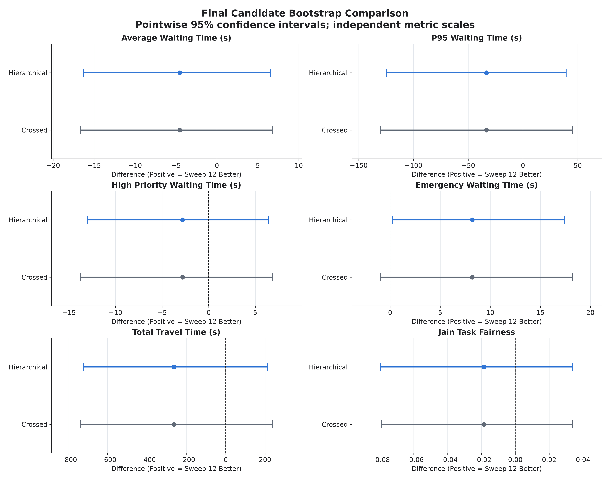

*Figure 12. Pointwise bootstrap confidence intervals.*

[PNG](figures/stage4/12_bootstrap_confidence_intervals.png) · [SVG](figures/stage4/12_bootstrap_confidence_intervals.svg)

歷史緊急等待 CI 未跨零，但 Crossed CI 跨零，兩種檢定及 Holm 校正均未達 0.05。因此採用 Sweep 12 是醫療時效需求導向的描述性效能取捨，不宣稱穩健統計顯著優勢。

[Historical bootstrap](data/stage4_final_selection/hierarchical_paired_bootstrap.csv) · [Supplementary statistics](data/stage4_final_selection/final_candidate_statistics.csv) · [Emergency by seed](data/stage4_final_selection/emergency_wait_by_seed.csv)

## 12. Representative Model Selection｜代表模型選擇

以六項指標的標準化偏差均方根衡量模型與配置平均值的距離：
$$
z_{ij}=\frac{x_{ij}-\mu_j}{s_j},\qquad D_i=\sqrt{\frac{1}{6}\sum_{j=1}^6 z_{ij}^2}
$$
距離越低越接近配置平均表現。

| Seed | Avg Wait | P95 Wait | High Wait | Emergency Wait | Total Travel | Jain Fairness | Within Rank Sum | Distance | Representative Rank |
| --- | --- | --- | --- | --- | --- | --- | --- | --- | --- |
| 7101 | 100.40 | 451.30 | 52.02 | 32.69 | 247,177.59 | 0.8802 | 23 | 0.520377 | 1 |
| 7102 | 93.15 | 465.86 | 48.66 | 20.55 | 246,700.14 | 0.9278 | 15 | 0.542336 | 2 |
| 7001 | 89.51 | 442.11 | 49.46 | 23.69 | 247,850.39 | 0.8983 | 16 | 0.565492 | 3 |
| 7104 | 89.91 | 423.48 | 45.41 | 17.44 | 246,240.79 | 0.9375 | 7 | 0.976203 | 4 |
| 7103 | 114.03 | 577.07 | 64.69 | 30.51 | 247,895.84 | 0.7858 | 29 | 1.470485 | 5 |

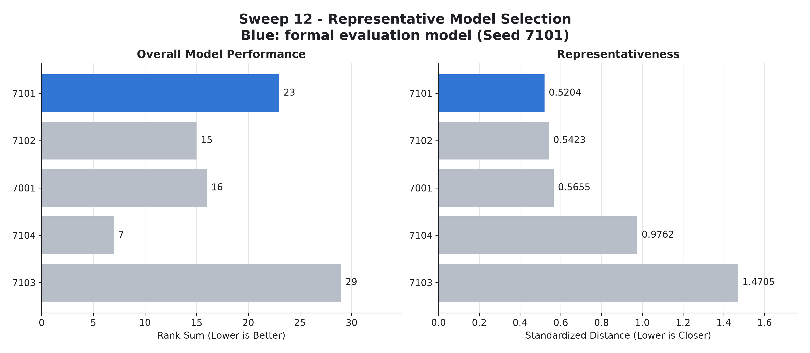

*Figure 13. Performance versus representativeness.*

[PNG](figures/stage4/13_representative_model_selection.png) · [SVG](figures/stage4/13_representative_model_selection.svg)

Seed 7104 效能排名最佳；Seed 7101 最接近配置平均值，且為歷史正式 Baseline 評估使用的模型。代表性距離屬事後補充分析，不是已證實的歷史選擇程序；亦不能消除所有選擇偏差或替代多模型比較。

[Representative model analysis](data/stage4_final_selection/representative_model_selection.csv)

## 13. Final PPO Configuration｜正式評估模型

| Parameter | Value |
| --- | --- |
| Algorithm | Maskable PPO |
| Environment | Nav2-calibrated battery_v2 |
| Config / Seed | Sweep 12 / 7101 |
| W/A/Q/I | 0.40 / 0.35 / 0.15 / 0.10 |
| Observation / Action | 98 / 7 |
| Fleet / Workload | (2,2,3) / 4.0× |
| Requested / actual steps | 200,000 / 200,192 |
| Selection evaluation seeds | 9501–9530 |
| Formal baseline evaluation seeds | 9601–9630 |
| Model identity | Verified |
| System deployment | Pending |

模型路徑：
experiments/fleet_sizing/results_rl/models/reward_confirm_nav2_sweep12_w40_a35_q15_i10_seed7101_200k/final_model.zip
SHA-256：
1972295e176e6907d3bee4d01b301fa10526dac40dca38a5e867fe1a63825d07
正式 Baseline 比較已採用此模型。部署程式仍待統一並完成整合測試。

## 14. Research Limitations｜研究限制

1. 前期與 Nav2 校準環境不同，不直接比較其效能差異作為改善證據。
2. Nav2 僅重新訓練七組權重，無法宣稱全部 33 組或連續權重空間的全域最優。
3. 最終候選各五個訓練種子，統計推論受樣本數限制；共用評估情境存在相關性。
4. Bootstrap 為個別指標信賴區間，非同時信賴區間；Holm 僅校正對應檢定。
5. 緊急等待優勢為描述性結果，未獲跨方法一致顯著性支持。
6. Rank Sum 與代表性分析為事後補充；單一代表模型不能呈現全部訓練變異。
7. 路線平均值無法完整反映交通壅塞、碰撞、動態阻塞及多機器人交互影響。
8. 歷史 Metadata 未完整保存精確訓練 commit、全部環境輸入 Hash 及獨立 Observation scale。
9. Fleet Sizing 對更新環境的適用性仍待交叉確認。

## 15. Reproducibility and Data Archive｜資料封存與可重現性

已封存 161 份原始檔案（含 143 份 Metadata），7 份衍生 CSV（106 筆），13 組正式圖表（26 檔），原有 Scale 圖表 8 組。原始檔、分析檔與圖檔已通過各自完整性驗證。全部模型權重仍保留於原始 results_rl/models，未複製至本章。

```text
05_reward_weight_selection/
├── README.md
├── archive_reward_selection.py
├── analyze_reward_selection.py
├── plot_reward_selection.py
├── data/
│   ├── scale_selection/
│   ├── stage1_initial_sweep/
│   ├── stage2_pareto_confirmation/
│   ├── stage3_nav2_confirmation/
│   ├── stage4_final_selection/
│   ├── nav2_calibration/
│   ├── reward_selection_manifest.json
│   ├── reward_selection_analysis_manifest.json
│   └── reward_selection_figure_manifest.json
└── figures/
    ├── scale_selection/
    ├── overview/
    ├── stage1/
    ├── stage2/
    ├── stage3/
    └── stage4/
```

從專案根目錄執行：

```bash
source .venv_rl/bin/activate
DOC=experiments/fleet_sizing/docs/05_reward_weight_selection
python "$DOC/archive_reward_selection.py"
python "$DOC/analyze_reward_selection.py"
python "$DOC/plot_reward_selection.py"
```

以上重建封存、分析及圖表，不重新訓練 PPO。本 README 為依已提供的實驗輸出直接整理的 Markdown 文件，表格為顯示精度，完整精度以封存 CSV 為準。資料完整性與分析可重現性不等同於重新訓練可重現性。

### 15.1 Historical experiment scripts

原始程式位於 experiments/fleet_sizing/rl/。

| Purpose | Script |
| --- | --- |
| Initial sweep | run_reward_weight_sweep.py |
| Initial evaluation | evaluate_reward_weight_sweep.py |
| Confirmation | run_reward_weight_confirmation.py |
| Remaining Pareto candidates | run_pareto_reward_confirmation.py |
| Nav2 training | run_pareto_reward_confirmation_nav2.py |
| Nav2 evaluation | evaluate_pareto_reward_confirmation_nav2.py |
| Historical candidate analysis | analyze_nav2_final_reward_candidates.py |
| Training | train_battery_v2.py |
| Evaluation | evaluate_battery_v2.py |

歷史程式可能隨開發更新，不直接重新執行以覆蓋既有結果。

### 15.2 Integrity manifests

- [Source archive manifest](data/reward_selection_manifest.json)
- [Analysis manifest](data/reward_selection_analysis_manifest.json)
- [Figure manifest](data/reward_selection_figure_manifest.json)

## 16. Conclusion｜研究結論

本研究由 240 組排列組合產生 33 組合法候選，透過初步訓練、多種子驗證與 Pareto Front 篩選至七組。以 31 條路線、155 次 Nav2 導航資料校準排程模擬器後重新訓練 35 個模型，完成 1,050 筆正式環境評估。經多目標排名及醫療緊急任務需求取捨，採用 Sweep 12；相較 Sweep 25，緊急等待時間平均改善 24.71%，但未獲穩健統計顯著性支持。

正式評估模型為 Nav2 Sweep 12 — Seed 7101，權重 (0.40, 0.35, 0.15, 0.10)。下一章以此模型與四種 Baseline 進行不同 Workload 的成果比較；系統部署一致性另於整合階段驗證。
