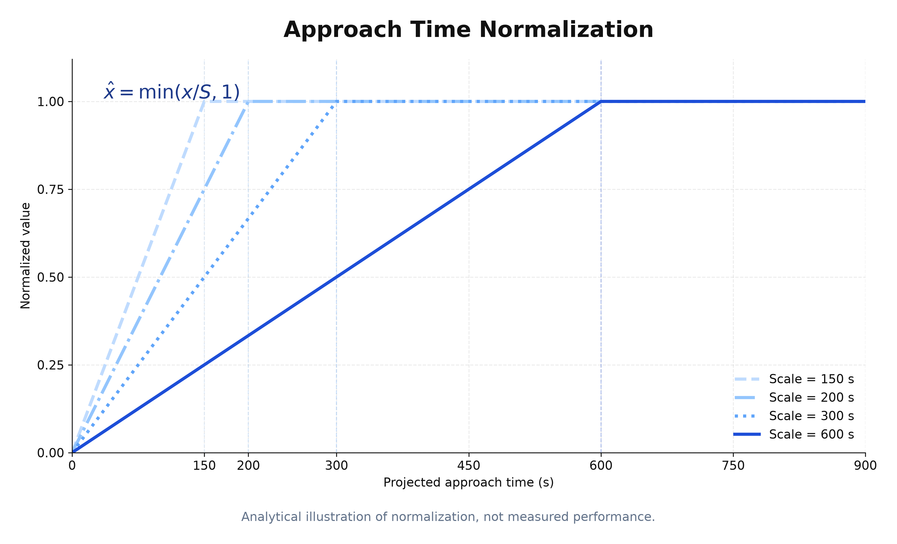
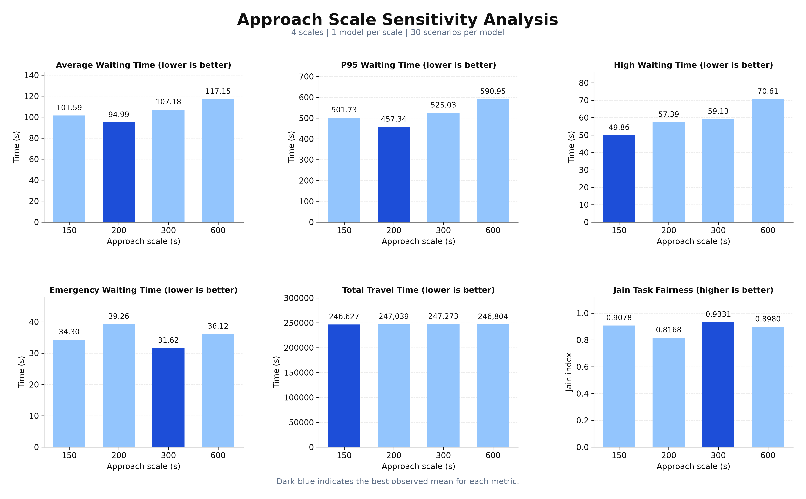
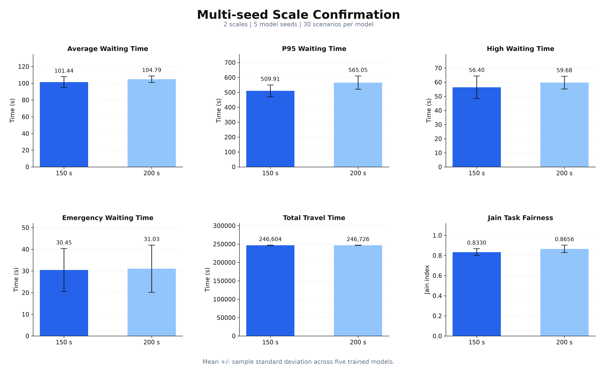
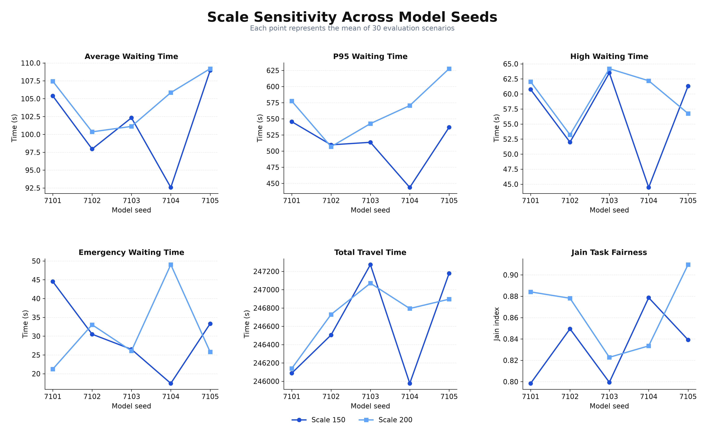
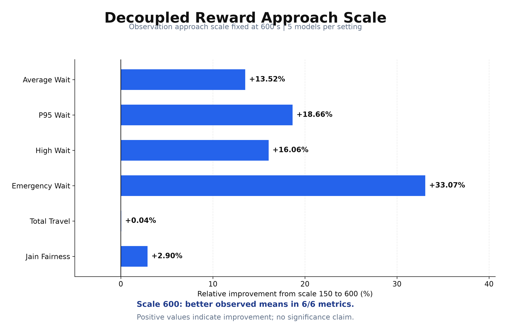
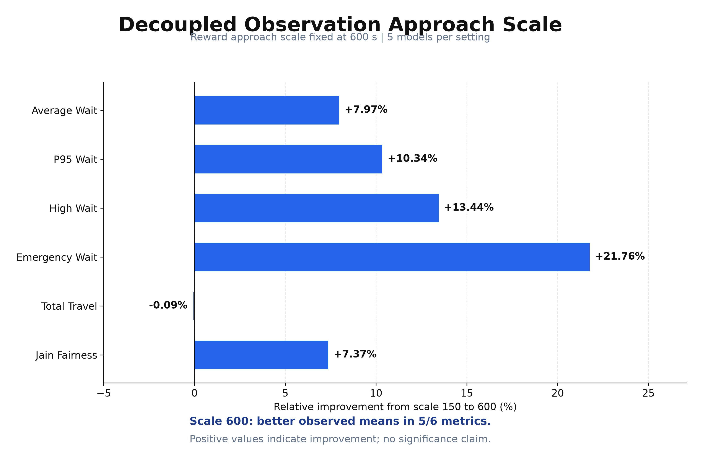
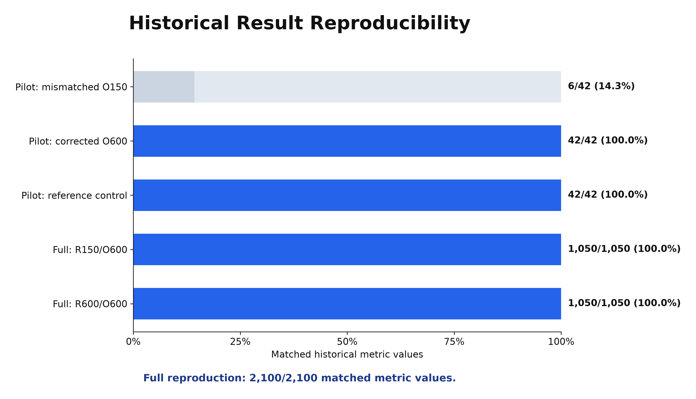
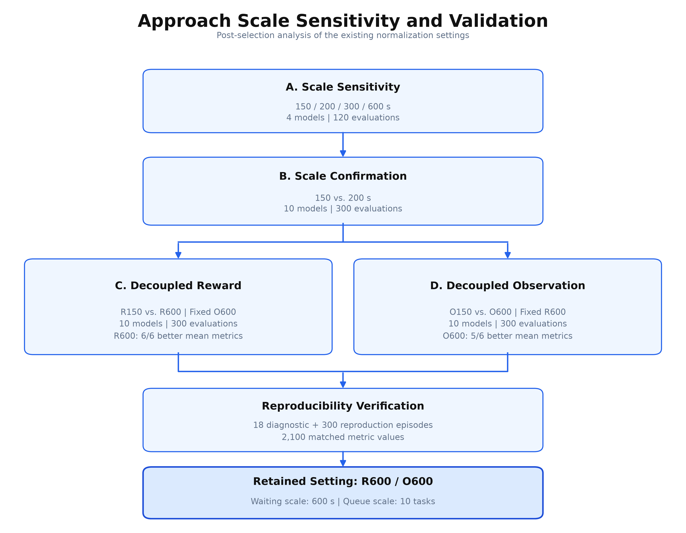

# Approach Scale Sensitivity and Reproducibility Analysis

醫療異質多機器人智慧任務調度系統 —
Observation 與 Reward 正規化尺度敏感度分析

---

## 1. 研究目的

本研究的 Maskable PPO 模型使用固定尺度，
將預估來源地移動時間、實際等待時間及任務數量
轉換為正規化數值。

正規化尺度可能影響：

- Observation 的特徵辨識能力。
- Reward 各項懲罰的實際大小。
- 模型訓練時的策略學習。
- 部署時的派工決策。
- 最終任務等待時間與分配公平性。

本章主要探討以下問題：

1. 不同 Approach Scale 是否影響派工效能？
2. 初步實驗結果是否能在不同 Model Seeds 下維持？
3. Reward Scale 與 Observation Scale 分別具有何種影響？
4. 目前使用的 600 秒設定是否具有實驗支持？
5. 評估時使用不同的 Observation Scale 是否影響結果重現？

本章屬於既有 Reward 權重及模型選擇之後的
補充敏感度分析，而非原始模型選擇之前的實驗。

目前固定使用的 Sweep 27、Seed 7104 模型
不因本章實驗而重新訓練或更換。

相關模型設計：
[PPO Design](../../../04_ppo_design/README.md)

---

## 2. Normalization Design

### 2.1 正規化公式

對於非負數值 x 與正規化尺度 S：

$$
\hat{x}=\min\left(\frac{x}{S},1\right)
$$

正規化結果介於 0 與 1 之間。

當 x 大於或等於 S 時，
正規化結果固定為 1。

因此較小的 Scale 容易使特徵提前飽和，
但較大的 Scale 也可能壓縮較短時間的數值差異。



### 2.2 Observation Approach Scale

用於將預估前往來源地的移動時間
轉換為 PPO 的 Observation 特徵。

$$
\hat{A}_{obs}
=
\min\left(
\frac{T_{approach}}{S_{obs}},1
\right)
$$

### 2.3 Reward Approach Scale

用於計算預估來源地移動時間懲罰。

$$
P_A=
w_A
\min\left(
\frac{T_{approach}}{S_{reward}},1
\right)
$$

其中 w_A 為 Approach Reward Weight。

Observation Scale 與 Reward Scale
在程式中可分別設定，
兩者不必具有相同數值。

### 2.4 其他固定尺度

| Parameter | Value |
|---|---:|
| Reward Waiting Scale | 600 s |
| Reward Tasks Ahead Scale | 10 tasks |
| Observation Load Scale | 10 tasks |
| Observation Tasks Ahead Scale | 10 tasks |

本章未對上述四項固定尺度進行完整搜尋。

因此本章結果只能用於說明
Approach Scale 的敏感度，
不能宣稱所有正規化參數均為實驗最佳值。

---

## 3. Experimental Configuration

### 3.1 共用設定

| Setting | Value |
|---|---|
| Algorithm | MaskablePPO |
| Environment | HospitalSchedulingEnv |
| Fleet configuration | (2,2,3) |
| Number of robots | 7 |
| Workload multiplier | 4.0 |
| Battery model | Enabled |
| Requested training timesteps | 50000 |
| Evaluation scenario seeds | 9501–9530 |
| Evaluation scenarios per model | 30 |
| Inference | Deterministic |
| Action mask | Enabled |
| Waiting weight | 0.50 |
| Approach weight | 0.30 |
| Queue weight | 0.15 |
| Imbalance weight | 0.05 |

每個模型使用相同的一組三十個評估情境，
以降低不同任務情境造成的比較偏差。

上述 Seeds 已經用於模型敏感度分析，
不得再將其視為後續獨立測試的新情境。

### 3.2 Evaluation Metrics

| Metric | Direction |
|---|---|
| Average Waiting Time | Lower |
| P95 Waiting Time | Lower |
| High Waiting Time | Lower |
| Emergency Waiting Time | Lower |
| Total Travel Time | Lower |
| Jain Task Fairness | Higher |
| Completion Rate | Higher |

前六項為主要效能比較指標。

Completion Rate 作為額外的任務完成情況檢查。

### 3.3 Statistical Aggregation

每個訓練模型先對三十個情境的結果取平均。

$$
\bar{x}_m
=
\frac{1}{30}
\sum_{s=1}^{30}x_{m,s}
$$

多 Model Seed 實驗再計算五個模型平均值的平均：

$$
\bar{x}
=
\frac{1}{5}
\sum_{m=1}^{5}\bar{x}_m
$$

模型間樣本標準差：

$$
SD
=
\sqrt{
\frac{
\sum_{m=1}^{5}(\bar{x}_m-\bar{x})^2
}{5-1}
}
$$

圖表中的誤差棒代表不同訓練模型之間的樣本標準差，
而非信賴區間。

P95 Waiting Time 使用各 Episode 的 P95 進行平均，
不是將所有 Episode 的任務等待時間合併後重新計算 P95。

### 3.4 Relative Improvement

對於越低越好的指標：

$$
Improvement
=
\frac{x_{old}-x_{new}}{x_{old}}\times100\%
$$

對於越高越好的指標：

$$
Improvement
=
\frac{x_{new}-x_{old}}{x_{old}}\times100\%
$$

正值表示改善，負值表示退步。

本章改善幅度均為描述性平均值比較，
不代表統計顯著性。

---

## 4. Experiment A — Scale Sensitivity

### 4.1 實驗設計

初步測試四種 Approach Scale：

- 150 s
- 200 s
- 300 s
- 600 s

每種尺度使用一個模型，
Model Seed 為 7001。

每個模型訓練指定 50000 Timesteps，
再使用三十個相同評估情境。

總評估數：

$$
4\times1\times30=120
$$

目前保存的評估程式在未額外指定 Observation Scale 時，
會使 Reward Approach Scale 與 Observation Approach Scale
使用相同數值。

但本批歷史訓練 Metadata
未獨立記錄 Observation Approach Scale，
因此訓練時的完整輸入尺度仍存在證據限制。

### 4.2 實驗結果

所有時間指標的單位為秒。

| Scale | Avg Wait | P95 Wait | High Wait | Emergency Wait | Travel | Jain |
|---:|---:|---:|---:|---:|---:|---:|
| 150 | 101.59 | 501.73 | 49.86 | 34.30 | 246627.29 | 0.9078 |
| 200 | 94.99 | 457.34 | 57.39 | 39.26 | 247039.01 | 0.8168 |
| 300 | 107.18 | 525.03 | 59.13 | 31.62 | 247273.15 | 0.9331 |
| 600 | 117.15 | 590.95 | 70.61 | 36.12 | 246803.52 | 0.8980 |



### 4.3 結果分析

| Metric | Best observed scale |
|---|---:|
| Average Waiting Time | 200 |
| P95 Waiting Time | 200 |
| High Waiting Time | 150 |
| Emergency Waiting Time | 300 |
| Total Travel Time | 150 |
| Jain Task Fairness | 300 |

200 秒具有較好的平均等待及 P95 等待時間。

150 秒具有較好的 High Waiting Time
及 Total Travel Time。

300 秒具有較好的 Emergency Waiting Time
及 Jain Task Fairness。

因此沒有單一尺度在所有指標中勝出。

後續選擇 150 與 200 秒進行確認，
符合以等待時間為主要研究目標的方向。

但 300 秒仍有部分指標優勢，
不能視為已被全面證明劣於其他尺度。

由於每組只有一個訓練模型，
初步結果可能受到 Model Seed 影響。

### 4.4 原始資料

- [Episode results](sensitivity/episode_results.csv)
- [Scale summary](sensitivity/summary.csv)

原始評估程式：
[evaluate_scale_sensitivity.py](../../../../rl/evaluate_scale_sensitivity.py)

---

## 5. Experiment B — Scale Confirmation

### 5.1 實驗設計

選擇 150 與 200 秒，
增加訓練模型數量以觀察跨模型穩定性。

| Setting | Value |
|---|---|
| Scales | 150, 200 |
| Model seeds | 7101–7105 |
| Models per scale | 5 |
| Total models | 10 |
| Evaluation scenarios per model | 30 |
| Total evaluation records | 300 |

$$
2\times5\times30=300
$$

本批歷史 Metadata 同樣未獨立保存
訓練時的 Observation Approach Scale。

### 5.2 實驗結果

| Metric | Scale 150 | Scale 200 |
|---|---:|---:|
| Average Wait | 101.44 | 104.79 |
| P95 Wait | 509.91 | 565.05 |
| High Wait | 56.40 | 59.68 |
| Emergency Wait | 30.45 | 31.03 |
| Total Travel | 246604.40 | 246725.93 |
| Jain Task Fairness | 0.8330 | 0.8656 |
| Completion Rate | 100% | 100% |



### 5.3 Model Seed Stability



平均等待時間的跨模型變異：

| Scale | Mean | Sample SD |
|---|---:|---:|
| 150 | 101.44 | 6.40 |
| 200 | 104.79 | 3.90 |

150 秒具有較低的平均等待時間，
但 200 秒在平均等待時間上的跨模型變異較小。

各 Seed 的排序並不完全一致，
表示單一 Model Seed 的結果
不足以完整反映尺度設定的效能。

### 5.4 結果分析

150 秒在六項主要指標中的五項平均表現較佳。

200 秒則具有較好的 Jain Task Fairness。

但前兩項實驗未充分分離
Reward Scale 與 Observation Scale 的影響。

因此進一步設計兩項獨立尺度實驗。

### 5.5 原始資料

- [Episode results](confirmation/episode_results.csv)
- [Model seed summary](confirmation/model_seed_summary.csv)
- [Aggregate summary](confirmation/aggregate_summary.csv)

原始評估程式：
[evaluate_scale_confirmation.py](../../../../rl/evaluate_scale_confirmation.py)

---

## 6. Experiment C — Decoupled Reward Scale

### 6.1 實驗設計

固定 Observation Approach Scale = 600 秒。

比較：

| Configuration | Reward Scale | Observation Scale |
|---|---:|---:|
| R150/O600 | 150 | 600 |
| R600/O600 | 600 | 600 |

每組使用五個不同 Model Seeds，
每個模型使用三十個評估情境。

共十個模型與三百筆評估紀錄。

訓練 Metadata 已明確記錄
上述 Reward Scale 與 Observation Scale。

### 6.2 實驗結果

| Metric | R150/O600 | R600/O600 | Improvement |
|---|---:|---:|---:|
| Average Wait | 111.16 | 96.13 | 13.52% |
| P95 Wait | 587.59 | 477.93 | 18.66% |
| High Wait | 64.55 | 54.18 | 16.06% |
| Emergency Wait | 40.21 | 26.91 | 33.07% |
| Total Travel | 247182.90 | 247073.52 | 0.04% |
| Jain Task Fairness | 0.8546 | 0.8794 | 2.90% |
| Completion Rate | 100% | 100% | Equal |



改善比例以原始完整精度數值計算，
而非使用表格中四捨五入後的數字。

### 6.3 結果分析

R600 在六項主要評估指標的平均表現均優於 R150。

其中 Emergency Waiting Time 改善約 33.07%，
為相對改善幅度最大的主要指標。

Total Travel 的改善只有約 0.04%，
實際差異相對小。

因此本實驗支持保留 Reward Approach Scale 600 秒。

此結論限於本實驗的尺度候選、
模型設定及評估情境，
不代表 600 秒是全域最佳尺度。

本實驗歷史數據已完成
三百次評估的完整重現性驗證。

### 6.4 原始資料

- [Episode results](decoupled_reward/episode_results.csv)
- [Model seed summary](decoupled_reward/model_seed_summary.csv)
- [Aggregate summary](decoupled_reward/aggregate_summary.csv)

原始評估程式：
[evaluate_decoupled_reward_scale.py](../../../../rl/evaluate_decoupled_reward_scale.py)

原始評估程式存在參數傳遞缺漏，
詳見第九節。

---

## 7. Experiment D — Decoupled Observation Scale

### 7.1 實驗設計

固定 Reward Approach Scale = 600 秒。

比較：

| Configuration | Reward Scale | Observation Scale |
|---|---:|---:|
| R600/O150 | 600 | 150 |
| R600/O600 | 600 | 600 |

每組使用五個不同 Model Seeds，
每個模型評估三十個情境。

共十個模型與三百筆評估紀錄。

### 7.2 實驗結果

| Metric | R600/O150 | R600/O600 | Improvement |
|---|---:|---:|---:|
| Average Wait | 104.46 | 96.13 | 7.97% |
| P95 Wait | 533.03 | 477.93 | 10.34% |
| High Wait | 62.59 | 54.18 | 13.44% |
| Emergency Wait | 34.39 | 26.91 | 21.76% |
| Total Travel | 246863.11 | 247073.52 | -0.09% |
| Jain Task Fairness | 0.8191 | 0.8794 | 7.37% |
| Completion Rate | 100% | 100% | Equal |



### 7.3 結果分析

O600 在六項主要評估指標中的五項平均表現較佳。

四項等待時間指標皆有所改善，
Jain Task Fairness 亦有所提升。

Total Travel 則略微增加約 0.09%。

較大的 Observation Scale
能保留較長 Approach Time 之間的差異，
減少過早飽和的問題。

這是可能的解釋，
但本實驗未單獨證明特徵飽和
是效能差異的唯一原因。

因此本實驗支持保留
Observation Approach Scale 600 秒，
並接受少量 Total Travel 的取捨。

### 7.4 原始資料

- [Episode results](decoupled_observation/episode_results.csv)
- [Model seed summary](decoupled_observation/model_seed_summary.csv)
- [Aggregate summary](decoupled_observation/aggregate_summary.csv)

原始評估程式：
[evaluate_decoupled_observation_scale.py](../../../../rl/evaluate_decoupled_observation_scale.py)

---

## 8. Shared Control Consistency

Experiment C 與 Experiment D
共同使用五個 R600/O600 模型。

共同 Model Seeds：

```text
7101, 7102, 7103, 7104, 7105
```

共同 Evaluation Seeds：

```text
9501–9530
```

共用評估紀錄：

$$
5\times30=150
$$

每個 Episode 比對七項效能指標。

$$
150\times7=1050
$$

驗證結果：

| Item | Result |
|---|---:|
| Shared episode records | 150 |
| Compared metric values | 1050 |
| Matched metric values | 1050 |
| Mismatches | 0 |

兩項歷史實驗在共用 R600/O600 設定下，
所有比對數值均一致。

共用的五個模型及一百五十筆評估紀錄
不應視為額外的獨立模型與獨立觀測。

---

## 9. Evaluation Implementation Issue

### 9.1 問題辨識

現存 evaluate_decoupled_reward_scale.py
原本預期固定 Observation Scale 為 600：

```python
REWARD_SCALES = (150, 600)
OBSERVATION_SCALE = 600
```

但呼叫 evaluate_one 時，
未明確傳入 Observation Scale：

```python
result = evaluate_one(
    model=model,
    scale=reward_scale,
    seed=eval_seed,
)
```

共用評估函式在未收到 Observation Scale 時，
會使用 scale 作為 Observation Approach Scale。

因此 R150/O600 模型可能被錯誤地使用
O150 進行評估。

### 9.2 正確評估設定

應明確指定 Observation Scale：

```python
result = evaluate_one(
    model=model,
    scale=reward_scale,
    seed=eval_seed,
    observation_scale=600,
)
```

本研究保留原始評估程式，
並使用獨立診斷及重現程式進行驗證。

### 9.3 歷史資料處理原則

- 不直接覆蓋歷史 CSV。
- 不直接修改歷史模型。
- 不重新訓練已保存的模型。
- 新評估結果儲存在獨立資料夾。
- 透過 SHA256 確認受保護檔案未被修改。

現存評估程式具有參數缺漏，
並不代表歷史 CSV 必然使用錯誤設定產生。

因此需要實際重現歷史結果。

---

## 10. Diagnostic Pilot Experiment

### 10.1 實驗設定

| Setting | Value |
|---|---|
| Model seeds | 7101, 7104 |
| Evaluation seeds | 9501, 9502, 9503 |
| Model files | 4 |
| Evaluation cases | 3 |
| Total episodes | 18 |

比較三種設定：

| Case | Trained Model | Evaluation R | Evaluation O |
|---|---|---:|---:|
| Mismatched input scale | R150/O600 | 150 | 150 |
| Corrected input scale | R150/O600 | 150 | 600 |
| Reference control | R600/O600 | 600 | 600 |

原始診斷 CSV 使用 historical_behavior
表示第一種假設設定。

根據診斷結果，
此名稱不代表歷史實際行為，
應解讀為 Mismatched Observation Scale。

### 10.2 實驗結果

| Metric | Mismatched O150 | Corrected O600 | Reference |
|---|---:|---:|---:|
| Average Wait | 111.06 | 99.61 | 76.75 |
| P95 Wait | 615.20 | 532.91 | 339.88 |
| High Wait | 62.23 | 51.22 | 40.93 |
| Emergency Wait | 61.08 | 47.31 | 17.48 |
| Total Travel | 244749.03 | 245223.21 | 244650.19 |
| Jain Task Fairness | 0.8286 | 0.8293 | 0.8923 |
| Completion Rate | 100% | 100% | 100% |

### 10.3 歷史結果重現程度

| Case | Matched | Compared |
|---|---:|---:|
| Mismatched O150 | 6 | 42 |
| Corrected O600 | 42 | 42 |
| Reference control | 42 | 42 |

錯誤 Observation Scale 只有 Completion Rate 一致，
其餘六項主要效能指標均無法重現。

正確指定 O600 後，
六個抽查情境的全部指標均一致。

因此歷史 CSV 更符合正確尺度設定下的結果。

### 10.4 原始資料

- [Pilot episode results](diagnostics/pilot/episode_results.csv)
- [Historical comparison](diagnostics/pilot/historical_comparison.csv)
- [Pilot summary](diagnostics/pilot/summary.csv)
- [Diagnostic metadata](diagnostics/pilot/diagnostic_metadata.json)

診斷程式：
[diagnose_reward_scale.py](../../diagnose_reward_scale.py)

---

## 11. Full Reproducibility Verification

### 11.1 完整評估設定

使用十個既有 Decoupled Reward Scale 模型，
並明確固定 Observation Scale 為 600。

| Setting | Value |
|---|---|
| Reward scales | 150, 600 |
| Observation scale | 600 |
| Model seeds | 7101–7105 |
| Evaluation seeds | 9501–9530 |
| Models | 10 |
| Evaluation episodes | 300 |
| Metric comparisons | 2100 |
| Model retraining | No |

### 11.2 數值比對條件

使用 math.isclose() 進行浮點數比對。

| Tolerance | Value |
|---|---:|
| Relative tolerance | 1e-9 |
| Absolute tolerance | 1e-8 |

因此本章所稱數值一致，
是指在上述浮點數容許誤差內一致，
不代表所有浮點數必然逐位元完全相同。

### 11.3 完整重現結果

| Case | Matched | Compared | Mismatches |
|---|---:|---:|---:|
| R150/O600 | 1050 | 1050 | 0 |
| R600/O600 | 1050 | 1050 | 0 |
| Total | 2100 | 2100 | 0 |



三百次評估的全部二千一百項指標數值，
均在指定容許誤差內重現。

導航資料、共用環境設定、
模型 Metadata 與受保護檔案 SHA256
均通過驗證。

### 11.4 結論

現存歷史評估程式存在參數傳遞缺漏。

然而，歷史 Decoupled Reward Scale 數據
已使用正確 Observation Scale 完整重現，
因此可以繼續用於研究分析。

目前無法確認歷史 CSV 產生時
所使用的完整程式版本。

本章不對未保存的歷史操作進行推測。

完整重現驗證針對 Experiment C，
並不代表其餘三項歷史 Scale 實驗
也都已重新執行。

### 11.5 原始資料

- [Reproduction episodes](diagnostics/full_reproduction/episode_results.csv)
- [Historical comparison](diagnostics/full_reproduction/historical_comparison.csv)
- [Reproduction summary](diagnostics/full_reproduction/summary.csv)
- [Reproduction metadata](diagnostics/full_reproduction/diagnostic_metadata.json)

完整驗證程式：
[verify_reward_scale_full.py](../../verify_reward_scale_full.py)

---

## 12. Overall Experiment Summary



### 12.1 實驗規模

| Experiment | Model records | Evaluation records |
|---|---:|---:|
| Scale Sensitivity | 4 | 120 |
| Scale Confirmation | 10 | 300 |
| Decoupled Reward | 10 | 300 |
| Decoupled Observation | 10 | 300 |
| Historical total | 34 | 1020 |

其中兩項 Decoupled 實驗共用五個模型。

因此不重複的歷史訓練模型名稱共有：

$$
34-5=29
$$

### 12.2 補充驗證規模

| Experiment | New evaluations |
|---|---:|
| Diagnostic pilot | 18 |
| Full reproduction | 300 |
| Total | 318 |

本次補充驗證未重新訓練模型。

歷史評估與新增驗證共 1338 筆紀錄，
但包含共同對照組及重複重現性評估，
不是 1338 個獨立情境。

---

## 13. Retained Normalization Configuration

### 13.1 Approach Scale

| Parameter | Retained value | Evidence |
|---|---:|---|
| Reward Approach Scale | 600 s | 6/6 better observed means |
| Observation Approach Scale | 600 s | 5/6 better observed means |

### 13.2 Other Normalization Parameters

| Parameter | Retained value |
|---|---:|
| Reward Waiting Scale | 600 s |
| Reward Tasks Ahead Scale | 10 tasks |
| Observation Load Scale | 10 tasks |
| Observation Tasks Ahead Scale | 10 tasks |

上述其他尺度為既有固定設定，
並非本章敏感度分析選出的最佳值。

### 13.3 Research Interpretation

本章結果支持保留現有的 R600/O600 設定。

Reward Approach Scale 600 秒
在指定比較中具有較好的六項平均效能。

Observation Approach Scale 600 秒
具有較好的等待時間及分配公平性，
但 Total Travel 略微增加。

本研究因此保留現有設定，
而非替換已選定的最終 PPO 模型。

---

## 14. Limitations

1. 初步 Scale Sensitivity 每組只有一個 Model Seed。

2. Scale Sensitivity 與 Scale Confirmation 的歷史 Metadata
   未明確保存訓練時的 Observation Approach Scale。

3. Decoupled 實驗每組只有五個訓練模型。

4. 未對全部可能的正規化尺度進行搜尋。

5. 未建立包含所有 Reward Scale 與 Observation Scale
   組合的完整因子實驗。

6. 本章未進行 Waiting Scale 或 Tasks Ahead Scale
   的獨立敏感度分析。

7. 使用固定七台機器人與 4.0x Workload，
   不代表其他車隊規模或工作負載必然具有相同結論。

8. 各項改善幅度為描述性平均值比較，
   尚未進行統計顯著性檢定。

9. 兩項 Decoupled 實驗使用共用 R600/O600 對照組，
   不能視為完全獨立的實驗。

10. 完整重現性驗證只涵蓋 Decoupled Reward Scale 實驗。

11. 現存歷史評估程式具有參數傳遞缺漏，
    歷史 CSV 的完整程式版本尚未確認。

12. 600 秒設定具有後續實驗支持，
    但不能宣稱其為所有情況中的全域最佳尺度。

13. 本章是在原始 Reward 權重選擇之後進行，
    不應描述為原始模型選擇前的超參數搜尋。

14. 本章 Scope 為正規化尺度分析，
    不直接證明 PPO 優於全部 Baselines。

---

## 15. Data Integrity and Archive

### 15.1 封存資料

| Category | Files |
|---|---:|
| Scale sensitivity | 2 |
| Scale confirmation | 3 |
| Decoupled reward | 3 |
| Decoupled observation | 3 |
| Pilot diagnostics | 4 |
| Full reproduction | 4 |
| Training metadata | 29 |
| Archive manifest | 1 |
| Total original archive files | 49 |

49 份為建立本 README 之前的原始封存檔案數。

本 README 為額外的研究說明文件，
不屬於原始 Archive Manifest 的複製清單。

### 15.2 驗證結果

| Verification | Result |
|---|---:|
| Historical models with metadata | 29 |
| Verified numeric values | 5859 |
| Verified copied files | 48 |
| Source SHA256 validation | PASS |
| Archive SHA256 validation | PASS |
| Shared control consistency | PASS |
| Full historical reproduction | PASS |

封存階段未重新執行模擬，
亦未重新訓練模型。

完整清單：
[Archive manifest](archive_manifest.json)

### 15.3 Training Metadata

共保存二十九份原始訓練 Metadata，
位於 training_metadata/。

模型本體仍保留於原始 results_rl/models/。

封存資料夾未重複複製大型模型檔案。

---

## 16. Reproducibility

### 16.1 環境設定

從專案根目錄執行：

```bash
source .venv_rl/bin/activate

export PYTHONPATH="$PWD:$PWD/experiments/fleet_sizing${PYTHONPATH:+:$PYTHONPATH}"
```

### 16.2 Pilot Diagnostics

```bash
python -u \
experiments/fleet_sizing/docs/05_reward_weight_selection/diagnose_reward_scale.py
```

此程式會執行十八次診斷評估。

不會重新訓練模型。

### 16.3 Full Reproduction

```bash
python -u \
experiments/fleet_sizing/docs/05_reward_weight_selection/verify_reward_scale_full.py
```

此程式會執行三百次完整重現評估。

上述兩支評估程式均具有輸出防覆蓋機制。
重新執行時應使用獨立工作副本或新輸出目錄。

### 16.4 Archive

```bash
python -u \
experiments/fleet_sizing/docs/05_reward_weight_selection/archive_scale_results.py
```

此程式負責歷史資料驗證、
摘要數值重新計算及 SHA256 封存。

若既有封存資料夾存在，程式會拒絕覆蓋。

[Archive script](../../archive_scale_results.py)

### 16.5 Reproduce Figures

```bash
python -u \
experiments/fleet_sizing/docs/05_reward_weight_selection/plot_scale_results.py
```

繪圖程式直接讀取已封存 CSV 與 JSON，
不需要重新載入 PPO 模型。

重新執行會更新同名 PNG 與 SVG 圖檔。

[Plotting script](../../plot_scale_results.py)

### 16.6 Available Figures

| Figure | PNG | SVG |
|---|---|---|
| Scale sensitivity | [PNG](../../figures/scale_selection/01_scale_sensitivity.png) | [SVG](../../figures/scale_selection/01_scale_sensitivity.svg) |
| Scale confirmation | [PNG](../../figures/scale_selection/02_scale_confirmation.png) | [SVG](../../figures/scale_selection/02_scale_confirmation.svg) |
| Multi-seed stability | [PNG](../../figures/scale_selection/03_scale_multiseed_stability.png) | [SVG](../../figures/scale_selection/03_scale_multiseed_stability.svg) |
| Decoupled reward scale | [PNG](../../figures/scale_selection/04_decoupled_reward_scale.png) | [SVG](../../figures/scale_selection/04_decoupled_reward_scale.svg) |
| Decoupled observation scale | [PNG](../../figures/scale_selection/05_decoupled_observation_scale.png) | [SVG](../../figures/scale_selection/05_decoupled_observation_scale.svg) |
| Historical reproducibility | [PNG](../../figures/scale_selection/06_historical_reproducibility.png) | [SVG](../../figures/scale_selection/06_historical_reproducibility.svg) |
| Normalization function | [PNG](../../figures/scale_selection/07_normalization_function.png) | [SVG](../../figures/scale_selection/07_normalization_function.svg) |
| Overall scale analysis | [PNG](../../figures/scale_selection/08_overall_scale_selection.png) | [SVG](../../figures/scale_selection/08_overall_scale_selection.svg) |

所有 PNG 以 300 DPI 輸出。

SVG 為可縮放向量圖檔，
適合研究簡報及文件使用。

---

## 17. Conclusion

本章透過四項歷史尺度實驗、
十八次診斷評估與三百次完整重現評估，
分析 Approach Scale 對 PPO 派工效能的影響。

初步敏感度分析顯示，
不同尺度各自具有不同效能優勢。

多 Seed 確認顯示，
單一模型結果不足以完整反映尺度表現。

獨立尺度實驗進一步顯示：

- Reward Approach Scale 600 秒，
  六項主要指標平均表現皆較佳。

- Observation Approach Scale 600 秒，
  六項主要指標中五項平均表現較佳。

- 兩項獨立實驗的 Completion Rate 均為 100%。

此外，完整重現性驗證確認，
正確的 Observation Scale 設定
能重現歷史 Decoupled Reward Scale 結果。

二千一百項歷史指標數值全部通過比對。

本研究因此保留現有 R600/O600 設定，
並維持既有 Sweep 27、Seed 7104 模型。

下一階段將獨立整理原始 Reward 權重搜尋、
Pareto 篩選、多 Seed 確認及代表模型選擇。

