# 06. PPO vs. Calibrated Baselines

基於強化學習之醫療異質多機器人智慧任務調度系統

**Final Nav2-Calibrated Scheduling Performance Evaluation**

本章記錄最新版正式效能評估，取代舊版 Static 0.5、Dynamic (0.4, 0.8) 的比較結果。所有結果來自既有排程模擬與統計分析，不包含新的訓練。

## 1. Executive Summary

| 項目 | 結果 |
| --- | --- |
| 正式評估 | 750 Episodes / 25 組 |
| 原始與衍生指標 | 22 + 4 |
| 任務完成率 | 100%（全部方法） |
| 主要 Bootstrap | 91/120 較佳、16 較差、13 CI 包含 0 |
| 主要 Holm t-test | 85/120 較佳、15 較差、20 未達顯著 |
| 主要 Holm Wilcoxon | 85/120 較佳（以平均差異標記方向） |
| 三種既有判定交集 | 84/120 |
| 輔助 Bootstrap | 93/140 較佳、16 較差、31 CI 包含 0 |
| 輔助 Holm t-test | 67/140 較佳、15 較差、58 未達顯著 |
| 輔助 Holm Wilcoxon | 82/140 達顯著（不合併方向） |
| Task Travel 一致性 | 600/600 |
| 最低觀測 SOC | 18.1161% |
| 低於 15% SOC | 0/750 |

PPO 在五種負載下均有最低平均等待、高優先級等待、緊急等待及最高平均 Jain 任務公平性。改善延伸至平均回應與完成時間，但部分尾端延遲及額外移動成本仍有改善空間。

## 2. Research Objectives

評估異質機器人派工能否在能力、位置、負載、優先級及電量限制下改善醫療服務效率，並分析等待時間、移動成本、負載集中及電量之間的取捨。

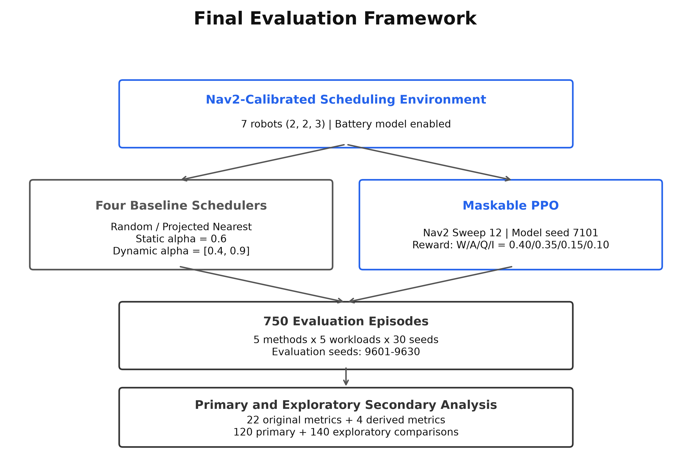

**Figure 01.** 正式評估架構。

[PNG](figures/overview/01_experimental_setup.png) · [SVG](figures/overview/01_experimental_setup.svg)

## 3. Experimental Environment

| 設定 | 內容 |
| --- | --- |
| Fleet | (2,2,3)，共七台 |
| Battery | Enabled |
| 導航成本 | Nav2 校準經驗移動時間與導航圖估計 |
| 校準資料 | 31 條有向路線 × 5 次，共 155 次 |
| 負載 | 3.0、3.5、4.0、4.5、5.0× |
| 評估種子 | 9601–9630 |
| 任務生成期間 | 7 天 |
| Runtime Nav2 checks | 750/750 |
| 執行耗時 | 1250.45 秒 |

本實驗為使用 Nav2 校準資料的排程模擬，並非每個 Episode 都啟動 Gazebo/Nav2。Fleet 為前期選定的固定控制條件，未重新最佳化。

導航摘要 SHA-256：`0baf6a695bacd2dac8f99a9e1b540dbb30901dfff0086afb93a0666acf030399`

完整導航來源與版本見 [experiment_metadata.json](data/evaluation/experiment_metadata.json)。

## 4. Baseline Scheduling Methods

| 方法 | 原則 | 設定 |
| --- | --- | --- |
| Random Feasible | 可行機器人隨機選擇 | Seed-controlled |
| Projected Nearest | 預估前往來源地成本 | 預設 |
| Static Weighted | 固定加權成本 | α = 0.6 |
| Dynamic Weighted | 依負載調整權重 | α_min = 0.4，α_max = 0.9 |

Static 搜尋 11 組、Dynamic 搜尋 55 組，各使用 10 個校準 Seeds（3001–3010），分別執行 110、550 Episodes；Random、Nearest 各 10 次，合計 680 次。權重經完成率篩選、Pareto 與 Rank Sum 選定。正式評估使用與校準分離的 Seeds，但已用於歷史比較，並非全新測試集。

[static_selected_parameters.json](data/configuration/static_selected_parameters.json) · [dynamic_selected_parameters.json](data/configuration/dynamic_selected_parameters.json)

## 5. Selected PPO Model

| 參數 | 值 |
| --- | --- |
| 演算法 | Maskable PPO |
| 設定 | Nav2 Sweep 12 |
| Model seed | 7101 |
| 訓練步數 | 200000（實際 200192） |
| Observation / Action | 98 / 7 |
| Reward W/A/Q/I | 0.40 / 0.35 / 0.15 / 0.10 |
| 推論 | CPU、deterministic、action mask |

權重選擇流程：33 → 15 → 7 → 2 → 1。七組候選在 Nav2 校準後重新訓練；最後選用 Sweep 12 Seed 7101。

模型：`experiments/fleet_sizing/results_rl/models/reward_confirm_nav2_sweep12_w40_a35_q15_i10_seed7101_200k/final_model.zip`

SHA-256：`1972295e176e6907d3bee4d01b301fa10526dac40dca38a5e867fe1a63825d07`

正式評估模型已驗證，ROS 2/Open-RMF 部署一致性尚待確認。

## 6. Experimental Design

| Workload | Random | Nearest | Static | Dynamic | PPO | Total |
| --- | --- | --- | --- | --- | --- | --- |
| 3.0× | 30 | 30 | 30 | 30 | 30 | 150 |
| 3.5× | 30 | 30 | 30 | 30 | 30 | 150 |
| 4.0× | 30 | 30 | 30 | 30 | 30 | 150 |
| 4.5× | 30 | 30 | 30 | 30 | 30 | 150 |
| 5.0× | 30 | 30 | 30 | 30 | 30 | 150 |
| Total | 150 | 150 | 150 | 150 | 150 | 750 |

同負載內依 Evaluation Seed 配對。已確認生成任務數量一致；尚未取得完整任務序列一致性紀錄。所有 750 筆皆完成全部生成任務。

## 7. Evaluation Metrics

| 主要指標 | 定義 | 方向 |
| --- | --- | --- |
| Average Waiting Time | 平均排隊等待 | ↓ |
| P95 Waiting Time | Episode 內等待時間第 95 百分位 | ↓ |
| High Priority Waiting Time | 高優先級平均等待 | ↓ |
| Emergency Waiting Time | 緊急任務平均等待 | ↓ |
| Total Travel Time | 任務相關累計移動時間 | ↓ |
| Jain Task Fairness | 完成任務數量的分配公平性 | ↑ |
| Completion Rate | 完成／生成任務數 | ↑ |

| 輔助指標 | 定義 |
| --- | --- |
| Low Waiting Time | 低優先級平均等待 |
| Normal Waiting Time | 一般優先級平均等待 |
| Average Response Time | 生成到抵達來源地平均時間 |
| P95 Response Time | 來源地回應時間第 95 百分位 |
| Average Total Time | 生成到完成平均時間 |
| P95 Total Time | 任務總耗時第 95 百分位 |
| Total Approach Time | 前往來源地累計時間 |
| Total Task Travel Time | 來源到目的地累計運送時間 |
| Makespan | 最後一筆已完成任務的完成時間 |
| Average Robot Utilization | 七台機器人平均利用率 |
| Max Robot Utilization | 單台最高利用率 |
| Return to Charge Count | 返回充電站次數 |
| Charging Count | 充電次數 |
| Minimum Robot SOC | 最低記錄電量 |
| Average Final SOC | 結束時平均剩餘電量 |

令 $t_a,t_s,t_p,t_c$ 分別為任務生成、開始執行、抵達來源地及完成時間。

$$T_{wait}=t_s-t_a$$

$$T_{response}=t_p-t_a$$

$$T_{total}=t_c-t_a$$

$$T_{travel}=T_{approach}+T_{task\ travel}$$

$$J=\frac{(\sum_i x_i)^2}{n\sum_i x_i^2}$$

其中 $x_i$ 為第 $i$ 台機器人完成的任務數。Total Travel 不等同全部充電行駛成本或實際能源消耗。P95 先在 Episode 內計算，再對 30 個 Episode 統計，並非合併全部任務的 P95。

| 衍生指標 | 公式 |
| --- | --- |
| Approach Time Ratio | Approach / Total Travel |
| Utilization Gap | Max Utilization − Average Utilization |
| Charging per 100 Tasks | Charging Count / Completed Tasks × 100 |
| Battery Reserve Margin | Minimum SOC − 0.15 |

## 8. Statistical Methodology

每組使用 30 個 Evaluation Seeds。描述性統計採平均及樣本標準差：

$$\bar{x}=\frac{1}{n}\sum_i x_i,\quad s=\sqrt{\frac{\sum_i(x_i-\bar{x})^2}{n-1}}$$

越低越佳的指標採 $d_i=B_i-P_i$，越高越佳採 $d_i=P_i-B_i$。正值代表 PPO 較佳。相對改善：

$$I=100\frac{\bar d}{\bar B}\%$$

Paired Bootstrap 以配對 Seed 為重抽樣單位，有放回抽取 30 筆，重複 10,000 次，取平均差異分布的 2.5 與 97.5 百分位。CI 全正判為較佳、全負判為較差、包含零則未能判定差異。個別 CI 未經多重比較校正。

Paired t-test 檢定平均配對差異；Wilcoxon signed-rank 檢定配對差異的符號與秩，並非平均數檢定。主要分析的 Wilcoxon 優劣標記採平均差異符號；輔助分析將顯著性與中位數方向分開記錄。Holm 校正分別套用於主要 120 項及探索性 140 項，每種檢定各自為一個家族。

| 設定 | 主要 | 輔助 |
| --- | --- | --- |
| 比較數 | 6×5×4=120 | 7×5×4=140 |
| 配對樣本 | 30 | 30 |
| Bootstrap iterations | 10000 | 10000 |
| Bootstrap seed | 20261127 | 20261128 |
| 信賴水準 | 95% | 95% |

## 9. Primary Metric Results

### 9.1 Average Waiting Time

| Workload | Random | Nearest | Static | Dynamic | PPO |
| --- | --- | --- | --- | --- | --- |
| 3.0× | 103.56 | 183.49 | 72.57 | 69.14 | 43.84 |
| 3.5× | 130.07 | 219.16 | 88.34 | 85.50 | 63.85 |
| 4.0× | 173.84 | 291.98 | 108.74 | 112.89 | 91.95 |
| 4.5× | 225.75 | 355.75 | 152.55 | 147.92 | 134.46 |
| 5.0× | 265.86 | 428.40 | 194.54 | 189.50 | 165.96 |

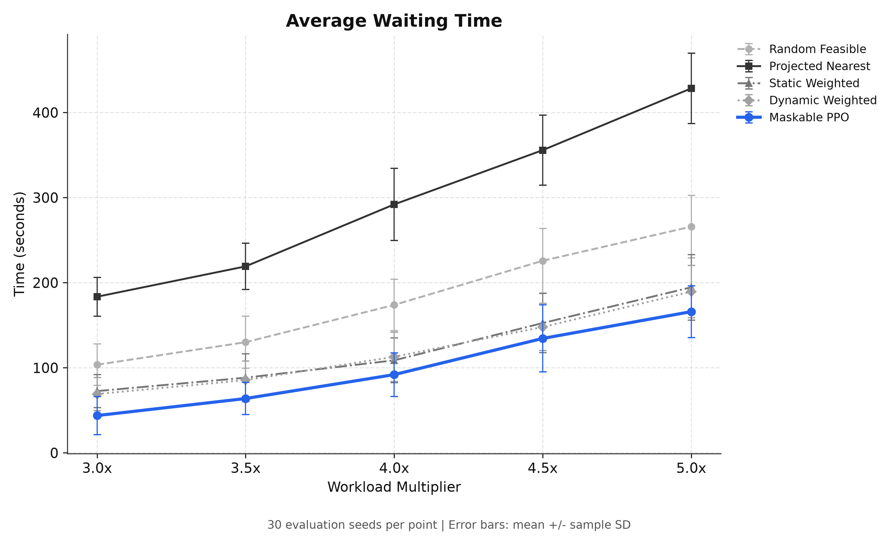

**Figure 02.** 平均等待時間在五種負載均最低。

[PNG](figures/primary_metrics/02_average_waiting_time_s.png) · [SVG](figures/primary_metrics/02_average_waiting_time_s.svg)

### 9.2 P95 Waiting Time

| Workload | Random | Nearest | Static | Dynamic | PPO |
| --- | --- | --- | --- | --- | --- |
| 3.0× | 316.43 | 610.03 | 190.76 | 172.11 | 161.40 |
| 3.5× | 465.64 | 884.76 | 281.11 | 251.84 | 262.77 |
| 4.0× | 726.85 | 1,697.62 | 385.15 | 448.04 | 424.88 |
| 4.5× | 1,318.07 | 2,380.31 | 813.28 | 707.97 | 812.99 |
| 5.0× | 1,603.86 | 3,102.58 | 1,157.43 | 1,123.87 | 1,051.85 |

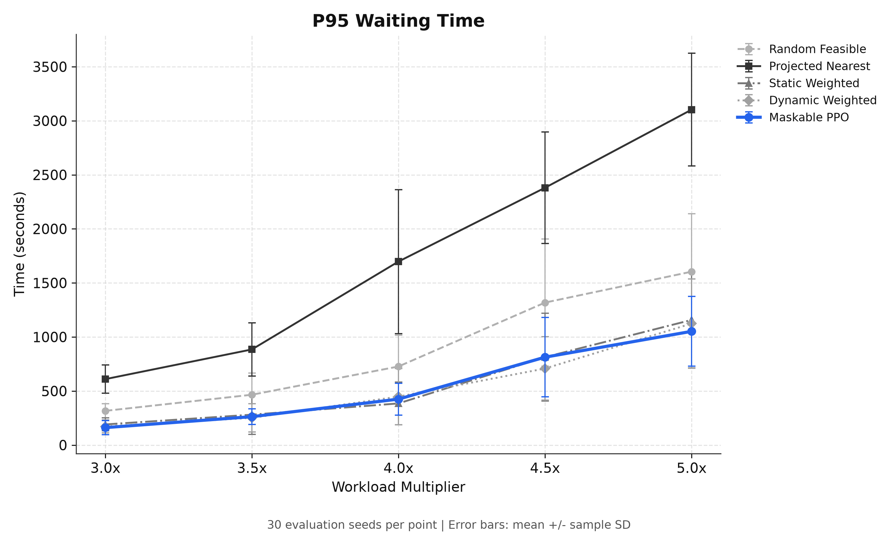

**Figure 03.** P95 並非所有負載均最佳。

[PNG](figures/primary_metrics/03_p95_waiting_time_s.png) · [SVG](figures/primary_metrics/03_p95_waiting_time_s.svg)

### 9.3 High Priority Waiting Time

| Workload | Random | Nearest | Static | Dynamic | PPO |
| --- | --- | --- | --- | --- | --- |
| 3.0× | 81.27 | 168.78 | 53.08 | 45.01 | 21.80 |
| 3.5× | 94.36 | 225.54 | 58.01 | 50.52 | 29.22 |
| 4.0× | 129.16 | 275.18 | 76.26 | 77.25 | 49.10 |
| 4.5× | 163.65 | 327.60 | 103.80 | 92.06 | 66.47 |
| 5.0× | 185.45 | 390.93 | 123.70 | 116.77 | 82.16 |

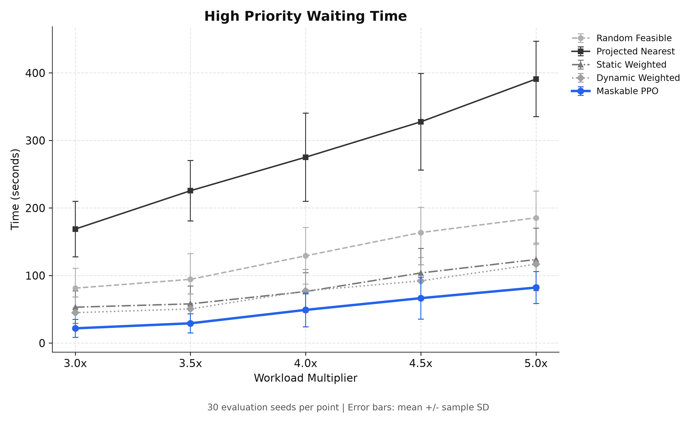

**Figure 04.** 高優先級等待時間均最低。

[PNG](figures/primary_metrics/04_high_waiting_time_s.png) · [SVG](figures/primary_metrics/04_high_waiting_time_s.svg)

### 9.4 Emergency Waiting Time

| Workload | Random | Nearest | Static | Dynamic | PPO |
| --- | --- | --- | --- | --- | --- |
| 3.0× | 56.02 | 141.56 | 43.69 | 47.19 | 16.93 |
| 3.5× | 71.80 | 153.17 | 52.40 | 36.24 | 13.49 |
| 4.0× | 92.98 | 177.45 | 60.30 | 67.61 | 30.91 |
| 4.5× | 100.55 | 226.95 | 66.94 | 72.27 | 42.25 |
| 5.0× | 122.66 | 264.28 | 94.56 | 90.93 | 50.41 |

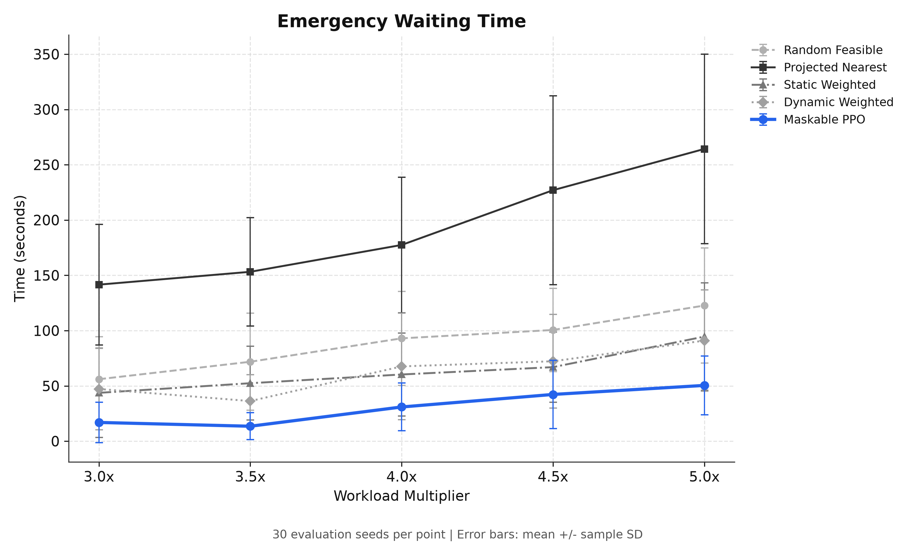

**Figure 05.** 緊急任務等待時間均最低。

[PNG](figures/primary_metrics/05_emergency_waiting_time_s.png) · [SVG](figures/primary_metrics/05_emergency_waiting_time_s.svg)

### 9.5 Total Travel Time

| Workload | Random | Nearest | Static | Dynamic | PPO |
| --- | --- | --- | --- | --- | --- |
| 3.0× | 182,872.48 | 177,499.87 | 178,038.21 | 178,430.00 | 182,943.92 |
| 3.5× | 213,533.13 | 207,475.82 | 207,969.24 | 208,548.06 | 213,305.37 |
| 4.0× | 245,503.87 | 239,158.26 | 239,927.74 | 240,570.58 | 245,679.86 |
| 4.5× | 273,818.67 | 267,006.43 | 267,884.66 | 268,609.46 | 273,734.48 |
| 5.0× | 305,145.53 | 297,737.01 | 299,123.94 | 299,823.23 | 304,955.30 |

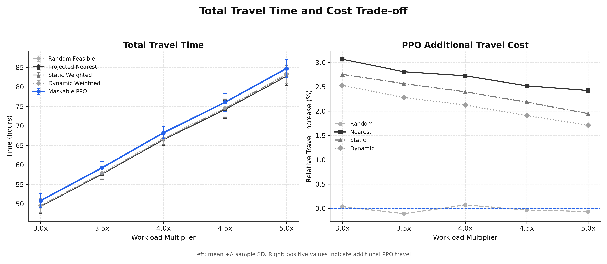

**Figure 06.** 總移動時間及額外成本。

[PNG](figures/primary_metrics/06_total_travel_time_s.png) · [SVG](figures/primary_metrics/06_total_travel_time_s.svg)

### 9.6 Jain Task Fairness

| Workload | Random | Nearest | Static | Dynamic | PPO |
| --- | --- | --- | --- | --- | --- |
| 3.0× | 0.8653 | 0.5910 | 0.7075 | 0.7065 | 0.8848 |
| 3.5× | 0.8700 | 0.6042 | 0.7290 | 0.7273 | 0.8810 |
| 4.0× | 0.8775 | 0.6230 | 0.7530 | 0.7515 | 0.8835 |
| 4.5× | 0.8701 | 0.6361 | 0.7628 | 0.7597 | 0.8789 |
| 5.0× | 0.8752 | 0.6664 | 0.7811 | 0.7822 | 0.8815 |

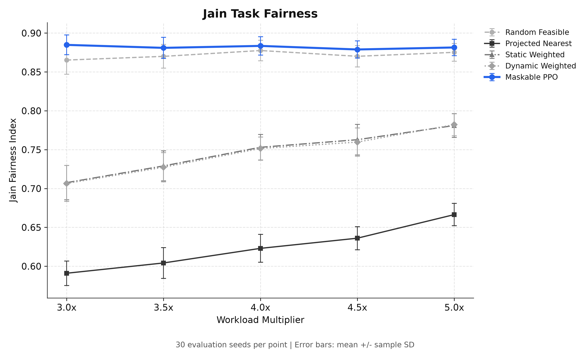

**Figure 07.** Jain 公平性均最高。

[PNG](figures/primary_metrics/07_jain_task_fairness.png) · [SVG](figures/primary_metrics/07_jain_task_fairness.svg)

### 9.7 Completion Rate

| Workload | Random | Nearest | Static | Dynamic | PPO |
| --- | --- | --- | --- | --- | --- |
| 3.0× | 100% | 100% | 100% | 100% | 100% |
| 3.5× | 100% | 100% | 100% | 100% | 100% |
| 4.0× | 100% | 100% | 100% | 100% | 100% |
| 4.5× | 100% | 100% | 100% | 100% | 100% |
| 5.0× | 100% | 100% | 100% | 100% | 100% |

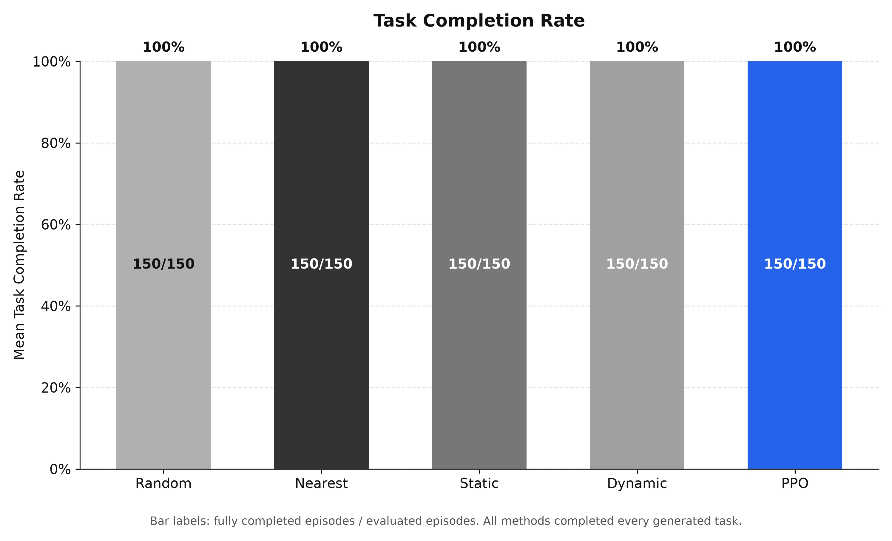

**Figure 08.** 全部方法均完成所有生成任務。

[PNG](figures/primary_metrics/08_completion_rate.png) · [SVG](figures/primary_metrics/08_completion_rate.svg)

表格為 30 Seeds 平均值，時間單位秒（圖 06 使用小時），公平性為無單位指數。折線圖誤差棒為 Mean ± Sample SD，而非 CI。完整平均、SD、Median 見 [comparison_summary.csv](data/evaluation/comparison_summary.csv)。

## 10. Primary Statistical Results

| 指標 | 較佳 | 較差 | CI 包含 0 |
| --- | --- | --- | --- |
| Average Waiting Time | 20 | 0 | 0 |
| P95 Waiting Time | 11 | 1 | 8 |
| High Priority Waiting Time | 20 | 0 | 0 |
| Emergency Waiting Time | 20 | 0 | 0 |
| Total Travel Time | 0 | 15 | 5 |
| Jain Task Fairness | 20 | 0 | 0 |
| Total | 91 | 16 | 13 |

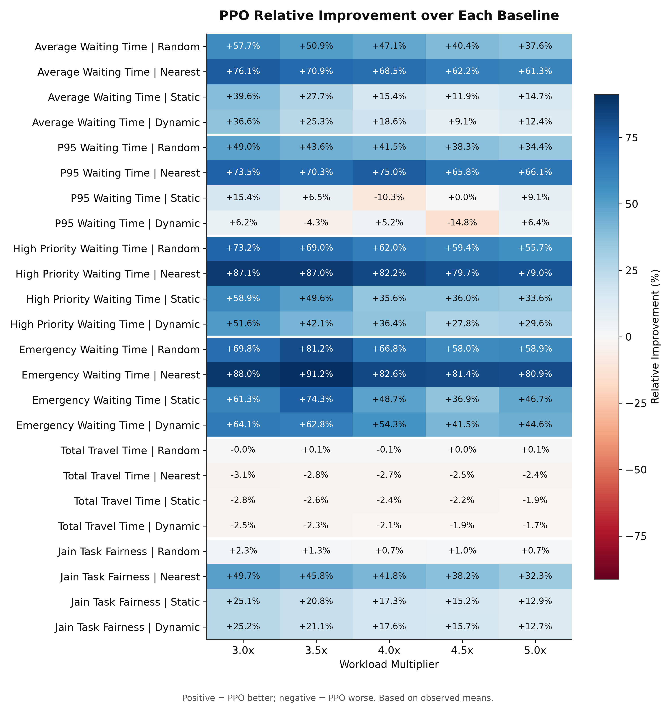

**Figure 09.** 各負載、各 Baseline 的相對改善百分比。

[PNG](figures/statistical_analysis/09_primary_relative_improvement.png) · [SVG](figures/statistical_analysis/09_primary_relative_improvement.svg)

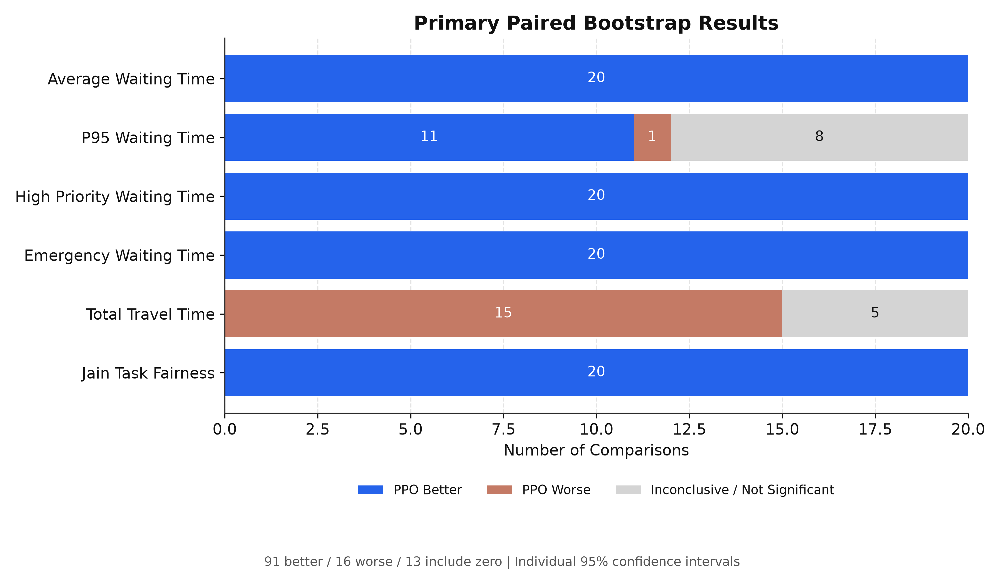

**Figure 11.** 主要指標個別 Bootstrap 95% CI 分類。

[PNG](figures/statistical_analysis/11_primary_bootstrap_results.png) · [SVG](figures/statistical_analysis/11_primary_bootstrap_results.svg)

## 11. Holm Correction and Statistical Agreement

| 指標 | Holm t-test 較佳 | Holm Wilcoxon 較佳（記錄方向） |
| --- | --- | --- |
| Average Waiting Time | 17 | 16 |
| P95 Waiting Time | 10 | 10 |
| High Priority Waiting Time | 20 | 20 |
| Emergency Waiting Time | 19 | 20 |
| Total Travel Time | 0 | 0 |
| Jain Task Fairness | 19 | 19 |

兩種檢定各 85 項較佳、15 項較差、20 項未達顯著；兩者共同較佳 84 項，與 Bootstrap 較佳的交集也是 84 項。這是既有判定規則的交集，不是額外獨立檢定。

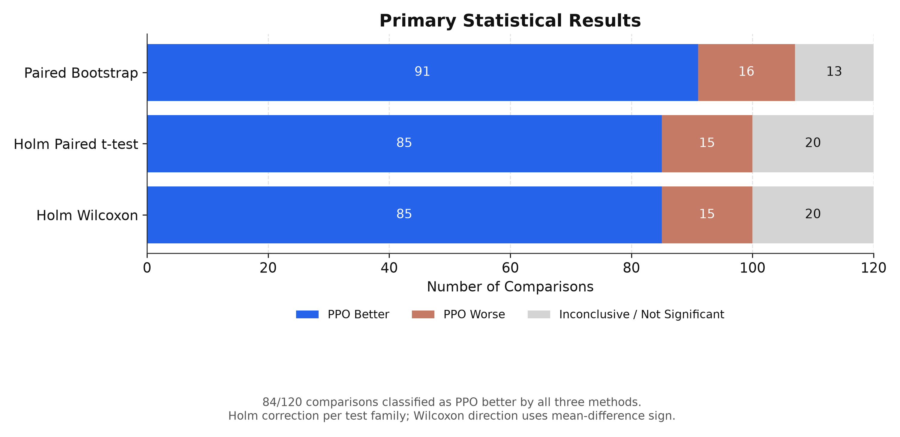

**Figure 12.** 主要統計結果及 Holm 校正。

[PNG](figures/statistical_analysis/12_holm_corrected_results.png) · [SVG](figures/statistical_analysis/12_holm_corrected_results.svg)

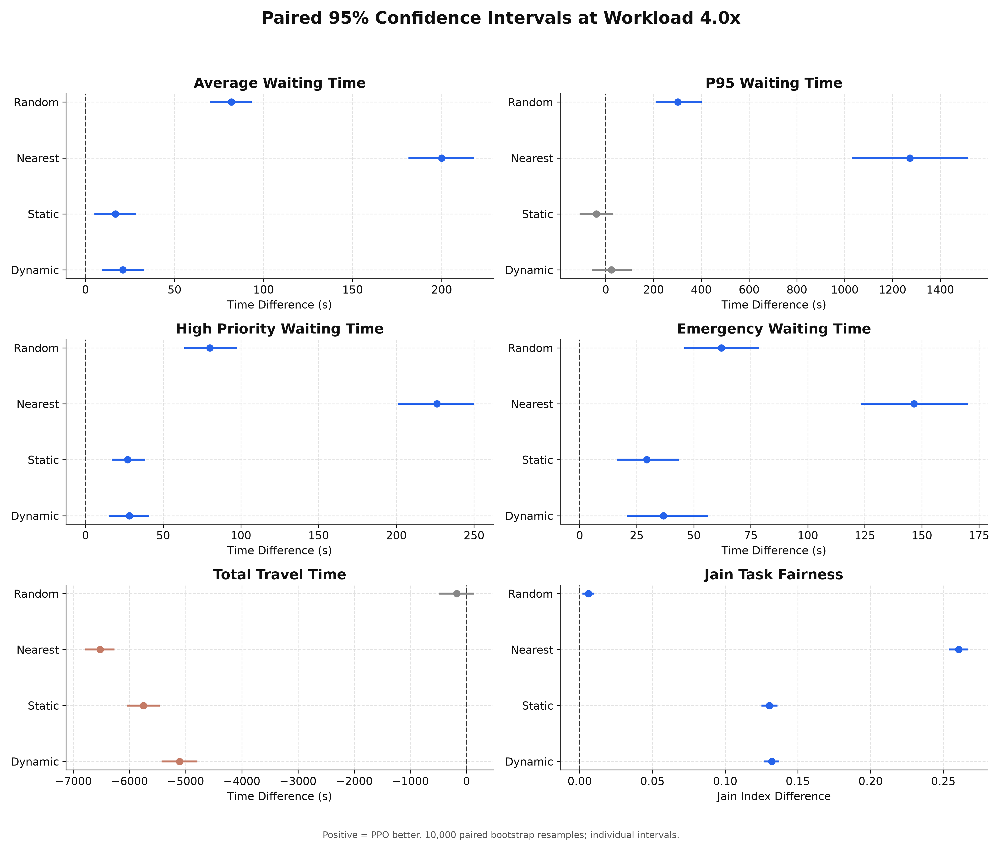

**Figure 13.** 4.0× 下 24 項個別配對 Bootstrap CI；正值表示 PPO 較佳。完整區間見 [paired_bootstrap_results.csv](data/analysis/paired_bootstrap_results.csv)。

[PNG](figures/statistical_analysis/13_paired_confidence_intervals.png) · [SVG](figures/statistical_analysis/13_paired_confidence_intervals.svg)

## 12. Comparison with Best Observed Baselines

| 負載 | 指標 | 最佳 Baseline | Baseline 平均 | PPO 平均 | 改善 | 個別 CI 判定 |
| --- | --- | --- | --- | --- | --- | --- |
| 3.0× | average_waiting_time_s | Dynamic | 69.1398 | 43.8387 | +36.59% | ppo_better |
| 3.0× | p95_waiting_time_s | Dynamic | 172.1090 | 161.3982 | +6.22% | ci_crosses_zero |
| 3.0× | high_waiting_time_s | Dynamic | 45.0093 | 21.8050 | +51.55% | ppo_better |
| 3.0× | emergency_waiting_time_s | Static | 43.6949 | 16.9256 | +61.26% | ppo_better |
| 3.0× | total_travel_time_s | Nearest | 177499.8660 | 182943.9186 | -3.07% | ppo_worse |
| 3.0× | jain_task_fairness | Random | 0.8653 | 0.8848 | +2.26% | ppo_better |
| 3.5× | average_waiting_time_s | Dynamic | 85.4972 | 63.8543 | +25.31% | ppo_better |
| 3.5× | p95_waiting_time_s | Dynamic | 251.8397 | 262.7735 | -4.34% | ci_crosses_zero |
| 3.5× | high_waiting_time_s | Dynamic | 50.5152 | 29.2234 | +42.15% | ppo_better |
| 3.5× | emergency_waiting_time_s | Dynamic | 36.2437 | 13.4862 | +62.79% | ppo_better |
| 3.5× | total_travel_time_s | Nearest | 207475.8232 | 213305.3675 | -2.81% | ppo_worse |
| 3.5× | jain_task_fairness | Random | 0.8700 | 0.8810 | +1.26% | ppo_better |
| 4.0× | average_waiting_time_s | Static | 108.7360 | 91.9482 | +15.44% | ppo_better |
| 4.0× | p95_waiting_time_s | Static | 385.1540 | 424.8753 | -10.31% | ci_crosses_zero |
| 4.0× | high_waiting_time_s | Static | 76.2635 | 49.0952 | +35.62% | ppo_better |
| 4.0× | emergency_waiting_time_s | Static | 60.3031 | 30.9083 | +48.75% | ppo_better |
| 4.0× | total_travel_time_s | Nearest | 239158.2583 | 245679.8649 | -2.73% | ppo_worse |
| 4.0× | jain_task_fairness | Random | 0.8775 | 0.8835 | +0.68% | ppo_better |
| 4.5× | average_waiting_time_s | Dynamic | 147.9158 | 134.4619 | +9.10% | ppo_better |
| 4.5× | p95_waiting_time_s | Dynamic | 707.9674 | 812.9853 | -14.83% | ppo_worse |
| 4.5× | high_waiting_time_s | Dynamic | 92.0550 | 66.4703 | +27.79% | ppo_better |
| 4.5× | emergency_waiting_time_s | Static | 66.9390 | 42.2457 | +36.89% | ppo_better |
| 4.5× | total_travel_time_s | Nearest | 267006.4332 | 273734.4822 | -2.52% | ppo_worse |
| 4.5× | jain_task_fairness | Random | 0.8701 | 0.8789 | +1.01% | ppo_better |
| 5.0× | average_waiting_time_s | Dynamic | 189.5002 | 165.9572 | +12.42% | ppo_better |
| 5.0× | p95_waiting_time_s | Dynamic | 1123.8658 | 1051.8540 | +6.41% | ci_crosses_zero |
| 5.0× | high_waiting_time_s | Dynamic | 116.7675 | 82.1640 | +29.63% | ppo_better |
| 5.0× | emergency_waiting_time_s | Dynamic | 90.9278 | 50.4084 | +44.56% | ppo_better |
| 5.0× | total_travel_time_s | Nearest | 297737.0076 | 304955.2951 | -2.42% | ppo_worse |
| 5.0× | jain_task_fairness | Random | 0.8752 | 0.8815 | +0.72% | ppo_better |

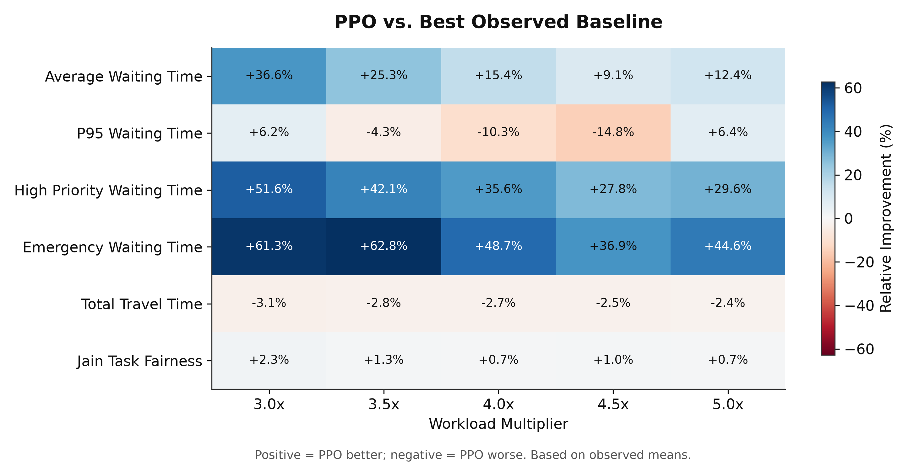

**Figure 10.** 相較各指標觀測平均值最佳的 Baseline。

[PNG](figures/statistical_analysis/10_best_baseline_comparison.png) · [SVG](figures/statistical_analysis/10_best_baseline_comparison.svg)

最佳 Baseline 依同批評估資料的平均值選出，屬描述性比較；不同指標可能對應不同方法。平均等待改善 9.10–36.59%，高優先級改善 27.79–51.55%，緊急改善 36.89–62.79%，Jain 相對改善 0.68–2.26%。相較最短移動時間方法，額外成本 2.42–3.07%。

## 13. Secondary Metric Results

### 13.1 Waiting time by priority (4.0×)

| Method | Low | Normal | High | Emergency |
| --- | --- | --- | --- | --- |
| Random | 290.74 ± 82.40 | 167.43 ± 30.88 | 129.16 ± 42.01 | 92.98 ± 42.47 |
| Nearest | 357.61 ± 87.70 | 296.61 ± 40.17 | 275.18 ± 65.33 | 177.45 ± 61.33 |
| Static | 219.19 ± 82.32 | 92.89 ± 24.48 | 76.26 ± 27.87 | 60.30 ± 37.55 |
| Dynamic | 222.66 ± 77.24 | 98.39 ± 31.10 | 77.25 ± 31.74 | 67.61 ± 48.19 |
| PPO | 205.43 ± 83.67 | 82.13 ± 25.29 | 49.10 ± 25.08 | 30.91 ± 21.61 |

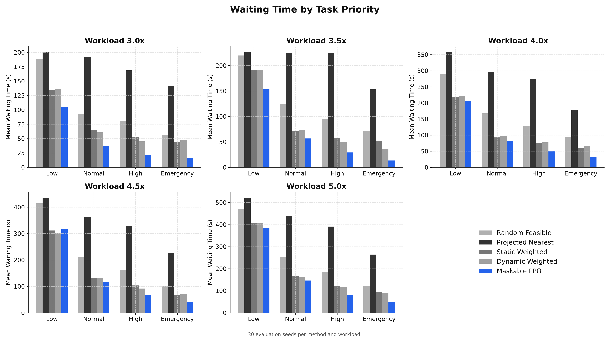

**Figure 16.** 四種優先級的平均等待時間。

[PNG](figures/secondary_metrics/16_waiting_time_by_priority.png) · [SVG](figures/secondary_metrics/16_waiting_time_by_priority.svg)

4.0× 下四種優先級均有最低平均值，但 Low 與 Normal 對最佳 Baseline 的 CI 包含零；4.5× 下 Low 比 Dynamic 高 4.92%，CI 包含零。未觀察到普遍犧牲低優先級任務的現象，但無法排除個別任務飢餓。

### 13.2 Service efficiency

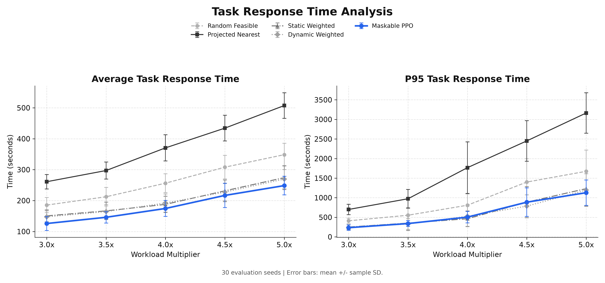

**Figure 17.** 平均及 P95 來源地回應時間。

[PNG](figures/secondary_metrics/17_response_time_analysis.png) · [SVG](figures/secondary_metrics/17_response_time_analysis.svg)

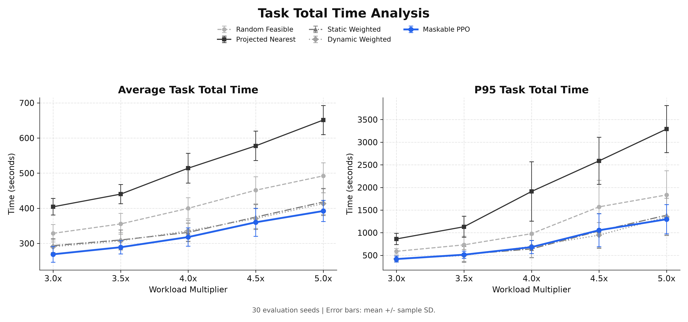

**Figure 18.** 平均及 P95 任務總耗時。

[PNG](figures/secondary_metrics/18_total_time_analysis.png) · [SVG](figures/secondary_metrics/18_total_time_analysis.svg)

平均回應與平均總耗時各 20/20 項個別 CI 支持改善。相較最佳觀測 Baseline，平均回應改善 4.68–14.65%，平均總耗時改善 2.87–7.43%。4.5× 下 P95 Total 相較 Dynamic 增加 11.44%，個別 CI 支持較差。

## 14. Exploratory Secondary Statistical Analysis

| 指標 | Bootstrap 較佳 | 較差 | CI 包含零 | Holm t-test 較佳 | Holm Wilcoxon 顯著 |
| --- | --- | --- | --- | --- | --- |
| Low Wait | 14 | 0 | 6 | 9 | 9 |
| Normal Wait | 19 | 0 | 1 | 12 | 12 |
| Average Response | 20 | 0 | 0 | 13 | 13 |
| P95 Response | 10 | 0 | 10 | 10 | 10 |
| Average Total | 20 | 0 | 0 | 13 | 13 |
| P95 Total | 10 | 1 | 9 | 10 | 10 |
| Approach | 0 | 15 | 5 | 0 | 15 |
| Total | 93 | 16 | 31 | 67 | 82 |

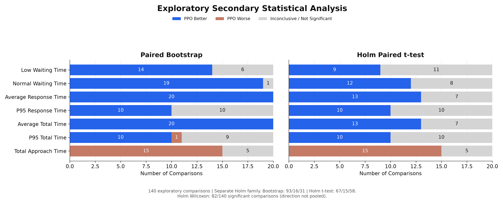

**Figure 23.** 140 項探索性分析，Holm t-test 與 Bootstrap 分開呈現。

[PNG](figures/statistical_analysis/23_secondary_statistical_analysis.png) · [SVG](figures/statistical_analysis/23_secondary_statistical_analysis.svg)

| 負載 | 指標 | 最佳 Baseline | Baseline 平均 | PPO 平均 | 改善 | 個別 CI 判定 |
| --- | --- | --- | --- | --- | --- | --- |
| 3.0× | average_response_time_s | Dynamic | 147.40510 | 125.81611 | +14.65% | ppo_better |
| 3.0× | average_total_time_s | Dynamic | 290.57169 | 268.98270 | +7.43% | ppo_better |
| 3.0× | low_waiting_time_s | Static | 135.31394 | 105.17691 | +22.27% | ppo_better |
| 3.0× | normal_waiting_time_s | Dynamic | 60.73626 | 37.30427 | +38.58% | ppo_better |
| 3.0× | p95_response_time_s | Dynamic | 243.50344 | 234.59537 | +3.66% | ci_includes_zero |
| 3.0× | p95_total_time_s | Dynamic | 420.46602 | 417.92290 | +0.60% | ci_includes_zero |
| 3.0× | total_approach_time_s | Nearest | 94379.32096 | 99823.37355 | -5.77% | ppo_worse |
| 3.5× | average_response_time_s | Dynamic | 164.25867 | 145.97260 | +11.13% | ppo_better |
| 3.5× | average_total_time_s | Dynamic | 307.33168 | 289.04562 | +5.95% | ppo_better |
| 3.5× | low_waiting_time_s | Dynamic | 191.15276 | 153.24738 | +19.83% | ppo_better |
| 3.5× | normal_waiting_time_s | Static | 72.26086 | 56.57482 | +21.71% | ppo_better |
| 3.5× | p95_response_time_s | Dynamic | 326.52955 | 339.92558 | -4.10% | ci_includes_zero |
| 3.5× | p95_total_time_s | Dynamic | 497.59583 | 513.68540 | -3.23% | ci_includes_zero |
| 3.5× | total_approach_time_s | Nearest | 110546.78726 | 116376.33159 | -5.27% | ppo_worse |
| 4.0× | average_response_time_s | Static | 187.70125 | 174.45255 | +7.06% | ppo_better |
| 4.0× | average_total_time_s | Static | 331.26370 | 318.01500 | +4.00% | ppo_better |
| 4.0× | low_waiting_time_s | Static | 219.18821 | 205.42775 | +6.28% | ci_includes_zero |
| 4.0× | normal_waiting_time_s | Static | 92.89377 | 82.13077 | +11.59% | ci_includes_zero |
| 4.0× | p95_response_time_s | Static | 462.39541 | 503.53982 | -8.90% | ci_includes_zero |
| 4.0× | p95_total_time_s | Static | 641.31453 | 681.34969 | -6.24% | ci_includes_zero |
| 4.0× | total_approach_time_s | Nearest | 127546.80229 | 134068.40895 | -5.11% | ppo_worse |
| 4.5× | average_response_time_s | Dynamic | 227.32585 | 216.69599 | +4.68% | ppo_better |
| 4.5× | average_total_time_s | Dynamic | 370.67850 | 360.04865 | +2.87% | ppo_better |
| 4.5× | low_waiting_time_s | Dynamic | 303.63061 | 318.56808 | -4.92% | ci_includes_zero |
| 4.5× | normal_waiting_time_s | Dynamic | 131.62368 | 116.56434 | +11.44% | ppo_better |
| 4.5× | p95_response_time_s | Dynamic | 784.41988 | 885.67654 | -12.91% | ci_includes_zero |
| 4.5× | p95_total_time_s | Dynamic | 945.73651 | 1053.93716 | -11.44% | ppo_worse |
| 4.5× | total_approach_time_s | Nearest | 142602.90541 | 149330.95439 | -4.72% | ppo_worse |
| 5.0× | average_response_time_s | Dynamic | 269.44697 | 248.45059 | +7.79% | ppo_better |
| 5.0× | average_total_time_s | Dynamic | 413.17813 | 392.18175 | +5.08% | ppo_better |
| 5.0× | low_waiting_time_s | Dynamic | 405.30413 | 383.55025 | +5.37% | ci_includes_zero |
| 5.0× | normal_waiting_time_s | Dynamic | 162.74977 | 146.24223 | +10.14% | ppo_better |
| 5.0× | p95_response_time_s | Dynamic | 1193.92042 | 1127.70575 | +5.55% | ci_includes_zero |
| 5.0× | p95_total_time_s | Dynamic | 1346.59447 | 1297.24305 | +3.66% | ci_includes_zero |
| 5.0× | total_approach_time_s | Nearest | 159131.41102 | 166349.69854 | -4.54% | ppo_worse |

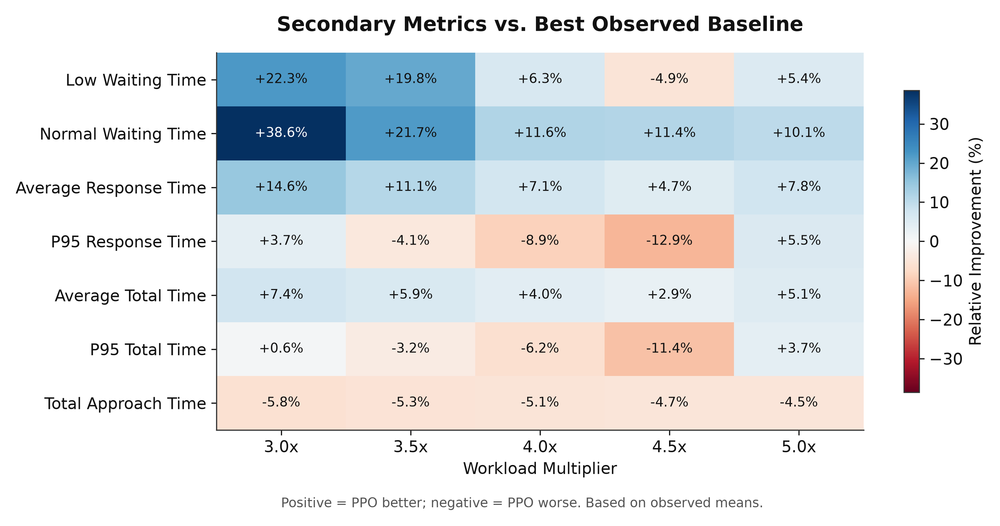

**Figure 22.** 輔助指標相較最佳觀測 Baseline。

[PNG](figures/secondary_metrics/22_secondary_relative_improvement.png) · [SVG](figures/secondary_metrics/22_secondary_relative_improvement.svg)

輔助分析為事後探索，不回頭參與模型選擇，不與主要比較合併為單一勝率。

## 15. Performance Trade-offs and Constraints

### 15.1 Travel decomposition

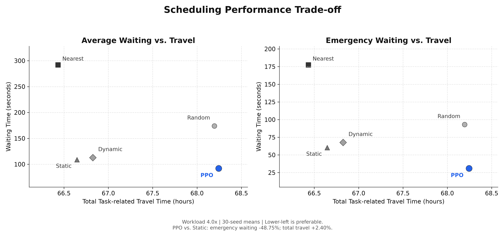

**Figure 14.** 4.0× 的等待時間與移動成本取捨。

[PNG](figures/statistical_analysis/14_performance_tradeoff.png) · [SVG](figures/statistical_analysis/14_performance_tradeoff.svg)

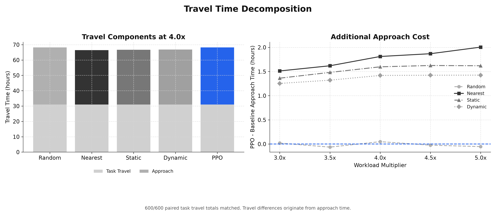

**Figure 19.** 任務移動時間分解。

[PNG](figures/secondary_metrics/19_travel_time_decomposition.png) · [SVG](figures/secondary_metrics/19_travel_time_decomposition.svg)

| 負載 | Baseline | Approach 差異 (s) | Task Travel 差異 (s) | Total 差異 (s) | 一致 Seeds |
| --- | --- | --- | --- | --- | --- |
| 3.0× | Random | 71.43365 | 0.00000 | 71.43365 | 30/30 |
| 3.0× | Nearest | 5444.05259 | 0.00000 | 5444.05259 | 30/30 |
| 3.0× | Static | 4905.71293 | 0.00000 | 4905.71293 | 30/30 |
| 3.0× | Dynamic | 4513.92292 | 0.00000 | 4513.92292 | 30/30 |
| 3.5× | Random | -227.76611 | 0.00000 | -227.76611 | 30/30 |
| 3.5× | Nearest | 5829.54433 | 0.00000 | 5829.54433 | 30/30 |
| 3.5× | Static | 5336.13040 | 0.00000 | 5336.13040 | 30/30 |
| 3.5× | Dynamic | 4757.30528 | 0.00000 | 4757.30528 | 30/30 |
| 4.0× | Random | 175.99496 | 0.00000 | 175.99496 | 30/30 |
| 4.0× | Nearest | 6521.60666 | 0.00000 | 6521.60666 | 30/30 |
| 4.0× | Static | 5752.12625 | 0.00000 | 5752.12625 | 30/30 |
| 4.0× | Dynamic | 5109.28035 | 0.00000 | 5109.28035 | 30/30 |
| 4.5× | Random | -84.18442 | 0.00000 | -84.18442 | 30/30 |
| 4.5× | Nearest | 6728.04898 | 0.00000 | 6728.04898 | 30/30 |
| 4.5× | Static | 5849.81906 | 0.00000 | 5849.81906 | 30/30 |
| 4.5× | Dynamic | 5125.01758 | 0.00000 | 5125.01758 | 30/30 |
| 5.0× | Random | -190.23733 | 0.00000 | -190.23733 | 30/30 |
| 5.0× | Nearest | 7218.28753 | 0.00000 | 7218.28753 | 30/30 |
| 5.0× | Static | 5831.35669 | 0.00000 | 5831.35669 | 30/30 |
| 5.0× | Dynamic | 5132.06664 | 0.00000 | 5132.06664 | 30/30 |

600/600 配對的 Task Travel 總量在浮點容許誤差內一致，因此本次任務相關移動成本差異來自 Approach。4.0× 相較 Static，PPO 緊急等待下降 48.75%，總移動增加約 2.40%。這是模擬成本分解，不代表實際導航路線或能源消耗完全一致。

### 15.2 Utilization (4.0×)

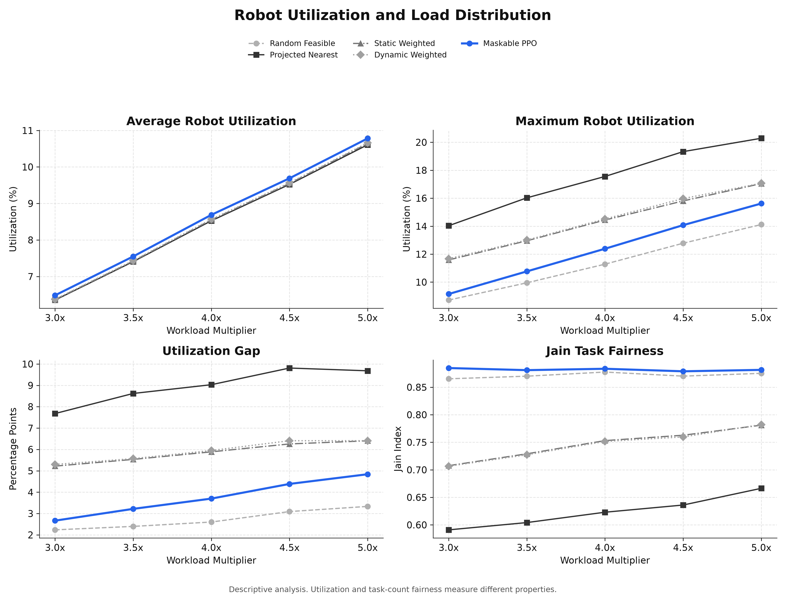

**Figure 20.** 利用率與任務公平性。

[PNG](figures/secondary_metrics/20_robot_utilization_analysis.png) · [SVG](figures/secondary_metrics/20_robot_utilization_analysis.svg)

| Method | 平均利用率 | 最高利用率 | 差距（pp） | Jain | Makespan (s) |
| --- | --- | --- | --- | --- | --- |
| Random | 8.68% | 11.28% | 2.60 | 0.87754 | 604276.67 |
| Nearest | 8.53% | 17.56% | 9.03 | 0.62300 | 604639.52 |
| Static | 8.55% | 14.44% | 5.89 | 0.75303 | 604102.39 |
| Dynamic | 8.57% | 14.52% | 5.95 | 0.75152 | 604100.73 |
| PPO | 8.69% | 12.39% | 3.70 | 0.88350 | 604105.34 |

Random 的利用率差距小於 PPO；PPO 的 Jain 較高、等待較短。利用率與任務數量公平性並非相同概念，已確認忙碌時間包含前往來源地、任務運送及服務時間，不包含返充、充電及閒置時間。利用率以 Makespan 為分母，完整公式見第 16.1 節。不能僅據此推論機器人數量過多。

### 15.3 Battery and charging (4.0×)

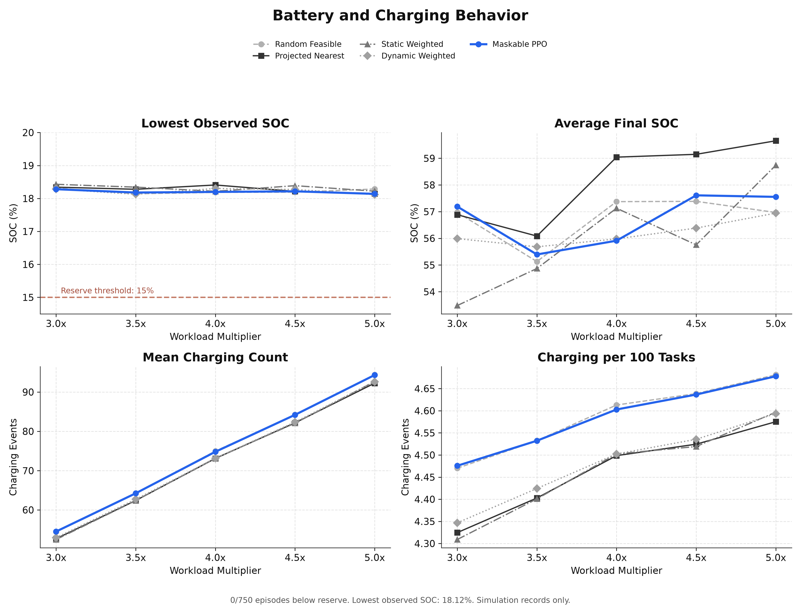

**Figure 21.** 最低觀測 SOC、最終 SOC 與充電行為。

[PNG](figures/secondary_metrics/21_battery_charging_analysis.png) · [SVG](figures/secondary_metrics/21_battery_charging_analysis.svg)

| Method | 最低觀測 SOC | 平均充電次數 | 每百任務充電 | 最終平均 SOC |
| --- | --- | --- | --- | --- |
| Random | 18.19% | 74.97 | 4.613 | 57.38% |
| Nearest | 18.41% | 73.10 | 4.499 | 59.04% |
| Static | 18.22% | 73.17 | 4.502 | 57.13% |
| Dynamic | 18.30% | 73.17 | 4.502 | 55.98% |
| PPO | 18.20% | 74.80 | 4.603 | 55.91% |

全部 750 Episodes 最低觀測 SOC 為 18.1161%，距 15% 分析門檻 3.1161 個百分點，0/750 低於門檻。充電次數不等同能源消耗，也不能由模擬直接證明實體安全。

### 15.4 Complete descriptive and derived metrics

全部 15 項輔助指標與四項衍生指標共 475 組描述性統計（Mean、SD、Median、Min、Max）已封存於 [secondary_descriptive_summary.csv](data/secondary_analysis/secondary_descriptive_summary.csv)；逐 Episode 衍生指標見 [derived_episode_metrics.csv](data/secondary_analysis/derived_episode_metrics.csv)。目前可直接取得的終端紀錄未列出全部 475 組數值，故不在本文補造完整表格。

## 16. Historical Reproducibility

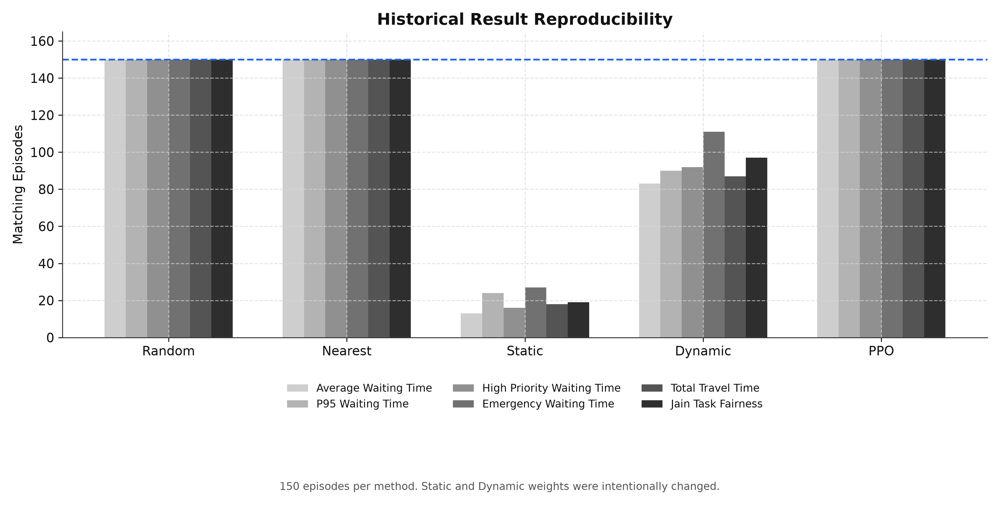

**Figure 15.** 歷史與最新版六項主要指標一致性。

[PNG](figures/reproducibility/15_historical_reproducibility.png) · [SVG](figures/reproducibility/15_historical_reproducibility.svg)

| 方法 | 六項指標均一致的 Episodes |
| --- | --- |
| Random | 150/150 |
| Nearest | 150/150 |
| Static | 13/150 |
| Dynamic | 83/150 |
| PPO | 150/150 |

Static、Dynamic 權重有意更換；PPO、Random、Nearest 的六項主要比較指標完全重現。此結果不等同完整任務序列或所有內部狀態相同。

### 16.1 補充：已確認的指標實作定義

後續共用環境原始碼核對已確認正式評估使用
`calculate_episode_metrics()`。

Makespan 定義為最後一筆已完成任務的完成時間：

$$
T_{\mathrm{makespan}}=\max_{j\in C}t_{c,j}
$$

其中 C 為已完成任務集合。

每台機器人的累計任務忙碌時間：

$$
T_{\mathrm{busy},i}
=
\sum_{j\in A_i}
(T_{\mathrm{approach},j}
+T_{\mathrm{task\ travel},j}
+T_{\mathrm{service},j})
$$

機器人利用率：

$$
U_i=\frac{T_{\mathrm{busy},i}}{T_{\mathrm{makespan}}}
$$

平均及最高利用率：

$$
U_{\mathrm{avg}}=\frac{1}{n}\sum_{i=1}^{n}U_i
$$

$$
U_{\max}=\max_i U_i
$$

Busy Time 不包含任務排隊等待、閒置、
返回充電站及充電時間。

因此本章利用率應解讀為任務執行利用率，
而非機器人所有非閒置狀態的時間比例。

Makespan 並非固定七天，
也不一定等於所有充電事件結束的時間。

正式完成率使用 Episode 最終完成任務數，
而非限制在七天內完成的任務數。

與前期 Fleet Sizing 的指標定義不同，
不宜直接跨階段比較數值。

本次補充僅澄清已使用的指標實作，
不重新計算或修改任何實驗結果。

完整定義與來源程式：

- [01 Experiment Environment](../01_experiment_environment/README.md)
- [Scheduling Simulator](../01_experiment_environment/scripts/scheduling_simulator.py)
- [Formal Metrics Implementation](../01_experiment_environment/scripts/rl/evaluate_reward_tuned_workload_robustness.py)

## 17. Conclusions and Limitations

在固定七台機器人的 Nav2 校準排程模擬中，PPO 的主要優勢為降低平均等待、高優先級及緊急等待並提升任務公平性，改善亦延伸至平均回應與完成時間。代價為額外 Approach Time 及部分負載的尾端延遲。所有方法均完成全部生成任務，未觀察到低於保留電量門檻的紀錄。

研究限制：

- Fleet 未在 Nav2 校準後重新最佳化。
- 僅比較單一 PPO 訓練模型；30 個 Evaluation Seeds 不代表 30 個訓練 Seeds。
- 完整任務生成序列尚未取得驗證紀錄。
- 個別 Bootstrap CI 未校正；Holm 家族分開；Wilcoxon 方向標記非平均數檢定。
- 最佳觀測 Baseline 屬描述性選擇；輔助分析屬探索性。
- 利用率及 SOC 依模擬器紀錄定義解讀。
- 模擬結果不直接等同真實醫院效益；正式模型部署尚待驗證。

## 18. Research Artifacts and Reproduction

### evaluation

- [comparison_runs.csv](data/evaluation/comparison_runs.csv)
- [comparison_summary.csv](data/evaluation/comparison_summary.csv)
- [runtime_nav2_checks.csv](data/evaluation/runtime_nav2_checks.csv)
- [experiment_metadata.json](data/evaluation/experiment_metadata.json)

### analysis

- [paired_bootstrap_results.csv](data/analysis/paired_bootstrap_results.csv)
- [relative_improvements.csv](data/analysis/relative_improvements.csv)
- [best_baseline_comparison.csv](data/analysis/best_baseline_comparison.csv)
- [bootstrap_summary_by_metric.csv](data/analysis/bootstrap_summary_by_metric.csv)
- [historical_reproducibility.csv](data/analysis/historical_reproducibility.csv)
- [analysis_metadata.json](data/analysis/analysis_metadata.json)

### secondary_analysis

- [secondary_descriptive_summary.csv](data/secondary_analysis/secondary_descriptive_summary.csv)
- [secondary_paired_bootstrap.csv](data/secondary_analysis/secondary_paired_bootstrap.csv)
- [secondary_best_baseline.csv](data/secondary_analysis/secondary_best_baseline.csv)
- [secondary_bootstrap_counts.csv](data/secondary_analysis/secondary_bootstrap_counts.csv)
- [priority_waiting_summary.csv](data/secondary_analysis/priority_waiting_summary.csv)
- [travel_decomposition.csv](data/secondary_analysis/travel_decomposition.csv)
- [utilization_summary.csv](data/secondary_analysis/utilization_summary.csv)
- [battery_charging_summary.csv](data/secondary_analysis/battery_charging_summary.csv)
- [derived_episode_metrics.csv](data/secondary_analysis/derived_episode_metrics.csv)
- [secondary_analysis_metadata.json](data/secondary_analysis/secondary_analysis_metadata.json)

### configuration

- [static_selected_parameters.json](data/configuration/static_selected_parameters.json)
- [dynamic_selected_parameters.json](data/configuration/dynamic_selected_parameters.json)

### Provenance and scripts

- [archive_manifest.json](data/archive_manifest.json)
- [figure_manifest.json](figures/figure_manifest.json)
- [evaluate_final_nav2_calibrated_baselines.py](scripts/evaluate_final_nav2_calibrated_baselines.py)
- [analyze_final_nav2_calibrated_baselines.py](scripts/analyze_final_nav2_calibrated_baselines.py)
- [analyze_secondary_metrics_nav2.py](scripts/analyze_secondary_metrics_nav2.py)
- [archive_final_comparison.py](archive_final_comparison.py)
- [plot_final_comparison.py](plot_final_comparison.py)

25 份核心封存檔案均經獨立 SHA-256 驗證；23 組 PNG/SVG 共 46 份圖檔，原版通過完整性檢查，八張修正版已檢視預覽。正式圖表與資料相對連結需在原專案目錄內使用。

重現指令（由 repository 根目錄執行；既有輸出須先備份，勿為閱讀本章而重跑）：

```bash
source .venv_rl/bin/activate
python -m experiments.fleet_sizing.rl.evaluate_final_nav2_calibrated_baselines
python -m experiments.fleet_sizing.rl.analyze_final_nav2_calibrated_baselines
python -m experiments.fleet_sizing.rl.analyze_secondary_metrics_nav2
DOC=experiments/fleet_sizing/docs/06_ppo_vs_baselines
python "$DOC/archive_final_comparison.py"
# 如需重新製圖，先備份 figures 目錄
python "$DOC/plot_final_comparison.py"
```

封存 scripts 為來源副本，應在原 repository 路徑執行。

