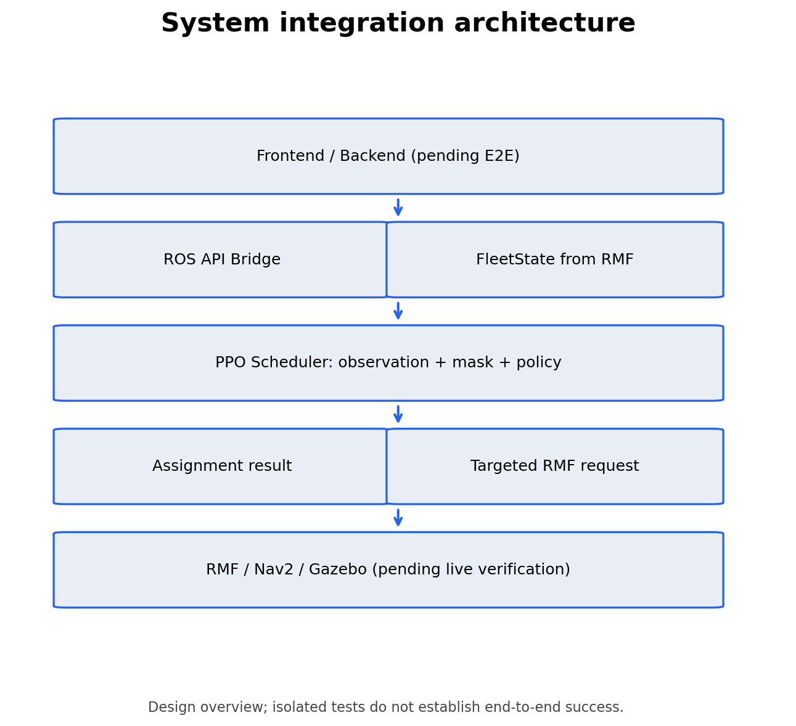
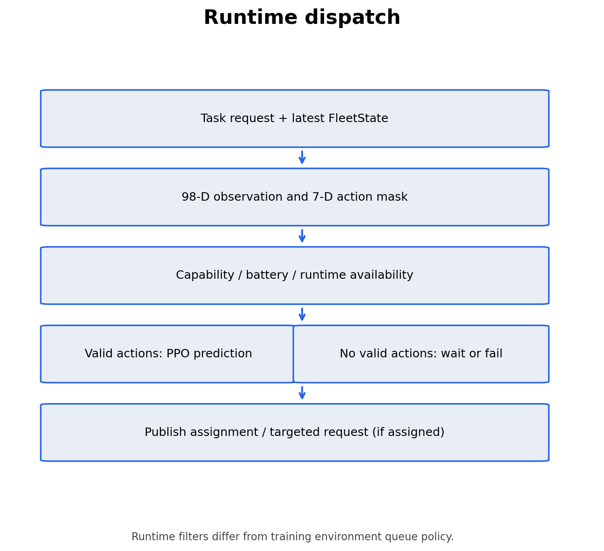
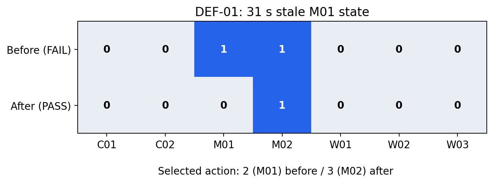
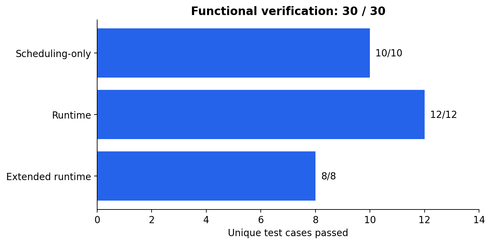
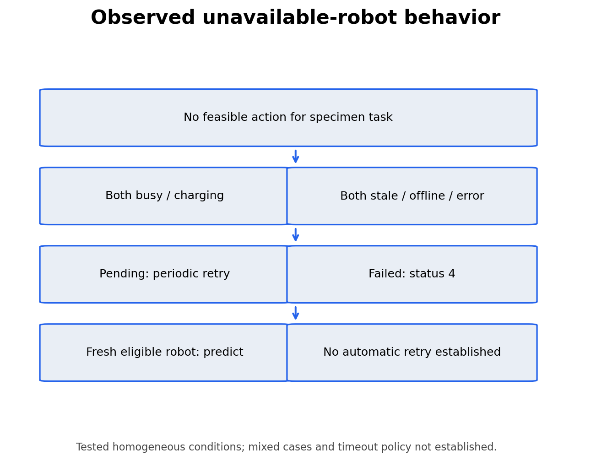
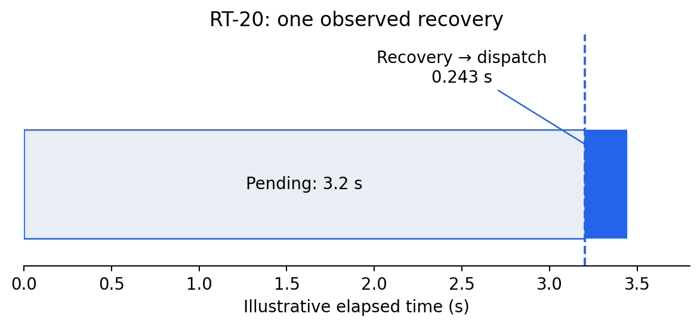
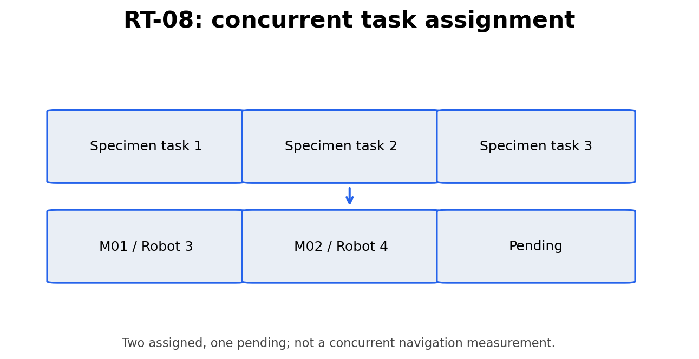
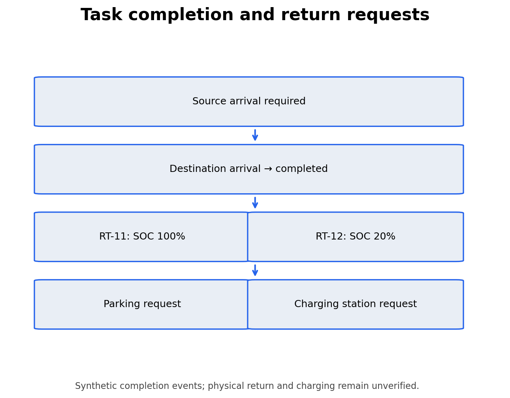

# 07 System Integration — 系統整合與驗證

> Part A：正式模型部署與 Scheduler 功能驗證（2026-11-28 已完成）；Part B：Gazebo 與前後端端到端驗證（待執行）。本文件為階段性成果，不代表完整系統已驗收。

## 7.1 研究目的

將第 04–06 章選定的 Maskable PPO 策略部署至 ROS 2 醫院異質多機器人系統，確認模型身分、輸入輸出相容性、派工限制及任務生命週期的基本邏輯。先以隔離環境驗證 Scheduler，再使用實際 Gazebo、RMF、Nav2 與前後端進行整合，避免混淆演算法與模擬環境問題。

## 7.2 系統架構與責任邊界

Backend 建立任務後透過 ROS API Bridge 發送 JSON 至 `/hospital_task_request`；Scheduler 接收 `/fleet_states`，建立 98 維 Observation 與七維 Action Mask，使用正式策略選擇機器人，再經 `/task_api_requests` 發布指定機器人的 RMF 請求。`/hospital_ppo_assignment` 回報派工結果，`/hospital_rmf_activity_completed` 提供抵達事件。RMF 負責交通協調，Nav2 負責導航，Gazebo 負責模擬執行。此處描述設計及已驗證的局部介面，尚未證明整條鏈路可運作。

## 7.3 正式模型部署

| 項目 | 設定 |
|---|---|
| 模型 | Nav2 Sweep 12 Seed 7101 |
| 演算法 | Maskable PPO / MlpPolicy |
| Fleet | Clean 2、Medical 2、Ward 3 |
| Observation | Box(0,1,(98,),float32) |
| Action | Discrete(7) |
| 訓練步數 | 200192（目標 200000） |
| Reward W/A/Q/I | 0.40 / 0.35 / 0.15 / 0.10 |
| Approach normalization | 600 s |
| 推論 | CPU、deterministic=True |
| Model SHA-256 | `1972295e176e6907d3bee4d01b301fa10526dac40dca38a5e867fe1a63825d07` |
| Scheduler 最終測試 SHA-256 | `eec1ad5bd06d84db696e513a39bda0fef9a21c0d76ac857e2ef25f1b88321a67` |

模型位於 `experiments/fleet_sizing/results_rl/models/reward_confirm_nav2_sweep12_w40_a35_q15_i10_seed7101_200k/final_model.zip`。啟動時驗證模型雜湊、seed、Observation 與 Action space、訓練步數；推論前檢查 Observation 是否符合空間。正式 launch 使用專案 `.venv_rl/bin/python` 執行 Source Scheduler。未重新訓練模型。

| Action | Logical ID | RMF ID |
|---:|---|---|
| 0 | C01 | hospital_robot_1 |
| 1 | C02 | hospital_robot_2 |
| 2 | M01 | hospital_robot_3 |
| 3 | M02 | hospital_robot_4 |
| 4 | W01 | hospital_robot_5 |
| 5 | W02 | hospital_robot_6 |
| 6 | W03 | hospital_robot_7 |

## 7.4 跨電腦推論一致性

以第 04 章的 T00153 範例比較 WSL 與實驗室主機 CPU 推論。兩者輸入 98 維 Observation、Mask `[0,0,1,1,0,0,0]`，皆選 Action 2（M01）。實驗室主機 Masked probabilities 為 M01 0.8139892816543579、M02 0.1860107183456421，其餘為零。原始及遮罩後機率的最大絕對差均為 5.960464477539063e-08；Critic 值 -16.746944427490234，差為 0。此結果為單一固定輸入的數值一致性檢查，不是跨平台全面等價證明。

## 7.5 Nav2 校準資料相容性

| 項目 | 結果 |
|---|---:|
| 歷史圖具名節點 | 51 |
| 部署圖具名節點 | 66 |
| Canonical locations | 16 |
| 缺失位置／座標改變 | 0 / 0 |
| 有向路徑組合 | 256 |
| 最短距離改變／不可達 | 0 / 0 |
| 經驗校準路線 | 31 |
| 有效速度 (m/s) | 0.3289677419354839 |

校準 CSV SHA-256 `0baf6a695bacd2dac8f99a9e1b540dbb30901dfff0086afb93a0666acf030399` 與研究版相同。部署圖 SHA-256 `04509ab6bf706a6274d6a88ae2c19f106646e857343e5efc8a223240843900d3`。歷史圖 SHA-256 `91c491b860ce97036ecceba4cf2460085baf9169d22484c1328cd722dc94bf79`。有經驗資料時使用有向路線平均耗時，否則以最短圖距離除以有效速度估算。例如 pharmacy→ward_a_2 115.296 s（經驗），反向 146.6996408 s（估算）。此檢查只證明既有位置的估算資料相容，不證明新增停車點、實際交通或更新後 Gazebo 的導航耗時一致。

## 7.6 Scheduling-only 功能測試

測試於 ROS_DOMAIN_ID=187、LOCALHOST、Fast DDS 的隔離環境執行。使用七台合成機器人資料，發布任務訊息、擷取真實模型推論與派工回報，不啟動 RMF Adapter 或 Gazebo。

| ID | 情境 | 預期／實際結果 | 判定 |
|---|---|---|---|
| TC-08A | waste_transport | Mask 1100000，C01 | PASS |
| TC-08B | clothes_collection | Mask 1100000，C01 | PASS |
| TC-08C | specimen_delivery | Mask 0011000，M01 | PASS |
| TC-08D | medication_delivery | Mask 0011111，W01 | PASS |
| TC-08E | ward_service | Mask 0000111，W01 | PASS |
| TC-09A | M01 SOC 10%、急件 | Mask 0001000，M02 | PASS |
| TC-09B | M01/M02 SOC 10% | Status 4，無 PPO 推論 | PASS |
| TC-10A | 重複任務 | 一次推論、一次回報、一次入列 | PASS |
| TC-10B | 未到預約時間 | 未提前推論或派工，時間到後 W02 | PASS |
| TC-SAFETY | 隔離保護 | RMF requests = 0 | PASS |

原始結果：[JSON](data/scheduling_only_test_results.json)、[Log](logs/scheduling_only_test.log)、[測試程式](scripts/test_hospital_ppo_dispatch.py)。修正後：[JSON](data/scheduling_only_test_after_fix.json)、[Log](logs/scheduling_only_test_after_fix.log)。

## 7.7 Runtime Mode 功能測試

使用 ROS 2 訊息注入合成 FleetState、任務完成事件，執行正式 Scheduler（Scheduling-only 關閉），擷取 RMF 請求。未啟動真正 Fleet Adapter，故請求發布不等於 RMF 接受或導航成功。

| ID | 情境 | 修正前 | 修正後 |
|---|---|---|---|
| RT-01 | 七台機器人狀態轉換 | PASS | PASS |
| RT-02 | M01 busy、M02 idle | PASS | PASS |
| RT-03 | 兩台皆忙碌，任務 Pending | PASS | PASS |
| RT-04 | 恢復閒置後重新派工 | PASS | PASS |
| RT-05 | 未收到 M01 狀態 | PASS | PASS |
| RT-06 | M01 adapter error | PASS | PASS |
| RT-07 | M01 狀態過期 | FAIL | PASS |
| RT-08 | 三筆檢體任務並行 | PASS | PASS |
| RT-09 | 指定機器人 RMF payload | PASS | PASS |
| RT-10 | 先收到目的地事件 | PASS | PASS |
| RT-11 | 正確來源地與目的地順序 | PASS | PASS |
| RT-12 | 任務完成時 SOC 20% | PASS | PASS |

[修正前 JSON](data/runtime_test_before_fix.json) · [修正後 JSON](data/runtime_test_after_fix.json) · [測試程式](scripts/test_hospital_ppo_runtime.py) · [回歸摘要](data/runtime_regression_summary.csv)

## 7.8 DEF-01 缺陷修正

原先只有停車相關邏輯檢查 FleetState 的接收時間，一般閒置機器人即使停止更新仍可能被派工。RT-07 注入 M01 狀態年齡 31 秒，修正前 Mask 0011000、Action 2；修正後 Mask 0001000、Action 3。以 `time.monotonic()` 計算接收年齡，Runtime 超過 30 秒或未接收狀態即視為 offline；不刪除已執行任務、佇列或充電紀錄。Scheduling-only 不受此限制。30 秒沿用既有停車時效條件，尚非臨床規範；上游重送舊資料的情形尚未驗證。

[修正差異](data/DEF-01_stale_state_fix.diff) · [修正前快照](data/scheduler_before_stale_state_fix.py) · [修正後快照](data/scheduler_after_stale_state_fix.py) · [回歸 Manifest](data/regression_manifest.json)

## 7.9 延伸測試與總結

| ID | 情境 | 實際結果 | 判定 |
|---|---|---|---|
| RT-13 | 注入 10 秒狀態年齡 | M01 仍可派工 | PASS |
| RT-14 | 兩台狀態皆過期 | Status 4，無推論及 RMF 請求 | PASS |
| RT-15 | 重新回報正常狀態 | offline→idle，可派工 | PASS |
| RT-16 | 執行任務時狀態過期 | 保留原任務，新任務給 M02 | PASS |
| RT-17 | 兩台充電中 | Pending | PASS |
| RT-18 | 兩台離線 | Status 4 | PASS |
| RT-19 | 兩台故障 | Status 4 | PASS |
| RT-20 | 充電狀態恢復 | 原 Pending 任務派給 M02 | PASS |

共 30 個不同測試案例：Scheduling-only 10/10、Runtime 12/12、Extended 8/8。修正前 Runtime 11/12，修正後原有 22 個回歸案例全部通過。延伸測試的部分 PASS 意指沒有非法派工且結果為明確的 Pending 或 Failed，並非等待政策已完成需求驗收。四份 Manifest 所涵蓋 19 份不同檔案皆通過 SHA-256 與大小驗證（SYS-01 另外封存）。

[延伸測試 JSON](data/runtime_extended_test_results.json) · [Log](logs/runtime_extended_test.log) · [測試程式](scripts/test_hospital_ppo_runtime_extended.py) · [30 項總表](data/scheduler_functional_test_summary.csv) · [功能驗證 Manifest](data/scheduler_functional_manifest.json)

## 7.10 延後派工與任務生命週期

Runtime 中相容機器人皆忙碌或充電時任務可保留於 Pending，每秒檢查一次。兩台相容機器人皆離線、過期或故障的測試則回傳 Status 4。所有電量不足的失敗行為僅於 Scheduling-only 驗證。混合不可用狀態及等待上限尚未全面驗證；不應解讀為所有無可用機器人的任務都會等待。

RT-20 等待觀察 3.2 s，期間 PPO 與 RMF 請求皆為 0；注入 M02 SOC 80% / idle 後，量測至確認派工及請求的時間為 0.2428873479948379 s。此為單次隔離測試，非平均值或最大延遲保證。

RT-08 三筆檢體任務依次分配 M01、M02、Pending，確認不重複占用機器人。此為派工並行，不是導航並行測試。

RT-10/11 確認目的地事件不能先於來源地完成；正確事件順序使任務 completed 並發布 parking_medical_1 請求。RT-12 在 SOC 20% 完成任務時（低於 25% 返充門檻）發布 charging_station_2 請求。尚未驗證實際抵達、停車取消、充電至 80% 或恢復執行的完整生命週期。

## 7.11 ROS Install 同步（SYS-01）

使用 `colcon build --packages-select my_hospital_rmf --event-handlers console_direct+` 成功同步。Source 與 Install 的 Scheduler、hospital.launch.py、Nav Graph 三項 SHA-256 一致；Scheduler 與 30 項測試版本相符。舊版 Install 已備份。結果：[SYS-01 JSON](data/ros_install_verification.json)。此為檔案身分驗證，不是啟動成功驗證。

## 7.12 Backend API 與資料介面（待驗證）

下一階段將核對 HTTP request、ROS JSON、Task ID、五種任務類型、priority 0–3、時間欄位及 Status 3/4 映射，並確認 Pending、失敗及完成事件是否能在後端持久化及前端呈現。尚未完成 Backend 端到端驗證。

## 7.13–7.16 實際系統驗證（待執行）

| ID | 測試 | 驗收條件 |
|---|---|---|
| SYS-02 | Gazebo 啟動 | 七台生成 |
| SYS-03 | Controller | 七台控制器 active |
| SYS-04 | Nav2 | 七台導航生命週期 active |
| SYS-05 | TF / Localization | 七台具有有效定位 |
| SYS-06 | FleetState | 七台持續更新 |
| SYS-07 | PPO | 正式模型 hash / seed 正確 |
| SYS-08 | 單筆檢體任務 | RMF 接受、Nav2 執行、完成 |
| SYS-09 | 五種任務 | 合法機器人執行 |
| SYS-10 | 多機器人導航 | 並行及交通協調 |
| SYS-11 | 停車 | 實際返回指定停車區 |
| SYS-12 | 停車中斷 | 安全停止並接新任務 |
| SYS-13 | 充電 | 返程、充電、恢復可用 |
| SYS-14 | 端到端 | 網站建立至完成狀態回報 |

待組員 GPU 修正推送後檢查 Git Diff，確認是否涉及導航、地圖或物理參數。僅渲染修正不必重訓模型；若改變校準條件須評估校準有效性。使用獨立 ROS Domain、Gazebo Partition 並檢查 TCP Port 和共用日誌清理範圍。記錄 GPU/CPU 負載、模擬時間及實際時間，避免將效能瓶頸誤認為 PPO 缺陷。

## 7.17 階段結論與限制

Part A 已完成：正式模型身分、單一跨電腦推論範例、既有路線相容性、30 項隔離功能測試、DEF-01 修正及 Install 同步。Part B 未完成；目前沒有實際七台導航成功率或完整網站任務完成率。研究環境允許忙碌機器人排隊，部署 Runtime 則排除忙碌機器人（停車另有特殊處理），因此第 06 章統計效能不能直接當成完整系統效能。GPU 更新及後端等待政策尚需確認。

## 封存索引

- [Scheduling-only manifest](data/scheduling_only_manifest.json)
- [Runtime before-fix manifest](data/runtime_before_fix_manifest.json)
- [Regression manifest](data/regression_manifest.json)
- [Functional manifest](data/scheduler_functional_manifest.json)
- 圖表產生程式：[plot_system_integration.py](scripts/plot_system_integration.py)，PNG 與 SVG 同步輸出。
