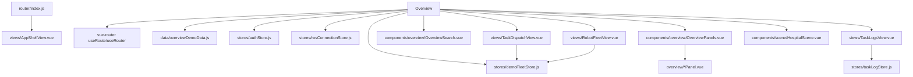

# AppShellView 單元測試導讀

這份文件以 `src/views/AppShellView.vue` 為中心，說明它和其他前端檔案的關係，以及如何為這個頁面設計單元測試。目的不是測試所有子元件的視覺細節，而是確認 `AppShellView` 是否正確協調資料、路由、瀏覽器 API 和子元件事件。

## 1. 被測單位的責任

`AppShellView.vue` 是頁面協調器，主要負責：

- 根據目前路由與 query string 決定 `activeSection`。
- 根據 `activeSection` 顯示首頁、任務派遣、機器人狀態、任務日誌或即時地圖。
- 從 `demoFleetStore` 和 `overviewDemoData` 組合 `sharedOverviewData`，傳給 `OverviewPanels`。
- 管理首頁面板顯示設定，並保存到 `localStorage`。
- 管理 light/dark 主題，並同步到 `document.documentElement.dataset.theme` 和 `localStorage`。
- 管理搜尋結果、使用者選單、個人資料 dialog、登出和全螢幕操作。
- 在掛載和卸載時註冊、移除 `pointerdown` 與 `fullscreenchange` 事件。

頁面的 CSS 不應成為這份單元測試的主要範圍。CSS、動畫與 3D 模型應由瀏覽器整合測試或專門的元件測試負責。

## 2. 檔案關聯圖



### 重要資料流

```text
demoFleetStore.robots/tasks
              + overviewDemoData 的 system/tasks 基礎資料
              v
        sharedOverviewData
              v
        OverviewPanels props
              v
      各個 overview panel
```

`sharedOverviewData` 的重點不是複製一份固定 demo 資料，而是：

- `robots` 直接使用 `demoFleetStore.robots.value`。
- `fleet.online` 排除 `state === 'offline'` 的機器人。
- `fleet.total` 是目前機器人數量。
- `fleet.activeTasks` 計算 `status === 'executing'` 的任務。
- `fleet.charging` 計算 `state === 'charging'` 的機器人。
- 其他欄位沿用 `overviewDemoData`。

因此，`AppShellView` 的資料測試應驗證「store 變動會反映到傳給頁面的資料」，而 `getTaskCompletion`、`getAverageBattery` 等純計算則留在 `overviewDemoData.test.js` 或各 Dashboard 元件的測試。

## 3. 建議的測試隔離方式

目前專案使用 Vitest 和 `@vue/test-utils`。測試 `AppShellView` 時建議：

1. 使用 `createMemoryHistory()` 建立測試 router。
2. 用 `global.stubs` 隔離 `HospitalScene`、`OverviewPanels`、`OverviewSearch`、背景元件和三個子頁面。
3. 保留 `AppShellView` 自己的 template，讓導覽按鈕、主題按鈕、面板設定和使用者選單仍然是真實 DOM。
4. 每個測試自行建立 wrapper，並在結束時 `unmount()`。
5. 測試前清除本頁使用的 localStorage key，避免測試順序影響結果。

最小 mount 骨架如下：

```js
import { mount } from '@vue/test-utils'
import { createMemoryHistory, createRouter } from 'vue-router'
import { afterEach, describe, expect, it, vi } from 'vitest'
import AppShellView from '@/views/AppShellView.vue'

const createTestRouter = async (path = '/') => {
  const router = createRouter({
    history: createMemoryHistory(),
    routes: [
      { path: '/', name: 'overview', component: { template: '<div />' } },
      { path: '/login', name: 'login', component: { template: '<div />' } },
      { path: '/task-logs', name: 'task-logs', component: { template: '<div />' } },
    ],
  })
  await router.push(path)
  await router.isReady()
  return router
}

const stubs = {
  AppAmbientBackground: true,
  OverviewRouteBackground: true,
  OverviewPanels: true,
  OverviewSearch: true,
  QuickTaskLog: true,
  HospitalScene: true,
  TaskDispatchView: { template: '<div data-test="dispatch-view" />' },
  RobotFleetView: { template: '<div data-test="robot-view" />' },
  TaskLogsView: { template: '<div data-test="logs-view" />' },
}

afterEach(() => {
  localStorage.clear()
  document.documentElement.dataset.theme = 'light'
  vi.restoreAllMocks()
})
```

## 4. 測試案例清單

### A. 初始狀態與主題

測試目的：確認 mount 時會讀取主題，且 watcher 會立即同步 HTML 根元素。

- 沒有 storage 時預設為 light。
- `hospital-rmf-color-theme = 'dark'` 時，`data-theme` 是 `dark`。
- 點擊 `.theme-toggle` 會在 light/dark 之間切換。
- 切換後會更新 `localStorage`，且按鈕的 `aria-label` 會跟著變化。
- 非 `dark` 的 storage 值應回到 light。
- `localStorage.getItem` 拋錯時，頁面仍然可以 mount，主題仍能在記憶體中切換。

專案目前的 [themeSwitch.test.js](../test/themeSwitch.test.js) 已經涵蓋基本切換；新增測試前先確認不要重複測同一個行為。

### B. 導覽與路由

測試目的：確認頁面導覽是 `activeSection` 的唯一入口，並且 task logs 特別依賴 router name。

- 初始 `/` 顯示 `OverviewPanels`，且首頁導覽按鈕有 `aria-current="page"`。
- 點擊「任務派遣」顯示 `TaskDispatchView` stub。
- 點擊「機器人狀態」顯示 `RobotFleetView` stub。
- 點擊「即時地圖」顯示 `HospitalScene` stub，且首頁背景元件不顯示。
- 點擊「任務日誌」呼叫 router，並切到 `task-logs` route。
- 從 `/task-logs` 進入時，初始 `activeSection` 是 `task-logs`，並顯示 `TaskLogsView`。
- 從 task logs 點回其他區段時，應離開 `/task-logs`，避免畫面狀態和 URL 不一致。
- 不允許的 section id 不應改變目前畫面。

這裡要分清楚兩層責任：`AppShellView` 決定要切哪個頁面；`ClinicOverviewView`、`TaskDispatchView`、`RobotFleetView`、`TaskLogsView` 各自負責自己的資料和互動測試。

### C. 面板顯示設定與 localStorage

測試目的：確認使用者設定只影響首頁面板，不會影響其他 section。

- 點擊「首頁面板顯示」按鈕後，drawer 出現。
- drawer 內有七個 panel toggle：`completion`、`schedule`、`tasks`、`fleet`、`summary`、`robots`、`taskProgress`。
- 點擊 checkbox 會更新 `visiblePanels`，並把完整設定寫入 `hospital-rmf-overview-visibility`。
- 初始 storage 只有部分欄位時，應與 default visibility merge，而不是遺失其他欄位。
- storage 是非法 JSON 時，應退回全部開啟的 default visibility。
- 關閉 drawer 不應修改面板設定。
- 面板設定改變時，應透過 `OverviewPanels` 的 `visible-panels` prop 傳下去。

這組測試可以用一個帶有 render stub 的 `OverviewPanels`，把接收到的 prop 印在 `data-visible-panels` 或測試元件狀態中，避免測試子面板的 CSS。

### D. OverviewPanels 的事件往上傳

測試目的：確認子元件事件會被 `AppShellView` 轉成導覽或選取狀態。

建議讓 stub 主動 emit：

```js
const overviewPanelsStub = {
  emits: ['open-robot-status', 'select-task'],
  template: '<button data-test="open-robots" @click="$emit(\'open-robot-status\')">robots</button>',
}
```

應驗證：

- `open-robot-status` 會切換到 `RobotFleetView`。
- `select-task` 會更新 `selectedOverviewTaskId`，並把新的 task/robot id 傳給 `QuickTaskLog`。
- 找不到指定 task 時，會 fallback 到第一個 `executing` task；完全沒有時才是 null。

### E. 搜尋結果往上傳

`OverviewSearch.vue` 只負責搜尋、鍵盤操作和 emit；`AppShellView` 負責解讀 `result.section`。

測試可用 stub emit 一個結果：

```js
const searchStub = {
  emits: ['select'],
  template: '<button data-test="search-dispatch" @click="$emit(\'select\', { section: \'dispatch\' })">search</button>',
}
```

驗證點：

- section 是 `dispatch`、`map` 或 `robots` 時，頁面切換到對應區段。
- section 是 `history` 時，目前 `selectSection` 會拒絕它；這是值得在測試中明確記錄的現況，因為 `OverviewSearch` 的 search item 有 `history`，但 `AppShellView` 的允許清單沒有 `history`。

這個差異是目前檔案關聯中很重要的線索：搜尋元件提供結果，頁面元件決定哪些結果真的可導航。

### F. 使用者選單、個人資料與登出

測試目的：驗證 `authStore` 和 router 的協作，不測試 store 本身已經測過的細節。

- 點擊使用者按鈕會顯示 `role="menu"`。
- 點擊「編輯個人資料」會把目前使用者名稱和 avatar 帶入 dialog。
- 空白名稱時，儲存按鈕 disabled。
- 選擇不支援的檔案類型時顯示錯誤。
- 超過 3 MB 時顯示錯誤。
- `FileReader.onload` 後顯示預覽並清除錯誤。
- `authStore.updateProfile` 成功時關閉 dialog。
- `authStore.updateProfile` 拒絕時保留 dialog 並顯示錯誤。
- 點擊登出會呼叫 `authStore.logout()`，關閉選單，再導向 `/login`。

若要測試檔案預覽，應 mock `FileReader`；不要真的依賴瀏覽器讀取本機檔案。

### G. 全螢幕與生命週期清理

測試目的：確認頁面使用瀏覽器 API 時不會留下全域 listener。

- 沒有 `document.fullscreenElement` 時，點擊全螢幕按鈕會呼叫 `document.documentElement.requestFullscreen`。
- 已在全螢幕時會呼叫 `document.exitFullscreen`。
- mount 後註冊 `pointerdown` 和 `fullscreenchange`。
- unmount 後移除相同的 listener。
- 點擊使用者選單外部會關閉選單。

可以用 `vi.spyOn(document, 'addEventListener')` 和 `vi.spyOn(document, 'removeEventListener')` 驗證註冊與清理；這比測試 timeout 或 CSS transition 更穩定。

## 5. 不應在這份測試重複驗證的內容

- `OverviewSearch.vue` 的模糊搜尋、方向鍵循環和 Escape：放在 `OverviewSearch` 測試。
- `OverviewPanels.vue` 各面板是否正確 render：放在 `OverviewPanels` 測試。
- `getTaskCompletion`、`getAverageBattery`：放在 [overviewDemoData.test.js](../test/overviewDemoData.test.js)。
- `demoFleetStore` 的任務衝突、電量和機器人驗證：放在 store 測試。
- `TaskLogsView` 的拖放與 task log 狀態：放在 `taskLogs.test.js`。
- `HospitalScene` 的 GLB 載入、相機與 Three.js 行為：放在 scene 或整合測試。

## 6. 建議的實作順序

1. 先複製現有 [themeSwitch.test.js](../test/themeSwitch.test.js) 的 router 與 stubs 設定，建立 `overviewView.test.js`。
2. 先寫 A、B、C，這三組只依賴頁面本身，失敗時最容易定位。
3. 再寫 D、E，確認 props/events 的上下資料流。
4. 最後寫 F、G，因為它們需要 mock auth、FileReader 或瀏覽器 API。
5. 執行單檔測試：`npm test -- --run test/overviewView.test.js`。
6. 全部完成後執行：`npm test`。

## 7. 閱讀這個頁面的推薦順序

若目標是理解前端檔案之間的關聯，建議按這個順序閱讀：

1. [AppShellView.vue](../src/views/AppShellView.vue)：先找 state、computed、watch、事件 handler。
2. [router/index.js](../src/router/index.js)：確認哪些 URL 會載入它，以及 route name 如何影響初始狀態。
3. [demoFleetStore.js](../src/stores/demoFleetStore.js)：了解 robots/tasks 的來源和可變動性。
4. [overviewDemoData.js](../src/data/overviewDemoData.js)：了解首頁固定資料與純函式衍生值。
5. [OverviewPanels.vue](../src/components/overview/OverviewPanels.vue)：追蹤 `data`、`visible-panels` 和 child emits。
6. [OverviewSearch.vue](../src/components/overview/OverviewSearch.vue)：追蹤搜尋結果如何回到頁面導覽。
7. [authStore.js](../src/stores/authStore.js) 與 [rosConnectionStore.js](../src/stores/rosConnectionStore.js)：理解頂部工具列的外部狀態。
8. 最後才深入 [TaskDispatchView.vue](../src/views/TaskDispatchView.vue)、[RobotFleetView.vue](../src/views/RobotFleetView.vue) 和 [TaskLogsView.vue](../src/views/TaskLogsView.vue)。

核心判斷方式是：看到 `props` 就往子元件追資料來源，看到 `emit` 就往父元件追事件處理，看到 store 或 router 就另外建立它的單元測試邊界。
