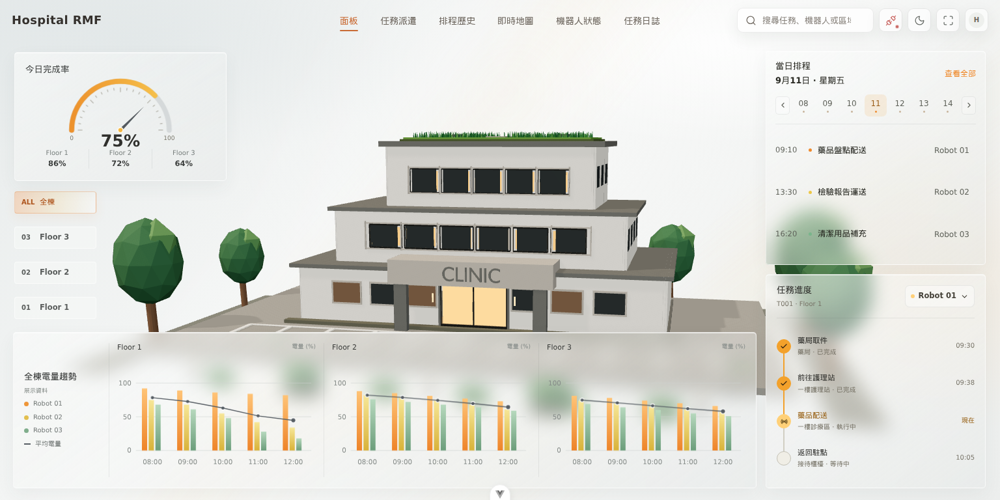
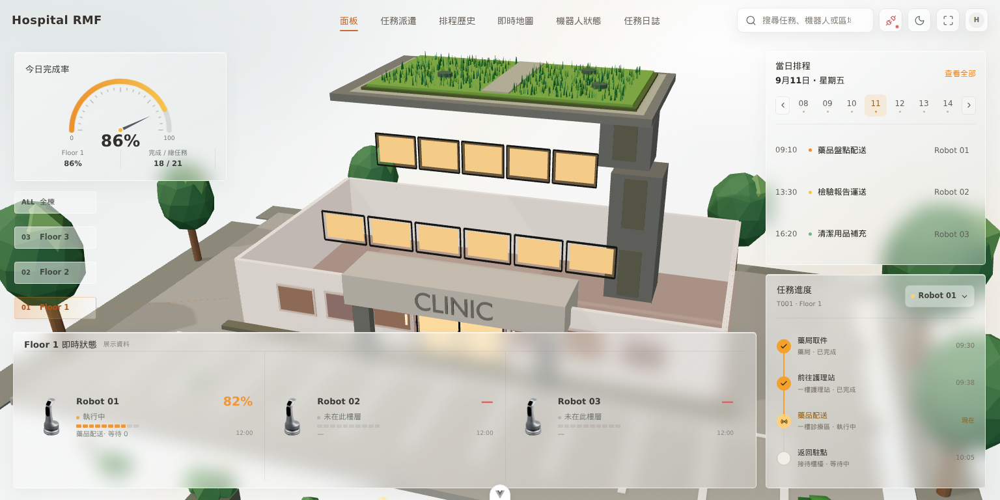

# Overview Navbar、底部模式與相機復位驗收

2026-09-11，實際 Chromium 1536×768。

## 修改檔案

- `src/app.css`：Navbar 與 Tool Panel 獨立 tokens。
- `src/views/AppShellView.vue`：Navbar 字級／控制尺寸，將現有任務列表傳給 Overview。
- `src/components/overview/OverviewSearch.vue`：13px 搜尋文字。
- `src/views/ClinicOverviewView.vue`：兩種 Bottom mode、樓層資料接線、300ms 模式切換。
- `src/components/overview/BuildingTrendPanel.vue`（新增）：三層每小時電量 SVG 圖表。
- `src/components/overview/FloorRobotStatusPanel.vue`（新增）：單層即時狀態、現有 thumbnail、10 格電量。
- `src/data/overviewStatusData.js`（新增）：集中歷史 fallback、樓層正規化、機器人樓層狀態 adapter。
- `src/components/scene/ClinicOverviewScene.vue`：取消舊 tween、850ms Home 復位、材質與 visibility 還原、保留原有暖光。
- `src/three/clinicOverviewPresets.js`：本次指定預設 Home position／target。
- `src/three/clinicOverviewLighting.js`：exposure、補光色彩與陰影。
- `test/overviewStatusData.test.js`、`test/overviewBottomModes.test.js`（新增）、`test/clinicOverviewPresets.test.js`（更新）。
- 本文件、`screenshots/overview-building-trend-1536x768.png`、`screenshots/overview-floor1-realtime-1536x768.png`。

## 字級與固定排版

品牌 18px / 600；Navbar `--navbar-font-size:14px` / 500；搜尋 13px；icon button 36×36px。
Tool Panel 獨立 `--tool-panel-title-size:13.5px` / 600，Bottom header 同為 13.5px。
單層 Robot 名稱 13px / 600；電量 19px / 600；狀態 11.5px / 500；meta 10.5px / 400。
保留透明 Navbar、active 底線，未增加 Navbar 外框或頂部分隔線。
Bottom 固定 116px，模式過渡離場／入場各 150ms，共約 300ms。Right Rail 與中央模型 transform 未改動。

## 資料與模式

- `building-trend`：全棟顯示 118px 圖例區與 Floor 1～3 圖表；每小時三台電量柱、實際算術平均線、最新節點與 SVG title。
- `floor-realtime`：單層 header + 三等寬 Robot 欄；不在此樓層的機器人顯示「未在此樓層」，電量為 —、任務為 null，不複用他層任務。

`createFloorRobotStatus()` 輸出 `floorRobotStatus[floorId][robotId]`，欄位含 floorId、robotId、battery、status、currentTask、pendingTaskCount、updatedAt 與 thumbnailUrl。沿用 Three.js 的數字樓層選擇，在 UI adapter 正規化為 floor1／floor2／floor3，沒有改寫既有樓層資料。

電量／狀態／任務優先讀目前 `data.robots` 與既有 fleet task list；樓層優先讀 floorId／floor／location.level_name。現有 Overview 是 demoFleetStore，沒有歷史 API 或樓層遙測接入，因此 demo 模式在單一 `overviewStatusData.js` 定義 R01→Floor 1、R02→Floor 2、R03→Floor 3。非 demo 沒有位置資料時顯示未知，不能把展示樓層視為真實遙測。

歷史來源優先 `data.batteryHistory`；沒有來源且為 demo 時才使用集中、固定的 08:00～12:00 fallback，頁面明示「展示資料」。非 demo 沒有歷史時顯示無資料，不產生隨機歷史。

## 動畫與 thumbnail

全棟：Floor 間隔 100ms；柱子 600ms 自基準線生長、Robot 間隔 75ms；平均線 1200ms 描繪、節點間隔 190ms。無循環。
單層：Robot 間隔 100ms；10 格，每格間隔 55ms、亮起 180ms；百分比沿用獨立 `useCountUp` 850ms；狀態點最後淡入。
電量更新保留面板與 Robot DOM，不重建全部資料列；測試驗證 82→79 後節點相同。
thumbnail 重用 `/images/robot-thumbnail.png`；48×60px preview，圖檔透明留白以 CSS 定位補償，模型本體约 56px 高。未新增 WebGL renderer，三台尺寸一致。

## 相機與材質

`restoreOverviewHome()` 先取消 `cameraTween`，再以同一個 850ms tween 同步插值 camera.position、camera.userData.target、OrbitControls.target，結束後 controls.update()。減少動態效果模式立即復位。
Home 沿用有效 localStorage preset 優先，否則：position (18.8923,13.6026,23.7785)、target (0.3037,5.008,2.1384)。模型 transform 不變。
修正舊行為：直接套 preset 沒有取消仍在執行的 floor tween，導致後續動畫可覆寫剛恢復的位置。

載入 GLB 時材質只 clone 一次；保存可見性、color、emissive、emissiveIntensity、opacity、transparent、depthWrite。保存點移到玻璃初始化之後；切回全棟直接還原，不重新 clone。既有 disposal 釋放資源。
實測正常切換及 120ms 內快速往返回全棟，三層 visible 全為 true、alteredMaterials 為 0，position／target 與 Home 完全一致。

## 光影

SRGBColorSpace、ACESFilmicToneMapping、exposure 1.0、PCFSoftShadowMap。
既有 hemisphere 1.25（#fff8ec / #8a8d88）、key 3.0（#ffead1）、fill 1.25（#e8eef0）、rim 0.12。沿用同一燈組，未重複建立。
Key 基準方向 (-10,18,12)，fill (12,9,10)；2048² shadow map，陰影 intensity 由 .55 降至 .35，radius 3。保留按模型範圍 fit shadow frustum。
`Clinic_Dark_Gray` 使用 RGB (.15,.16,.16) 使屋頂呈深灰；`Clinic_White` (.78,.79,.78)。
實際 GLB 已有 UP_DoorGlass／UP_WindowGlass emissive，沒有 KHR light extension，保留既有暖光；僅確切匹配指定入口／少量窗戶名稱且原 emissive 為零時，補 #ffb66f / .12。未對黑色材質或屋頂套 emissive。

## 檢查

- `npm run build`：通過；仍有 bundle >500kB 提示。
- `npm run typecheck`：已執行，package.json 缺少 script，未通過。
- `npm run lint`：已執行，package.json 缺少 script，未通過。
- 5 組相關 Vitest、12 個測試通過。
- document.scrollHeight = innerHeight = 768，沒有垂直捲動。
- 全棟 3 個圖表；Floor 1 有 3 個 Robot 欄、30 個電量格，只有 R01 在該樓層。
- 兩種模式皆高 116px；品牌 18px、選單 14px、Robot 名稱 13px、thumbnail 48×60px。
- 正常及快速樓層切換後 Home、target、材質與 visibility 均復原。
- 瀏覽器沒有 JavaScript 執行錯誤。
- API／WebSocket 介面未修改；未建立真實機器人連線，因此沒有宣稱真實遙測端到端驗收通過。

