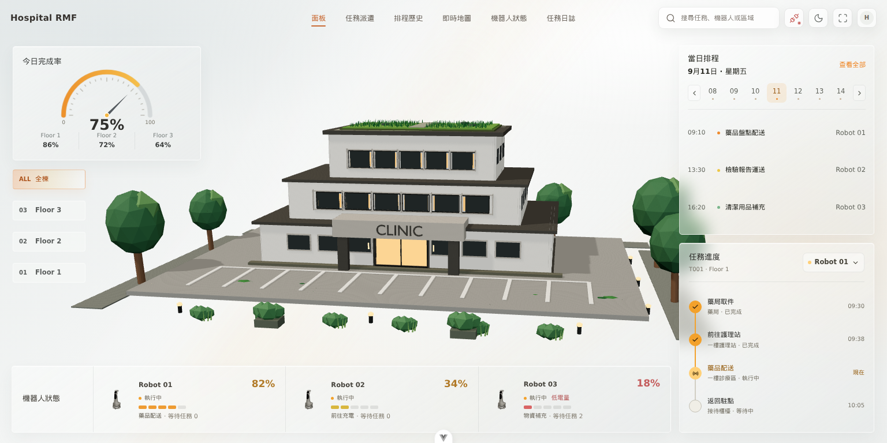

# Overview 珍珠白灰視覺驗收

驗收：1536×768，Chromium，2026-09-11。

## 修改檔案

- `src/app.css`：全站 typography tokens、字型平滑、共用玻璃面板、入場動畫、App Shell pseudo-element 光束、reduced-motion。
- `src/styles/theme.css`：更新既有 `--app-background-image`，共用圓角 tokens。
- `src/views/AppShellView.vue`：套用 app-shell、品牌與導覽字級、9px icon controls。
- `src/views/ClinicOverviewView.vue`：移除相互覆蓋的舊 Overview CSS，保留單頁絕對定位與 debug 操作。
- `src/components/overview/FloorSelector.vue`：固定樓層按鈕、漸層、只 render 選取的連線。
- `src/components/overview/F1SpeedGauge.vue`：刻度／弧線／指針／數值動畫、灰色指針。
- `src/components/overview/OverviewCalendar.vue`：當日排程標題、小字級、橫向逐列動畫。
- `src/components/overview/TaskProgressTimeline.vue`：小字級、逐站進場、active 節點最後出現且 pulse 一次。
- `src/components/overview/RobotStatusPanel.vue`：逐台入場、14×6px 五段電量、百分比 tween。
- `src/components/overview/AnimatedBatteryValue.vue`：新增獨立電量數值元件。
- `src/components/overview/RobotPreviewStrip.vue`：固定展示，只在載入、resize、theme 更新時 render。
- `src/components/overview/OverviewSearch.vue`：搜尋字級與控制圓角。
- `src/composables/useCountUp.js`：支援個別初始延遲，保留前值 tween 與取消排程。
- `src/components/scene/ClinicOverviewScene.vue`：只投影選取樓層的外緣、白牆中性色、入口玻璃微暖 emissive。
- `src/three/clinicOverviewLighting.js`：調整既有燈光，不疊加新燈組。
- `test/clinicFloorSelector.test.js`：增加 hover／單條線／回全棟互動測試。
- 本驗收文件與 `screenshots/overview-pearl-1536x768.png`。

## Typography 與面板

| 項目 | 字級 / weight |
| --- | --- |
| 品牌 | 15px / 600 |
| 導覽 | 12.5px / 500 |
| 主要標題 | 13.5px / 600 |
| Bottom 標題 | 13px / 600 |
| 日期 | 12.5px / 550 |
| 任務、Robot 名稱 | 11.5px / 550 |
| 一般文字 token | 11px |
| 次要資訊 | 10–10.5px |
| 電量 | 17px / 600 |
| 完成率 | token 26px，SVG 等效約 25.2px / 600 |

Inter、Noto Sans TC、PingFang TC、Microsoft JhengHei、system-ui；無外部 CDN。
主要面板 5px，樓層按鈕 4px，小控制 token 3px；搜尋與 Navbar icon 9px 以下。
共用 `.overview-tool-panel` 使用白灰 0.63→0.40 透明漸層、14px blur、108% saturate、1px 細白邊、淡陰影。

## 背景、樓層與動畫

`theme.css` 更新原本背景 image token：冷灰左上光暈、白色上方光暈、右側微暖光暈、底部低濃度暖光，基底 #e7ebeb→#f7f8f7→#eceeed。
`app.css` 的 `.app-shell::before` 提供 128°／142° 光束、18px blur、0.85 opacity；`::after` 提供 0.7 opacity 珍珠光澤。兩者 z-index 0、pointer-events none，UI 共用背景。

Floor hover 使用 100° 淡橘→淡黃→透明白漸層；selected 稍提高橘黃 alpha。無尺寸、位移或模型變化。
`activeLeaderLine` 僅在選取數字樓層且投影可見時存在；全棟不 render SVG；未選取樓層不計算投影。短線連到被選樓層左側外緣，stroke rgba(213,111,40,.44)、1px、dash 3 7。

| 入場區域 | 延遲 | 時長 |
| --- | --- | --- |
| 今日完成率 | 100ms | 520ms |
| 樓層按鈕 | 220ms | 520ms |
| 當日排程 | 280ms | 520ms |
| 任務進度 | 400ms | 520ms |
| Bottom | 520ms | 520ms |

完成率數值／指針 250ms 後 tween 1450ms，摘要 1300ms 起每層 130ms；排程列 360ms、間隔 150ms，由右側 6px 入場；Timeline 間隔 280ms，active 最後出現，pulse 400ms 一次；Robot 間隔 140ms，數值 tween 850ms，分段間隔 120ms。所有初始動畫約 2 秒內完成。
更新只針對數值元件與 keyed 任務資料，沒有以 WebSocket 更新重建整頁的邏輯。Robot 切換保留 out-in transition，面板高度不變。

## Renderer 與光影

SRGBColorSpace、ACESFilmicToneMapping、exposure 0.88；PCFSoftShadowMap、2048² shadow map、shadow intensity 0.55、radius 3。
既有 hemisphere：#fff8ec / #737978，1.25；key：#fff1df，3.0；fill：#e2eaed，1.25；rim：#ffbd72，0.12。Key 基準方向 (-10,18,12)，fill (12,8,10)，既有 shadow fit 依模型範圍調整光源及 shadow frustum。
採實際 GLB 檢視調整燈光強度，避免較低建議值使白牆過暗。白牆 RGB (0.78,0.79,0.78)，入口玻璃 emissive #ffc987 / 0.18。
中央模型 transform、相機 presets、API、WebSocket、既有樓層資料未修改。

## 驗證結果

- `npm run build`：通過；Vite 提示單一 chunk 超過 500kB。
- `npm run typecheck`：已執行，失敗原因為 package.json 缺少該 script。
- `npm run lint`：已執行，失敗原因為 package.json 缺少該 script。
- 6 組相關 Vitest、11 個測試通過，涵蓋樓層控制、Overview 整合、儀表、陰影、時間軸與 presets。
- 實際瀏覽器：innerHeight 768、document scrollHeight 768；四面板皆 5px，主標題 13.5px，Bottom 13px。
- 全棟與 hover：0 條；Floor 2：1 條，從 (148,357) 到 (330.1,401.4)；返回全棟：0 條。
- Robot 02 顯示 T014 · Floor 2，Timeline 高度維持 329px。
- Reduced motion：完成率立即顯示 75%，面板 opacity 1。
- 頁面無 JavaScript 執行例外，模型完成載入。
- 後端即時 ROS/WebSocket 連線未另外建立；本次以現有頁面資料驗證，未宣稱已通過真實機器人端到端連線測試。

