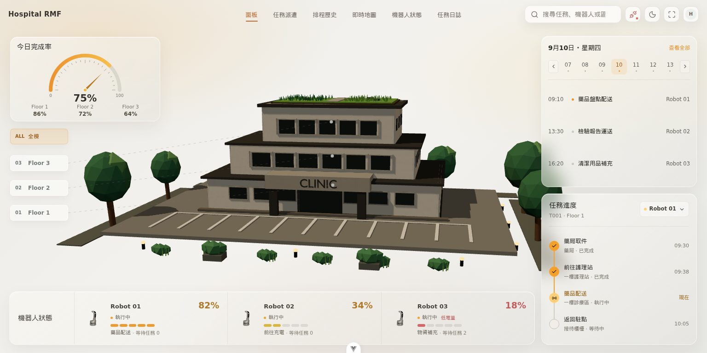

# Overview 最終淺色 UI 驗收

保留單頁 Overlay 與右側 Rail，改用淺色 Liquid Glass、適中字級與 F1 指針儀表。沒有新增 route，沒有修改醫院模型 transform、GLB、API 或 WebSocket 程式。

## 使用者指定的視角

- Camera position：`{ x: 19.9342, y: 13.3973, z: 32.1551 }`
- Camera target：`{ x: 0.9224, y: 4.2435, z: 2.2768 }`
- Model position：`{ x: -1.8543025866541414, y: 3.3902310247729797, z: -0.6720003973685588 }`
- Model scale：`0.81`；rotationY：`0.35`（模型參數未變）
- 相機 storage key 為 `overview-camera-preset-v5`，讓舊版本瀏覽器設定不會覆蓋本次指定預設。模型 storage key 不變。

## UI 實作

- `src/views/ClinicOverviewView.vue`：全棟完成率按完成數 / 總數計算，目前 `40 / 53 = 75%`；樓層摘要保留 86%、72%、64%。固定 Rail 位置未變。
- `src/components/overview/F1SpeedGauge.vue`：SVG 半圓、刻度、0/100、橘黃漸層、旋轉指針。角度為 `-90 + progress * 1.8`。使用 `useCountUp` 進行 1800ms ease-out，圓弧、指針、數字使用同一動畫值；切換樓層沿用同一元件，從目前值移動。Reduced motion 直接顯示最終值。
- `src/components/overview/RobotStatusPanel.vue`：一張連續淺色 Dock，標題欄 140px，Robot 三欄等寬；內部 `64px 18px minmax(0,1fr)`、間距 12px。模型在左側，直式電池 18×54px，百分比在右側；狀態、任務與等待數同列。
- `src/components/overview/TaskProgressTimeline.vue`：淺色面板與深灰文字，保留 280ms 逐站動畫與 Robot/task ID 更新時重播。
- `src/components/overview/OverviewCalendar.vue`：保留日期標題、7 天日期列、箭頭與橫向排程資料，只調整字級。
- `src/views/AppShellView.vue`：Navbar 導覽字級 14px。
- `src/three/clinicOverviewPresets.js`：更新使用者指定相機預設。
- 測試更新：`test/clinicOverviewView.test.js`、`test/clinicOverviewPresets.test.js`；新增 `test/f1SpeedGauge.test.js`。

## 實際尺寸

1536×768：

- Dock CSS `left:20px; right:calc(var(--overview-rail-width) + 36px); bottom:18px; height:126px`。
- Dock 實際右側 inset：373.91px；寬 1142.09px；頂部 624px。
- Rail 寬 337.91px，右側 inset 22px；Dock 與 Rail 間距 14px。
- 右側兩張面板各高 329px，排程頂部 78px、Timeline 頂部 421px；位置與前一版一致。
- Robot 三欄約 333.36px，沒有內容溢出。

| Viewport | 頁面 scrollHeight / clientHeight | Rail 每張高度 | Dock 高度 | Dock / Rail gap |
| --- | --- | --- | --- | --- |
| 1440×768 | 768 / 768 | 329px | 126px | 14px |
| 1536×768 | 768 / 768 | 329px | 126px | 14px |
| 1536×864 | 864 / 864 | 377px | 126px | 14px |
| 1920×1080 | 1080 / 1080 | 485px | 126px | 14px |

四種桌面尺寸的面板與 Dock 都在一個 viewport 內，三台 Robot 同列、等寬，無頁面垂直溢出。

## Typography

Token：title 17px、section 14px、body 13px、meta 11.5px、number 20px。

實際使用：Navbar 14px、面板標題 17px / 600、日期 16px / 600、任務 13px、Timeline 站名 14px / 600、Timeline 次要文字 12px、Robot 名稱 14px / 600、電量 20px / 700、狀態 12px、等待數 11.5px。中央儀表百分比屬主要數值，使用 SVG 27px / 700。

## 驗證結果

- `npm run build`：通過，附大型 chunk 警告。
- `npm test -- test/clinicOverviewView.test.js test/clinicOverviewPresets.test.js test/f1SpeedGauge.test.js test/taskProgressTimeline.test.js`：4 檔案、8 項通過。
- `npm run typecheck`：Missing script；未修改 scripts。
- `npm run lint`：Missing script；未修改 scripts。
- 本次沒有對外部 API / WebSocket 連線做端到端測試。

## 截圖

其他尺寸：[1440×768](screenshots/overview-1440x768.png)、[1536×864](screenshots/overview-1536x864.png)、[1920×1080](screenshots/overview-1920x1080.png)。
